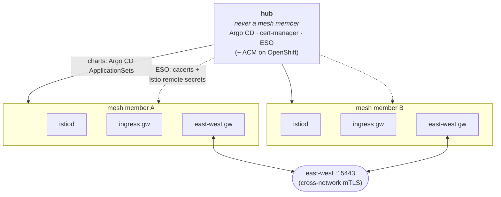

# istio-scale-tests

Measure how a multi-cluster Istio mesh behaves as it grows. This repo deploys a mesh across
several Kubernetes clusters, then runs test suites that answer questions such as "how long does
a new endpoint take to reach the other clusters?", "how much CPU and memory does istiod need for
N services?" and "how much latency does the cross-cluster hop add?". Every suite writes its raw
data and a markdown report that says how far each number can be trusted.

The mesh is Istio's multi-primary, multi-network model: every member cluster runs its own istiod,
the members reach each other through east-west gateways, and they share one root certificate
authority. One more cluster, the hub, deploys and wires the mesh but is never part of it.

Vanilla Kubernetes is the default and is tested on [kind](docs/runbooks/kind-lab/README.md).
OpenShift (`platform = "openshift"`: OpenShift Service Mesh 3, OpenShift GitOps and ACM, on
existing clusters or new ROSA ones) is an optional profile, kept for teams that run OpenShift.

## How it works

1. **Deploy** the hub and the mesh with Terraform ([Deploy](#1-deploy)). Terraform installs
   Argo CD on the hub and registers the member clusters; Argo CD then installs everything else
   from the charts in this repo.
2. **Check the mesh** is wired before you measure anything ([Check the mesh](#2-check-the-mesh)).
3. **Run a suite** against the members ([Run a suite](#3-run-a-suite)). Each suite deploys its own
   test workloads into its own namespace, measures, and removes them again.
4. **Read the report** ([Read the results](#4-read-the-results)).

To try all of it on one Linux machine first, follow the [kind lab](docs/runbooks/kind-lab/README.md).
It builds a hub and two members with kind, then walks through the same four steps.

## What gets set up



**On the hub** (installed once, by `terraform/platform` and then Argo CD):

| Namespace | What runs there | Why |
| --- | --- | --- |
| `argocd` (`openshift-gitops` on OpenShift) | Argo CD | Deploys every chart below to the hub and to each member, and keeps them in sync with this repo |
| `cert-manager` | cert-manager, the mesh's root CA and one intermediate CA per member | Every member's istiod signs with its own intermediate of one shared root, so the members trust each other |
| `external-secrets-operator` | External Secrets | Copies each member's CA (`cacerts`) to it, and gives every member the credentials (remote secrets) to read the other members' Services |
| `open-cluster-management` (OpenShift only) | ACM | Picks the member clusters on OpenShift |

**On each mesh member** (installed by Argo CD; you never apply these by hand):

| Namespace | What runs there | Why |
| --- | --- | --- |
| `sail-operator` (`openshift-operators` on OpenShift) | The Sail operator (OpenShift Service Mesh 3 on OpenShift) | Installs and upgrades Istio from an `Istio` resource |
| `istio-system` | istiod (3 replicas), the ingress gateway, the east-west gateway | The member's control plane; the ingress for test traffic; the cross-cluster entry point (a `LoadBalancer` Service on port 15443) |
| `istio-cni` | The Istio CNI node agent | Sets up each pod's traffic redirection |
| `mesh-wiring-verify` | One small pod, the wiring gate | Ready only when this member can see every other member ([Check the mesh](#2-check-the-mesh)) |

The Istio version is pinned (`ISTIO_VERSION` in `config/versions.env`, `istioVersion` in
`charts/spoke-ossm/values.yaml`). The mesh starts with a tuning baseline that scopes each proxy's
configuration and trims telemetry (`tuningBaseline` in that file); the tuning suite measures
changes on top of it. The sync order and every chart are in [charts/README.md](charts/README.md).

**During a test run**, each suite adds one namespace on the members it uses and removes it when
it ends (the namespace and what it holds are in each suite's README):

| Suite | Namespace on the members |
| --- | --- |
| propagation | `propagation-test` |
| controlplane | `controlplane-test` (or `controlplane-test-0` ... `-N` with several namespaces) |
| dataplane | `dataplane-test` |
| churn | `churn-test` |
| churn-dataplane | `churn-dataplane-test` |
| tuning | none of its own: it runs another suite, and patches istiod's settings during each pass |
| gateway-api | `mesh-verify-gwapi`, deployed from the hub on demand, not by the check itself |

## What you need

- A hub cluster and at least two member clusters (one member is enough to try the harness, but
  every cross-cluster measurement needs two), with a kube context for each.
- `kubectl` (`oc` also works), `terraform` >= 1.14.8, `helm` (3 or 4), `jq`, `curl`, bash 4.3+ (macOS ships 3.2: `brew install bash`)
- GNU coreutils `timeout` for live controlplane runs (macOS has none: `brew install coreutils`, which adds `gtimeout`)
- `istioctl` matching `ISTIO_VERSION` in `config/versions.env` (for diagnostics)
- `python3` with PyYAML (tuning suite only)
- `awk`: mawk, macOS's own or gawk up to 5.1. gawk 5.2 and 5.3 (Ubuntu 24.04's and Fedora's gawk)
  have a bug the reports would hit, so with them the harness runs mawk and stops when mawk is
  missing (`dnf install mawk`)
- Mesh members must be able to provision `type: LoadBalancer` Services (a cloud provider, MetalLB,
  or cloud-provider-kind on kind). Each member is registered at one API server URL (its
  kubeconfig context's server, or `cluster_api_url_overrides`): the hub's pods and every other
  member's istiod must all reach it.
- Capacity, at the chart defaults (sized for the 20-cluster campaign): each member requests about
  12.2 CPU / 49 GiB (istiod 3 × 4 CPU / 16 GiB, the two gateways 0.2 CPU / 1.1 GiB). The hub's
  Argo CD requests about 3 CPU / 6 GiB plus 2 CPU / 4 GiB per application controller, one per
  3 clusters counting the hub (`argocd_clusters_per_shard`): 5 CPU / 10 GiB with 2 members,
  17 CPU / 34 GiB with 20. Smaller clusters need the overrides in
  [terraform.tfvars.example](terraform/platform/terraform.tfvars.example) (`gitops_app_overrides`
  for istiod, `argocd_helm_values` for Argo CD), as the
  [kind lab](docs/runbooks/kind-lab/README.md) sets them.
- The CNI plugin and its config where the Sail `default` profile puts them (`/opt/cni/bin`,
  `/etc/cni/net.d`). k3s, MicroK8s and other distributions that keep them elsewhere need
  `istioCni.values` in `charts/spoke-ossm` (e.g. `global.platform: k3s`) through
  `gitops_app_overrides` for `spoke-ossm-appset`.
- The Gateway API CRDs on every member for the gateway-api check (OpenShift installs them; on
  Kubernetes use the pinned install in [tests/gateway-api](tests/gateway-api/README.md#deploy)).
- The metrics API (metrics-server) on every member for the controlplane report's utilization-%
  columns (OpenShift ships it); without it `istiod_*_pct_of_limit` and `node_*_pct` read `N/A`
  and the memory guard reads the gateways from Envoy's stats. kind: see its
  [runbook](docs/runbooks/kind-lab/README.md#6-smoke-run-a-suite), which also lists the figures a
  kind lab cannot give.

## 1. Deploy

**Kubernetes (default):** apply `terraform/platform` in kubeconfig mode. Name the hub context
and the member contexts (DNS labels: they become the cluster names). The apply installs Argo CD
on the hub with its Helm chart and registers every member with Argo CD. Steps and every input:
[terraform/platform/README.md](terraform/platform/README.md). On one machine:
[docs/runbooks/kind-lab](docs/runbooks/kind-lab/README.md).

**OpenShift (optional profile):** set `platform = "openshift"`. On existing clusters use
kubeconfig mode, with the brownfield switches for anything already installed. For new ROSA
clusters, create them with [terraform/rosa-hcp](terraform/rosa-hcp/README.md) (it covers the
one-time AWS and Red Hat account setup and a preflight check), then apply `terraform/platform`
with `cluster_provider = "rosa"`. The apply installs ACM and OpenShift GitOps unless already
present. Unverified there: the wiring gate counts istiod's `closed` sync state (a remote secret
changed and the new connection synced) only when istiod's `istio_build` tag reads 1.30 or a
later 1.x. If OSSM's istiod reports another tag, the gate fails closed, never open: after a
remote secret changes it reads NotReady, advising an istiod restart.

Either way the apply starts the app-of-apps, and Argo CD rolls out the mesh in order
([charts/README.md](charts/README.md)). On kind that took about 10 minutes. It's done when every
Application on the hub is Synced/Healthy:

```bash
kubectl --context <hub-ctx> get applications.argoproj.io -n argocd   # openshift-gitops on OpenShift
```

## 2. Check the mesh

Run the preflight against the members before every test session. It is read-only, and it stops
with a fix for each problem it finds:

```bash
export SETUP_CONTEXTS=<mesh-a-ctx>,<mesh-b-ctx>   # your members, never the hub
tests/preflight/001-check-mesh.sh
```

It checks the tools on your machine, that every context answers and is a mesh member (not the
hub), that each member's wiring gate is Ready with the shared root CA, and that the members run
the pinned Istio version. Add `--hub-context <hub-ctx> --echo` to also send traffic end to end:
it deploys a small echo app on every member from the hub, calls it through one member's ingress
gateway until every member has answered, and removes it again
([by hand](docs/reference.md#the-end-to-end-echo-check-by-hand)).

### The wiring gate

Every member runs `mesh-wiring-verify`, a gate that is Ready only when the member holds the remote
secret of every other member, every Ready istiod replica has synced each of them, no remote secret
or cluster of anything else is left (a removed member's stays behind), istiod signs with the shared
root, and the east-west gateway has an address. Otherwise its Argo Application goes Degraded, and
the gate's output says why, naming each member, secret and replica. To read it by hand:

```bash
kubectl --context <mesh-a-ctx> exec -n mesh-wiring-verify deploy/mesh-wiring-verify -- sh /opt/check/readiness.sh
# Ready: secrets=2 istiod_managed=2 (local=1 remote=1) expected=2 members=<mesh-a-ctx>,<mesh-b-ctx> ca=shared synced=1 replicas=3 root=<fingerprint> eastwest=<address>
```

`root=` is the first 16 hex digits of the SHA-256 of the root certificate in `cacerts`: compare it
across members, it must read the same on every one. `replicas=` counts the Ready istiod replicas
the gate read; each connects to every member on its own, so the istiod figures and `synced=` are
the lowest any of them reports. `synced=` comes from istiod's metric, which changes only when
istiod (re)connects: a member token revoked later still reads synced, and shows as errors in
istiod's log. `members=` lists the members it checked by name: Terraform sets them, each member's
Argo CD cluster name, which is also its Istio cluster ID and the suffix of its remote secret
`istio-remote-secret-<member>`. A gate installed without them counts instead (`members=unchecked`),
and a count cannot tell a removed member's leftover secret from a member's.

The gateway-api suite checks a different path: whether an HTTPRoute reaches a workload that runs
in another member ([tests/gateway-api](tests/gateway-api/README.md)).

## 3. Run a suite

Each suite answers one question. Pick the one that matches yours, and start with its sweep: the
sweep runs the suite's setup, measurement and cleanup for every mesh size (1 member, then 2, and
so on) and writes the report at the end. The times are rough estimates for two members at the
defaults; `--dry-run` prints the exact plan without touching a cluster.

| Suite | The question it answers | Start with | Time (2 members) |
| --- | --- | --- | --- |
| [propagation](tests/propagation/README.md) | When a pod becomes ready on one cluster, how long until istiod and the proxies on every cluster know about it? | `tests/propagation/006-run-sweep.sh` | ~10-20 min |
| [controlplane](tests/controlplane/README.md) | How much CPU, memory and push work does istiod need as services, replicas, namespaces and clusters grow, and how big is each proxy's configuration? | `tests/controlplane/003-run-sweep.sh` | ~10 min (default matrix; real campaigns run hours) |
| [dataplane](tests/dataplane/README.md) | How much latency does the cross-cluster hop through the east-west gateways add, compared with a call inside one cluster? | `tests/dataplane/003-run-sweep.sh` | ~15 min |
| [churn](tests/churn/README.md) | When Deployments scale up on one cluster, how long until the local and remote proxies can reach the new pods? | `tests/churn/003-run-sweep.sh` | ~10-15 min |
| [churn-dataplane](tests/churn-dataplane/README.md) | Does request latency get worse while the mesh is busy with endpoint churn? | `tests/churn-dataplane/004-run-sweep.sh` | ~20 min |
| [tuning](tests/tuning/README.md) | Does an istiod or proxy tuning change make one of the suites above better or worse? | `tests/tuning/003-run-tuning-sweep.sh` | one suite run per profile, plus the baseline |
| [gateway-api](tests/gateway-api/README.md) | Does an HTTPRoute need its backend Service (or its namespace) on every member, or only where the workload runs? | `tests/gateway-api/001-run-ingress-check.sh` | ~5 min |

A first run, end to end:

```bash
export SETUP_CONTEXTS=<mesh-a-ctx>,<mesh-b-ctx>
tests/preflight/001-check-mesh.sh                    # is the mesh ready?
tests/propagation/006-run-sweep.sh --dry-run         # what would run?
tests/propagation/006-run-sweep.sh                   # run it; the last lines name the report
```

Things every suite has in common:

- **Contexts.** Pass the mesh members only, never the hub: `--contexts <a>,<b>` or
  `SETUP_CONTEXTS`. The first one is the source (where changes and load start); the others are
  the remotes.
- **Help.** Every script has `--help`: each flag with its default, the settings it reads, its
  exit codes.
- **Settings.** Defaults are in [config/options.env](config/options.env), one comment per key;
  the version pins in [config/versions.env](config/versions.env). To describe a whole run in one
  file, copy a suite's `configs/smoke.env` to `configs/<name>.local.env` (ignored by git), edit
  it and pass `--config <file>` to every script of that run
  ([Run config](docs/reference.md#run-config---config-file)).
- **Stopping.** Ctrl-C stops a sweep cleanly: it stops the running step, records
  `STATUS=interrupted` and prints the cleanup command. Run that command, then start again into a
  new folder. A run that was killed outright may leave its namespace behind: run the suite's
  cleanup script (its README names it) with the same `--contexts`.
- **Istio version.** Before changing anything, every suite checks that the members run the pinned
  Istio version and stops if not ([details](docs/reference.md#the-istio-version-check)).

## 4. Read the results

Each sweep writes a folder, `tests/<suite>/results/sweep-<RUN_ID>/`, and its last lines name it.
Open the markdown report (`*.md`) in it. Before you quote a number, check that the sweep finished
(`STATUS=finished` in `sweep-outcome.txt`, exit `0`), that `n_valid` is close to `n_total`, and
that the report prints no warnings.

- [docs/reading-results.md](docs/reading-results.md): the five trust checks, every row status,
  and the words the reports use.
- Each suite README, "At a glance": that suite's headline numbers and how to read
  them.
- [docs/reference.md](docs/reference.md): what every result records (`HARNESS_SHA`, the Istio
  version, the platform), how a sweep ends and its exit codes, the version check, and the run
  config file format.
- [docs/campaigns](docs/campaigns/README.md): results recorded so far, as examples.

## Grow the mesh

`mesh_member_count` in `terraform/platform` sets how many spokes join, in sorted order (0 = all).
Raise it, or add a spoke, and re-apply; the wiring gate's member list follows automatically. Change
membership between test runs, not during one: every istiod connects to a new member, and on
`kubernetes` adding or removing a spoke moves the spokes that sort after it to another Argo CD
controller shard, which rebuilds their cache there (the shard pins in [terraform/platform/README.md](terraform/platform/README.md#run)).
Until the new member is wired, every gate reads NotReady and names it (no remote secret yet, then
not synced); wait until all of them read Ready again.

When a member leaves, External Secrets leaves its remote secret on every other member, and istiod
keeps that cluster until the secret is deleted. Each remaining member's gate reads NotReady and
prints the delete command; run it on each of them:

```bash
kubectl --context <mesh-ctx> -n istio-system delete secret istio-remote-secret-<removed-member>
```

## Troubleshooting

| Symptom | Fix |
| --- | --- |
| Gate says `istiod is not using the shared mesh root` | istiod started before `cacerts`. Delete the member's `<member>-ossm` Application on the hub (it's recreated and waits for `cacerts`), then restart that member's gateways. |
| No `cacerts` or remote secrets on members | Check the ESO pods on the hub (`kubectl get pods -n external-secrets-operator`); on a small hub lower the Argo CD requests with `argocd_helm_values` (`argocd_config_values` on OpenShift). |
| Pods stay `Pending` with `Insufficient cpu` or `Insufficient memory` (`kubectl describe pod`) | The chart defaults need the capacity in [What you need](#what-you-need). Lower istiod with `gitops_app_overrides` (`spoke-ossm-appset`) and Argo CD with `argocd_helm_values`, as in `terraform/platform/terraform.tfvars.example`. |
| The apply fails on `helm_release.argocd` after 900 s (`context deadline exceeded`) | Usually the same: the Argo CD pods cannot schedule on the hub (`kubectl -n argocd get pods`, then `describe` a Pending one). Lower the requests with `argocd_helm_values` and apply again. |
| The apply fails: `Argo CD on the hub cannot load state from these clusters` | The member's registered URL is not reachable from the hub's pods (a kubeconfig that points at `127.0.0.1`, a private endpoint). Set `cluster_api_url_overrides` to an address that the hub and every member reach, and apply again. `Unauthorized` or `Forbidden` in the quoted message is the member's token instead ([terraform/platform/README.md](terraform/platform/README.md#rotating-a-members-token)). |
| Gate says `no remote secret here for mesh member(s) <member>` | The hub has not pushed that member's remote secret to this one. On the hub, `kubectl -n external-secrets-operator describe pushsecret push-remote-secret-<member>` shows the stores it reached and its last error (`Unauthorized` for this member's store: [rotate this member's token](terraform/platform/README.md#rotating-a-members-token)). Right after a member joins, wait: the push takes up to about 10 minutes. |
| Gate says `remote secret(s) of no mesh member` | A member left, and External Secrets leaves what it pushed: run the `kubectl ... delete secret` the gate prints, on this member ([Grow the mesh](#grow-the-mesh)). Check first that the name is not a member being added: its secret can arrive a moment before this gate restarts with the new list. |
| Gate says `has not synced mesh member(s) <member> (not managed)` | The remote secret is here but istiod built no cluster from it: `kubectl -n istio-system logs <pod> \| grep <member>` says why (a kubeconfig it cannot use, a data key other than the member's name, or a cluster ID another secret already holds). |
| Gate says `manages remote cluster(s) of no mesh member` or `manages this member's own name as a remote cluster` | A remote secret holds a cluster that is no member: the gate prints a command that lists each remote secret's clusters; delete the secret (or the key) of a cluster that left. Its own name: this member's Istio cluster ID is not its Argo CD name (`spec.values.global.multiCluster.clusterName` in its Istio CR). |
| Gate says `expectedMembers is <n> but expectedClusters names <m>`, or `this member (<name>) is not in expectedClusters` | The gate's values disagree with the mesh: Terraform sets both from the mesh members, so apply `terraform/platform` again. A member that just joined reads the second until that apply has updated the gate's ApplicationSet. |
| Gate says `istiod pod <pod> (<address>) has not synced mesh member(s) <member> (<state>)` (counting: `has synced <n> remote cluster(s) < <need>`) | That istiod replica cannot use the named member's remote secret: that member's API server URL is unreachable from its node, or its token is wrong. `istioctl remote-clusters` lists each one's state, and `kubectl -n istio-system logs -l app=istiod --prefix --tail=-1 \| grep <member>` says why, per replica: `remote cluster <member> failed to sync after 30s` (fix the URL with `cluster_api_url_overrides`) or `watch error in cluster <member>: Unauthorized` ([terraform/platform/README.md](terraform/platform/README.md#rotating-a-members-token)). |
| Gate says `cannot list the EndpointSlices of the istiod Service` (HTTP 403) | The gate's Role lacks the chart's EndpointSlice rule (it reads every istiod replica through them): sync the member's `mesh-wiring-verify` Application on the hub. |
| Gateway Applications stay `Progressing`, the gateway Service `<pending>` | No LoadBalancer provider, or a MetalLB pool with auto-assign off: add `metallb.io/address-pool` via `gitops_app_overrides`. The gate says `has no external address yet` for the east-west gateway. |
| `istioctl` errors on API versions | Use an `istioctl` that matches `ISTIO_VERSION`. |

## Moving or forking the repo

Nothing in the code names the repo's home, so a move is settings, not code:

1. Point the platform at the new repo: set `gitops_app_repo_url` and `gitops_app_repo_revision` in
   your tfvars (plus `gitops_app_repo_password` or `gitops_app_repo_ssh_private_key` for a private
   repo) and re-apply `terraform/platform`. The on-demand checks (the preflight's `--echo` and the
   gateway-api check) read both from the hub when they deploy, so they follow.
2. Recreate CI: enable Actions, then protect `main` with a rule that requires a pull request and the
   checks `validate (ubuntu-latest)` and `validate (macos-latest)`
   ([portability.yml](.github/workflows/portability.yml); keep those job names). CI also runs on
   every push to `main`, weekly, and on demand (Actions, "Run workflow"), so drift shows up
   without a PR.
3. Name the owners in [.github/CODEOWNERS](.github/CODEOWNERS) and turn on "Require review from
   Code Owners" in that rule.
4. Tag the hand-over commit with an annotated tag (`git tag -a v1.0.0 -m "<note>"`, then
   `git push origin v1.0.0`). Results record `git describe` as `HARNESS_SHA`, so runs from that
   commit name the tag.

## More

For running tests:

- [docs/runbooks/kind-lab](docs/runbooks/kind-lab/README.md): the whole thing on one machine.
- [docs/scale-test-campaign](docs/scale-test-campaign/README.md): a full campaign across many
  clusters, stage by stage.
- [docs/campaigns](docs/campaigns/README.md): recorded results.
- [docs/runbooks](docs/runbooks): operating a deployed lab, and a ROSA validation run.

For changing the harness (not needed to run it):

- [AGENTS.md](AGENTS.md): repo conventions; [tests/lib/verify.sh](tests/lib/verify.sh) runs every
  offline check CI runs.
- [BACKLOG.md](BACKLOG.md), [STRATEGY.md](STRATEGY.md): open work and the reasoning behind the
  suites.
- [docs/scale-test-team](docs/scale-test-team/README.md): how harness changes are reviewed.

## License

[Apache License 2.0](LICENSE).
