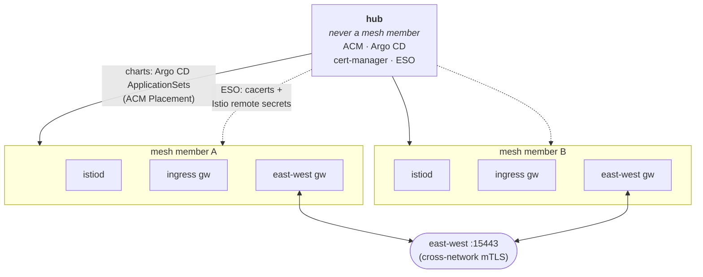

# istio-scale-tests

Deploy a multi-primary, multi-network Istio mesh on OpenShift (Red Hat OpenShift Service Mesh 3,
Sail operator) across several clusters, then measure how it scales. One cluster is the ACM + Argo CD
hub; every other cluster runs its own istiod and joins the mesh through east-west gateways, with a
shared root CA.



## What you need

- `oc` and `kubectl`, `terraform` >= 1.14.8, `helm` (3 or 4), `jq`, `curl`, bash 4.3+ (macOS ships 3.2: `brew install bash`)
- GNU coreutils `timeout` for live controlplane runs (macOS has none: `brew install coreutils`, which adds `gtimeout`)
- `istioctl` matching `ISTIO_VERSION` in `config/versions.env` (for diagnostics)
- `ps` from procps (Linux; macOS's own works) for the sweeps, which stop a step's whole process tree
  with it (on Linux, `/proc` stands in for a missing or busybox `ps`; a sweep warns at its start
  only when neither works)
- `python3` with PyYAML (tuning suite only)
- Mesh members must be able to provision `type: LoadBalancer` Services (cloud provider or MetalLB).

## Deploy

**Existing clusters:** use `terraform/platform` in kubeconfig mode. Name the hub context and the
member contexts, and set the brownfield switches for anything already installed. See
[terraform/platform/README.md](terraform/platform/README.md).

**New ROSA clusters:** create them with [terraform/rosa-hcp](terraform/rosa-hcp/README.md) (it covers
the one-time AWS and Red Hat account setup and a preflight check), then apply `terraform/platform`
with `cluster_provider = "rosa"`.

Either way the platform apply installs ACM and OpenShift GitOps (unless already present) and starts
the app-of-apps. Argo CD then rolls out the mesh in sync waves ([charts/README.md](charts/README.md)).
It's done when every Application on the hub is Synced/Healthy:

```bash
oc --context <acm-hub-ctx> get applications.argoproj.io -n openshift-gitops
```

## Verify

Every member runs `mesh-wiring-verify`, a gate that is Ready only when the member holds a remote
secret for every member, istiod has ingested them all, and istiod signs with the shared root.
Otherwise its Argo Application goes Degraded.

```bash
oc --context <mesh-a-ctx> exec -n mesh-wiring-verify deploy/mesh-wiring-verify -- bash /opt/check/readiness.sh
# Ready: secrets=2 istiod_managed=2 (local=1 remote=1) expected=2 ca=shared
```

End to end: deploy the echo app and call it through any member's ingress gateway. Answers should come
from every member. The manifest keeps `<repo-url>` and `<revision>` placeholders; fill them in on the
way to the hub from the repo and revision the hub already syncs, so the check runs the same charts
as the mesh.

```bash
read -r REPO REV < <(oc --context <acm-hub-ctx> -n openshift-gitops \
  get applications.argoproj.io hub-gitops-root \
  -o jsonpath='{.spec.source.repoURL} {.spec.source.targetRevision}')
sed -e "s|<repo-url>|${REPO:?}|g" -e "s|<revision>|${REV:?}|g" charts/mesh-verify-appset.yaml \
  | oc --context <acm-hub-ctx> apply -f -
INGRESS=$(oc --context <mesh-a-ctx> get svc istio-ingressgateway -n istio-system \
  -o jsonpath='{.status.loadBalancer.ingress[0].hostname}{.status.loadBalancer.ingress[0].ip}')
for i in $(seq 10); do curl -s -H 'Host: mesh-verify.local' "http://$INGRESS/"; done
oc --context <acm-hub-ctx> delete -f charts/mesh-verify-appset.yaml
```

Gateway API: [`tests/gateway-api`](tests/gateway-api/README.md) checks whether an HTTPRoute reaches a
workload that runs in another member, with or without a Service, or the Service's namespace, in the
ingress member (`charts/mesh-verify-gateway-api-appset.yaml` deploys it the same way, with one more
placeholder for the member that runs the workload).

## Run tests

Point the suites at the **mesh members only** (`--contexts <mesh-a-ctx>,<mesh-b-ctx>`, or
`SETUP_CONTEXTS`), never the hub, each member once: a list that names one twice, or a
`--remote-contexts` that names the source, stops before any cluster call. Each suite writes
TSV data plus a markdown summary under its `results/` directory; a sweep writes its TSVs and
reports into its own `results/sweep-<RUN_ID>/`. A sweep whose setup or probe failed for some
cells still writes its report, then ends with `N of M cells failed` (by reason) and exit code
4, as it does when the mesh changed under it (the Istio version or active revision changed
during the sweep, or the generation of a member's Istio CR or active IstioRevision went up: an
edit with the same version, an OSSM operator upgrade, a TLS profile change; or that end-of-sweep
check failed) and when its harness changed under it (below). `sweep-outcome.txt` in the sweep
dir keeps the outcome. While a sweep runs, its dir holds a lock (`.sweep.lock`, its PID):
another run into that dir, or a `--resume` of it, is refused until it ends (a PID another user
runs counts as alive; the lock of a run that died is taken over, by one run at a time). Each
suite README lists its exit codes. Every script has `--help`, and scripts that change a cluster
also accept `--dry-run`.

Every result records the harness that wrote it as `HARNESS_SHA`: `git describe`, plus
`-dirty.<8hex>` when a file under `tests/`, `config/`, `charts/` or `terraform/` differs from that
commit (an added untracked file there counts too, unless git ignores it: a run config in
`tests/<suite>/configs/` counts unless it is named `*.local.env`; an ignored file never counts, also
what your global `core.excludesFile`, or git's default `~/.config/git/ignore` when that key is
unset, ignores; your other git settings, `.git/info/attributes` included, never change the value; a
run's own results do not count). Next to it, `HARNESS_CONTENT_KEY` (12 hex characters) identifies
the content of those files alone; the `<8hex>` is its start. A sweep reads them again before its
steps (at most every `HARNESS_SHA_CHECK_SEC`, 60 s by default, `config/options.env`) and at its end,
and each probe's and setup step's own read counts too. A file edited, added or removed there during
the sweep (or a `git checkout`, `pull` or commit that changes one) is a problem in its outcome
(exit 4) when a read sees it, also when it was undone before the sweep's next read and only a step
read it (an edit made after a step's only read and undone before the next read is not seen); the
problem names both values and when the change was first seen, and the rows measured after it carry
the new value in their TSV (controlplane: a `# HARNESS_CHANGED_AT=` line in its one TSV;
churn-dataplane: each row's `harness_sha`), while the sweep's own records (the TSV preamble,
`sweep-outcome.txt`) keep the start's. A commit or tag that left those files as they were changes
only the name `git describe` gives: a note, and every step keeps recording the start's
`HARNESS_SHA`. Each report also records the harness it ran on as `REPORT_HARNESS_SHA`; the results
dir it reads never counts as a change.

| Suite | Measures | Start with |
| --- | --- | --- |
| [propagation](tests/propagation/README.md) | How fast an endpoint change reaches the other clusters | `tests/propagation/006-run-sweep.sh` |
| [controlplane](tests/controlplane/README.md) | istiod CPU/memory, xDS pushes and per-proxy config size vs mesh size and Sidecar scoping | `tests/controlplane/003-run-sweep.sh` |
| [dataplane](tests/dataplane/README.md) | Same-cluster vs cross-cluster latency through the east-west gateways | `tests/dataplane/003-run-sweep.sh` |
| [churn](tests/churn/README.md) | Convergence time when Deployments scale on one cluster | `tests/churn/003-run-sweep.sh` |
| [churn-dataplane](tests/churn-dataplane/README.md) | p99 latency change while endpoint churn runs | `tests/churn-dataplane/004-run-sweep.sh` |
| [tuning](tests/tuning/README.md) | Any suite above, with and without an istiod/proxy tuning profile | `tests/tuning/003-run-tuning-sweep.sh` |
| [gateway-api](tests/gateway-api/README.md) | Whether an HTTPRoute needs its backend Service, or its namespace, in every member (read-only check; deploy `charts/mesh-verify-gateway-api-appset.yaml` first) | `tests/gateway-api/001-run-ingress-check.sh` |

```bash
tests/propagation/006-run-sweep.sh --contexts <mesh-a-ctx>,<mesh-b-ctx> --mesh-sizes 1,2 --iterations 5 --dry-run
```

Settings and image pins live in `config/versions.env` and `config/options.env`. The deployed Istio
version is `istioVersion` in `charts/spoke-ossm/values.yaml`; keep `ISTIO_VERSION` equal to it.
Before its first change, every suite reads the version each member runs: the IstioRevision its
`istios.sailoperator.io default` CR names as active (`.status.activeRevisionName`), and that
revision's `.spec.version`, which must be an exact version (an alias such as `v1.30-latest` is
not). A CR or IstioRevision that is not reconciled yet (generation, `Reconciled` condition), has
no active revision, or is migrating between revisions reads as unknown. A CR whose only issue is
readiness (its state is not Healthy because istiod or IstioCNI is not ready) still gives its
version: the suite reads it again every `ISTIO_VERSION_READY_POLL_SEC` (5) for up to
`ISTIO_VERSION_READY_WAIT_SEC` (60) seconds, then records the version with a warning on stderr. An
istiod rollout in progress (its Deployment has fewer updated pods than pods, a generation not
observed yet, or pods still terminating, also while the CR already reads Healthy) is waited for
the same way, and reads as unknown if it outlasts the wait: old and new istiod pods both serve. A
pod stuck in Terminating (on a lost node, for example) reads this way until it is force-deleted;
the message then says "istiod pods still terminating" and shows how to list them. A rollout that
ends on the last read before the deadline is read once more, one poll later. A member stays in the
wait until the deadline or until it is ready, so a CR that is briefly not settled meanwhile does
not stop the run early; its answer at the deadline counts. The suite records the result as
`ISTIO_VERSION`, next to the pin (`ISTIO_VERSION_PIN`), `ISTIO_VERSION_SOURCE` (`live`; `pin` in a
`--dry-run`, which reads nothing), `ISTIO_VERSION_BY_CONTEXT`, each member's active revision in
`ISTIO_ACTIVE_REVISIONS` (`<ctx>=<revision>,...`, `<ctx>=` for a member whose Istio CR could not
be read; `unchecked` in a `--dry-run`, `unknown` after a version check that stopped unexpectedly
and, in a report, for a TSV written before the key existed; a controlplane `--resume` refuses a
member whose active revision changed since the sweep started), `ISTIO_GENERATIONS` (`<ctx>=<Istio
CR generation>/<active IstioRevision generation>`: a sweep compares them at its end, and a
controlplane `--resume` against the first run's, so a spec edited and changed back during the
sweep is a problem too), `ISTIO_PROXY_VERSIONS` (`<ctx>=<version>:<count>+...`: the proxies
connected to each member's istiod by Istio version, from istiod's `pilot_xds` gauge, read through
the API server's pod proxy, `ISTIO_PROXY_READ_PARALLEL` (20) members at once and one pod of a
member at a time, a pod being deleted left out with a note (the counts are approximate: a proxy can
move to another pod during the read); `none` or `unknown` per member; proxies on another version
than their istiod, such as sidecars not restarted after an upgrade, are a warning and a note of the
sweep outcome, never a stop), and the members still not ready after the wait in
`ISTIO_NOTREADY_AT_START` (the wait in `ISTIO_READY_WAITED_SEC`), which a sweep's outcome repeats as
a note. `ISTIO_NOTREADY_AT_START` reads `none` (every member was ready), `<ctx>=<state>,...` (the
Istio CR's state, such as `IstiodNotReady`), `<ctx>=rolling` (an istiod rollout still in progress),
`<ctx>=unreadable` (a rollout at the first read, then every re-read failed), `unchecked` (a
`--dry-run`, or a version check that stopped unexpectedly) or, in a report, `unknown` (a TSV written
before the key existed). A controlplane `--resume` keeps the first run's value in the TSV, and
records its own, with its UTC start time, in a note of the sweep outcome
(`ISTIO_NOTREADY_AT_RESUME=...`) and in the sweep dir's append-only `resumes.txt`, one line per
resume. With `ISTIO_VERSION_CHECK=fail` (the default) a member on another version than the pin,
members on different versions, or a member that cannot be read stop every suite but gateway-api (a
read-only check that only records it) before it changes anything; `ISTIO_VERSION_CHECK=warn` goes on
and records what the mesh runs (`mixed:<a>/<b>` or `unknown` when they differ or cannot be read). A
version check that stops unexpectedly counts as unknown: `fail` stops the run, `warn` records
`unknown`, and at the end of a sweep it is a problem (exit 4). A sweep reads it again at the end and
exits 4 when the version, the active revision or the generation of the Istio CR or its active
IstioRevision changed (also when the Istio CR is not settled at the end, or its istiod Deployment
cannot be read, but its active revision reads another version); istiod or IstioCNI not ready at the
end, on the same version, is a warning. From its start the sweep keeps a not-finished record in
`sweep-outcome.txt` in its results dir (`EXIT=unfinished`), and every report of that dir says the
sweep has not finished (it died, or still runs; json `sweep_outcome.unfinished`); at its end the
sweep writes its outcome there, and every report re-generated from that dir repeats its errors,
warnings and notes (json `"unfinished": false`). A sweep that ends between the two says how in that
record: one that stops on an error (a check it makes, or an unexpected abort whose `FATAL:` line
names the script, line and command) records a stop (`STOPPED=1`, the reason in `STOP_REASON`,
`TOTAL=unknown`, `CUT_SHORT=1`; every report shows the stop and its reason; exit 1, whatever code
the failed command had); one interrupted (Ctrl-C, SIGTERM, or SIGHUP when its terminal closes) stays
not finished and records when and by which signal (`ENDED_AT`, `ENDED_SIGNAL`; reports say
"interrupted at ...", json `interrupted_at`, `interrupted_by`; exit 130, 143 or 129); only one
killed outright (SIGKILL, out of memory, a lost host) leaves the record as it was. A signal sent to
the sweep's process alone (`kill <pid>`, `kill -INT <pid>`, a service manager) reaches the step that
runs (a setup, a probe, a cleanup) and every process under it (its kubectl calls, its per-member
workers) at once; the sweep ends once they have, or sends SIGKILL to what still runs
`SWEEP_STOP_GRACE_SEC` (30) seconds later (their own cleanup does not run; the warning names the
suite's cleanup command), and only then releases its lock. For a sweep in a terminal's foreground (a
terminal, a tmux or screen pane), a `kill -INT` or `kill -HUP` sent from elsewhere skips the
processes in that foreground, which a Ctrl-C reaches itself: they get SIGKILL after the grace, with
no cleanup, so stop such a sweep from elsewhere with SIGTERM (`kill <pid>`). The sweep's own
commands between steps finish first, each bounded: a settle wait, the Istio version and proxy reads
(tuning: the generation reads around each apply and revert), controlplane's leftover counts, and the
end-of-sweep recheck. Stopping the step's tree needs a `ps` that lists every process with its start
time (procps, or macOS's), or Linux's `/proc` in its place: without either, the sweep warns at its
start, and a stop reaches only the step's own process (a `--dry-run` warns too; when the sweep's
stdin is a terminal, a `kill -INT` or `kill -HUP` from elsewhere then reaches nothing: it is taken
for a Ctrl-C, which reached the step itself). A results dir without `sweep-outcome.txt` is from a
sweep that stopped before its start (nothing ran) or from an older harness. A kubectl error quoted
in a record or a report names the API server as `<api-host>` or `<ip>`, never its address.
`ISTIO_VERSION_CHECK`, `ISTIO_VERSION_READY_*`, `ISTIO_PROXY_READ_PARALLEL`, `HARNESS_SHA_CHECK_SEC`
and `SWEEP_STOP_GRACE_SEC` are set in the environment, never in a `--config` file.

### Run config (`--config FILE`)

Every numbered script of propagation, controlplane, dataplane, churn, churn-dataplane and
gateway-api takes `--config FILE`: one file of `KEY=value` lines (`SETUP_CONTEXTS` and the suite's
keys in `config/options.env`, the ones its README lists; not every key there, see "Environment
only" below) that describes a whole run, so setup, sweep, report and cleanup read
the same values. Each of these suites has a worked example, `tests/<suite>/configs/smoke.env`,
and a "Run config" section in its README that lists its keys. Tuning does not take one yet.

- **Precedence:** flag > `--config` > environment > default. The file loads before
  `options.env`, so the defaults derived there follow it. Each key is logged on stderr, with the
  environment value it overrides. `KEY=` (empty) means the built-in default.
- **Syntax:** the file is parsed, never sourced, so it cannot run code:
  `[export ]KEY=value [# comment]`, where the value is unquoted from `[A-Za-z0-9_.,:/@%+=-]`,
  `'...'`, or `"..."` without `"`, `$`, `` ` `` and `\`. No spaces around `=`, each key once. A
  bad line or a key outside the suite's list rejects the whole file before anything runs, with
  `file:line` and the reason.
- **Environment only:** `*_TEST_NAMESPACE` (cleanup deletes that namespace), `*_MAX_MATRIX` (the
  `--force-large-matrix` acknowledgment stays per run), `*_EXTEND_PLAN` (so does a controlplane
  `--resume`'s `--extend-plan`), `ISTIO_VERSION_CHECK`, `ISTIO_VERSION_READY_*` and
  `ISTIO_PROXY_READ_PARALLEL` (the version check above), `HARNESS_SHA_CHECK_SEC` and
  `SWEEP_STOP_GRACE_SEC` (every sweep, above) and the version pins in `config/versions.env`.
- **Flags only:** run switches such as `--dry-run`, `--force-large-matrix` and `--format`, and
  what a sweep passes to each step (`--source-context`, `--remote-contexts`, `--mesh-size`, ...).
  A standalone step still takes those on the command line.
- **Sweeps:** the steps a sweep runs inherit the file's values; the flags it passes them still
  win. Before the first step a sweep checks its numeric knobs: the ones it passes its steps as
  flags (durations, QPS, connections, settle times, ...) and the ones only its steps read (setup
  and cleanup timeouts, poll intervals, ...). A value such as `5m` fails `--dry-run` instead of
  every setup, every cleanup, or the probe window (fortio would read `5m` seconds as 5 ms).
- **Context names:** keep real ones out of git. Copy an example to
  `tests/<suite>/configs/<name>.local.env` (gitignored) and set `SETUP_CONTEXTS` there.
- **Provenance:** every TSV preamble records `RUN_CONFIG` (the file's path from the repo root, or
  only its name outside the repo; `none` without `--config`) and `RUN_CONFIG_SHA256`, and every
  report format repeats them: `unknown` for files written before these keys existed, and
  `mixed:<a>,<b>` with a warning when the inputs disagree. A sweep copies the file to
  `sweep-<RUN_ID>/run-config-<RUN_ID>.env`, and every probe's per-run markdown summary has a
  `Run config` row.
- **One run per report:** a report reads every TSV under its results dir. When that dir holds
  more than one run (each `sweep-*` directory is one run; outside one, each `RUN_ID`), it stops,
  lists the runs and prints the `--results-dir <dir>/sweep-<RUN_ID>` that reports each alone.
  `--allow-multi-run` pools them on purpose, and every format then says it pools N runs and
  lists their `HARNESS_SHA` and `ISTIO_VERSION` values. A key that differs across the inputs reads
  `mixed:<a>,<b>`, never one file's value. `HARNESS_SHA` values that differ while every input
  records one `HARNESS_CONTENT_KEY` differ only in git describe: every report then gives a note
  ("differ only in git describe: every ... records HARNESS_CONTENT_KEY=..., the same harness files")
  instead of a warning, which an input without the key keeps. A report repeats only its results
  dir's own `sweep-outcome.txt`: the record of a `sweep-*` dir below it (a pooled run, or one
  sweep reported from its parent dir) that has not finished, was interrupted, stopped early or
  records a `PROBLEM` is named in a note and a warning on stderr (json `pooled_sweep_outcomes`);
  controlplane names one that has not finished, was interrupted or stopped early in a data
  warning (on stderr too), and counts and names each record's `PROBLEM`s in its verdict instead.
  Report that sweep dir alone to see its outcome.

## Grow the mesh

`mesh_member_count` in `terraform/platform` sets how many spokes join, in sorted order (0 = all).
Raise it and re-apply; the wiring gate's expected size follows automatically.

## Troubleshooting

| Symptom | Fix |
| --- | --- |
| Gate says `istiod is not using the shared mesh root` | istiod started before `cacerts`. Delete the member's `<member>-ossm` Application on the hub (it's recreated and waits for `cacerts`), then restart that member's gateways. |
| No `cacerts` or remote secrets on members | Check the ESO pods on the hub (`oc get pods -n external-secrets`); on a small hub lower the Argo CD requests with `argocd_config_values`. |
| Gateway Service stays `<pending>` | No LoadBalancer provider, or a MetalLB pool with auto-assign off: add `metallb.io/address-pool` via `gitops_app_overrides`. |
| `istioctl` errors on API versions | Use an `istioctl` that matches `ISTIO_VERSION`. |

## Moving or forking the repo

Nothing in the code names the repo's home, so a move is settings, not code:

1. Point the platform at the new repo: set `gitops_app_repo_url` and `gitops_app_repo_revision` in
   your tfvars (plus `gitops_app_repo_password` or `gitops_app_repo_ssh_private_key` for a private
   repo) and re-apply `terraform/platform`. The on-demand checks read both from the hub when you
   apply them ([Verify](#verify)), so they follow.
2. Recreate CI: enable Actions, then protect `main` with a rule that requires a pull request and the
   checks `validate (ubuntu-latest)` and `validate (macos-latest)`
   ([portability.yml](.github/workflows/portability.yml); keep those job names). CI also runs on
   every push to `main`, weekly, and on demand (Actions, "Run workflow"), so drift shows up
   without a PR.
3. Name the owners in [.github/CODEOWNERS](.github/CODEOWNERS) and turn on "Require review from
   Code Owners" in that rule.
4. Tag the hand-over commit with an annotated tag (`git tag -a v1.0.0 -m "<note>"`, then
   `git push origin v1.0.0`). Results record `git describe` as `HARNESS_SHA`, so runs from that
   commit name the tag.

## More

- [AGENTS.md](AGENTS.md): repo conventions for contributors and coding agents
- [docs/scale-test-campaign](docs/scale-test-campaign/README.md): end-to-end campaign runbook; [docs/campaigns](docs/campaigns/README.md): recorded results
  (paste from a copy that `tests/lib/redact-results.sh --out <dir> <results-dir>` redacted)
- [docs/runbooks](docs/runbooks): operating a deployed lab or ROSA validation run

## License

[Apache License 2.0](LICENSE).
