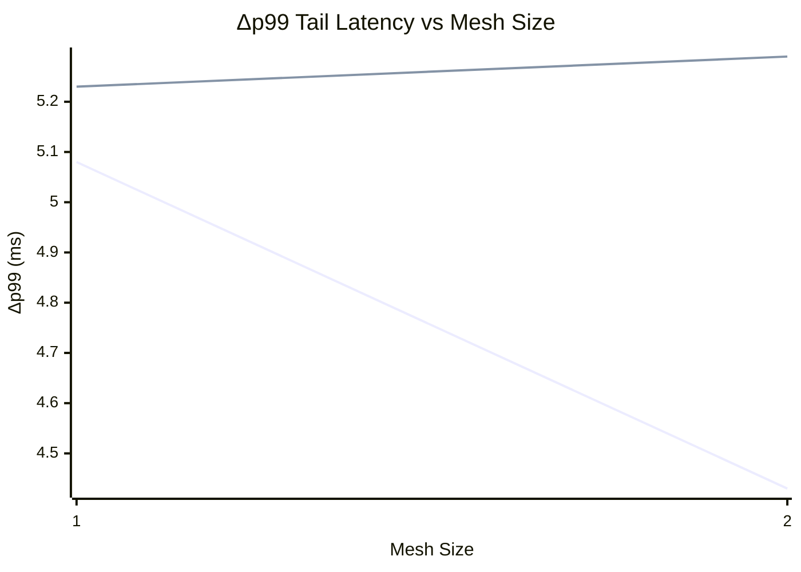
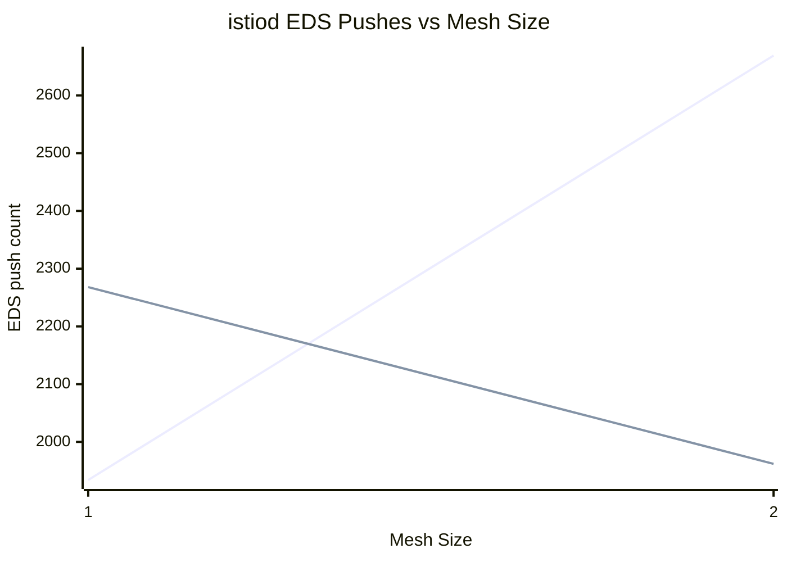

# Churn x Data-Plane — Charts

% Chart 1: Δp99 Tail Latency vs Mesh Size

> Series order (by churn rate): **1** **5**. Expected: ~flat across mesh size.

% Chart 2: istiod EDS Pushes vs Mesh Size

> Series order (by churn rate): **1** **5**. Expected: scales with churn rate, ~flat across mesh size.

