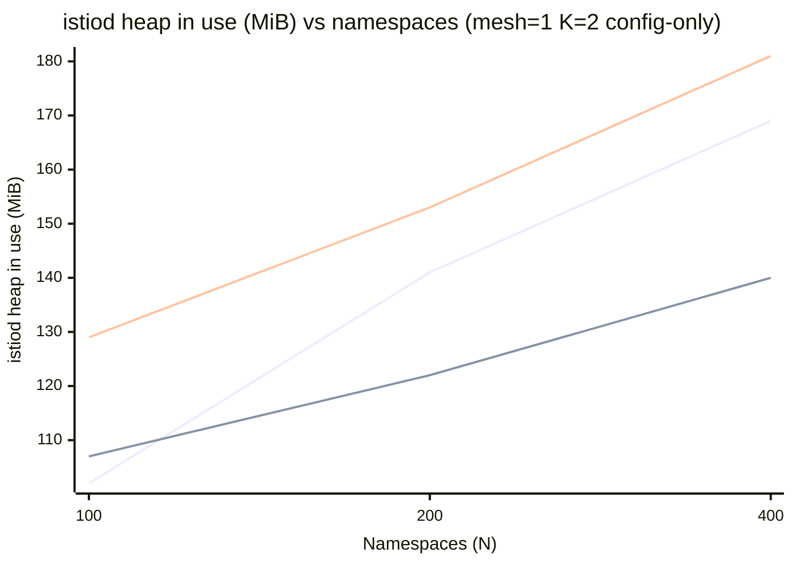
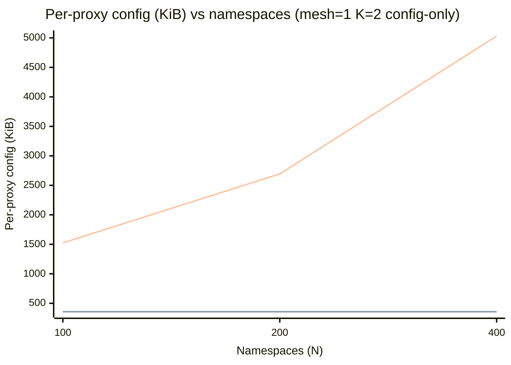
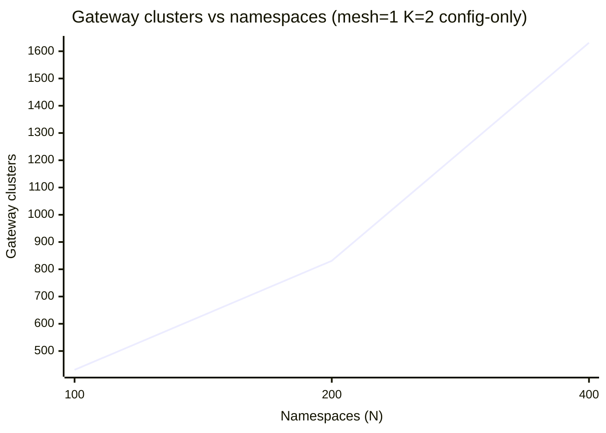
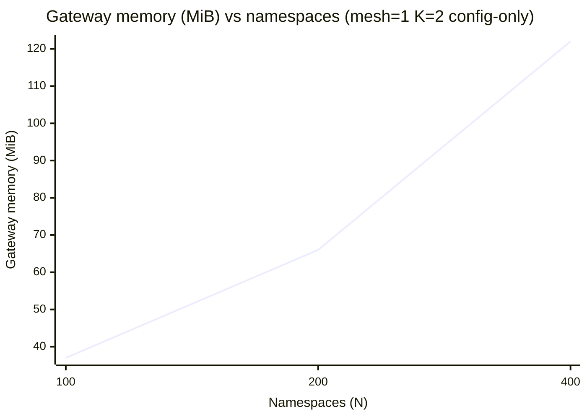
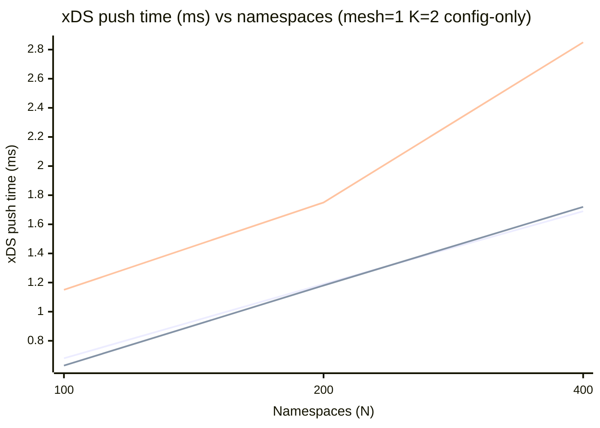

# Control-Plane Resource Scaling — Charts

## Namespace scaling

> Probe windows: the cost of one more namespace at N, a line per sidecar scoping (series order in the note under each chart). Points are the Namespace scaling table's; a cell with no valid sample has no point.

> Series order: **namespace**, **none**, **wide**.

> Series order: **namespace**, **none**, **wide**.

> One line: the gateway keeps `*/*`, so its figure does not depend on the sidecar scoping.

> One line: the gateway keeps `*/*`, so its figure does not depend on the sidecar scoping.

> Series order: **namespace**, **none**, **wide**.

