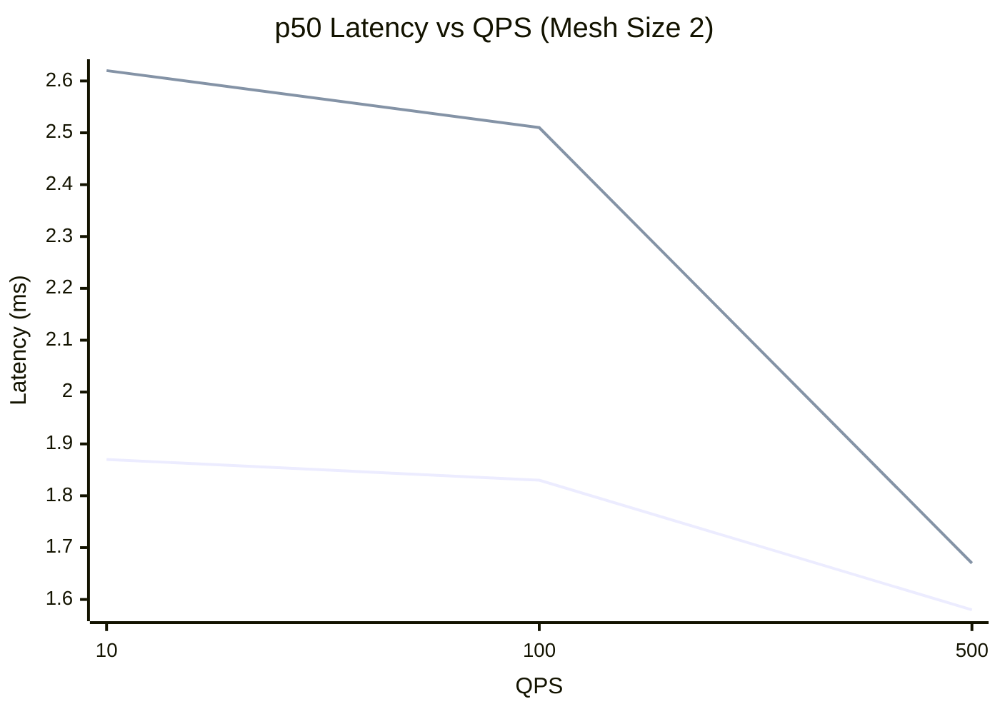

# Data-Plane Latency — Charts

> **Note (2026-10-27 lab run):** the sample was too small for the mesh-size chart. With two members only mesh size 2 has remote data, so only the QPS chart is generated. The numbers are in the [record](../README.md).

> The mesh-size chart needs two mesh sizes with remote data; only the QPS chart is shown.

> Series order: **local**, **remote** at mesh size 2.
