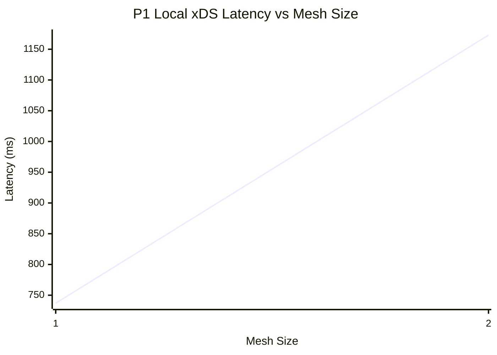
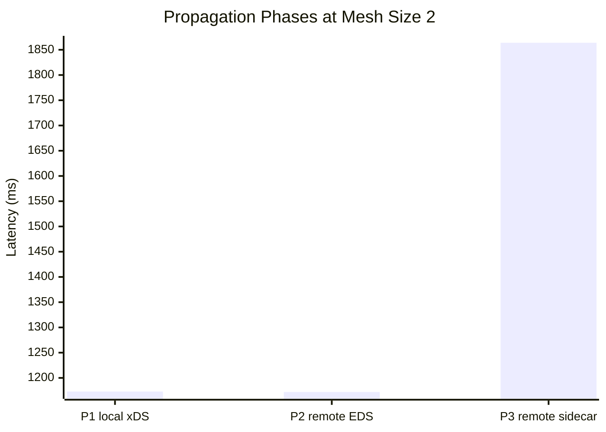

# Endpoint Propagation Latency — Charts

> The mesh-size charts require at least two mesh sizes with remote data (mesh >= 2); below, what this run can show.

> Series: **P1 local xDS (wall)**, the mean over valid iterations; a mesh size with none is left out.

> Means over valid samples (P1 per iteration, P2 and P3 per remote row) at the one mesh size with remote data.
