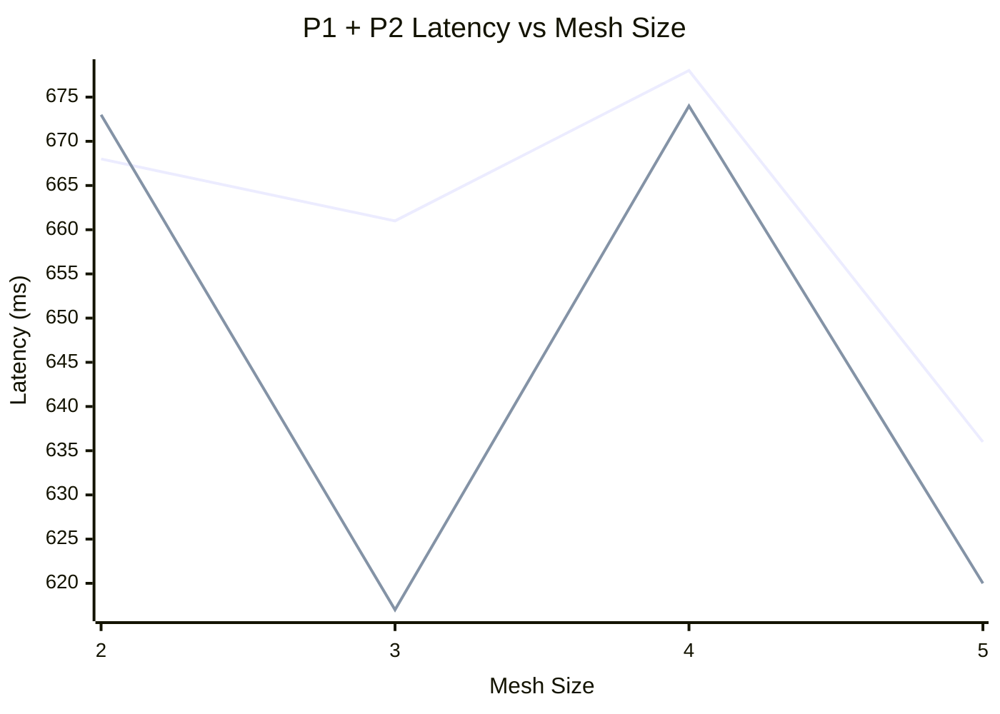
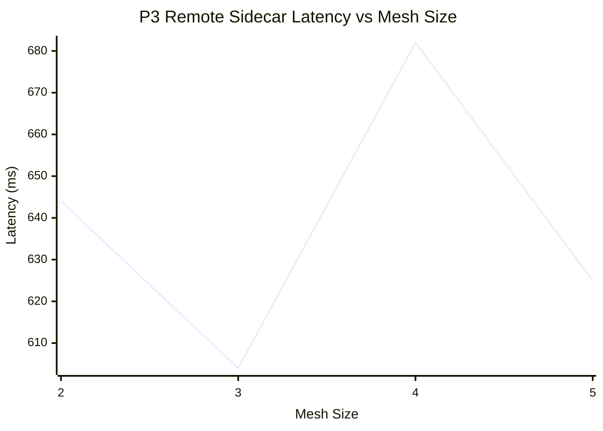

# Endpoint Propagation Latency — Charts

> Series order: **P1 wall avg** (ms), **P2 EDS avg** (ms).
> x-axis starts at mesh 2 — P2 is undefined at mesh size 1 (no remote cluster).

> Series: **P3 sidecar avg** (ms). Separate chart — P3 is typically ~10x P1/P2 scale.
