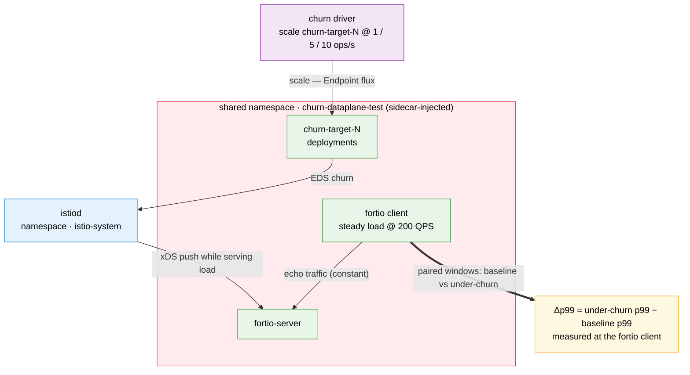

# Churn × Data-plane Test Suite

Measures how much request latency rises while istiod is busy with endpoint churn.
Fortio (client and server) and churn-target deployments share one namespace. Each combo
runs a **baseline** window (steady load, no churn) and a **churn** window (same load
plus deployment scale events) and reports `Δp99_ms = churn p99 − baseline p99`.

## Architecture

> Diagram conventions are shared across suites — see
> [`docs/scale-test-campaign/architecture.md`](../../docs/scale-test-campaign/architecture.md#diagram-conventions).



## What it measures

- Fortio p50/p90/p99/p999/max latency and actual QPS in both windows, and `Δp99_ms`.
- istiod deltas over each window, for attribution: xDS pushes (total and EDS), push
  triggers, and p99 of `pilot_proxy_convergence_time`, `pilot_proxy_queue_time`,
  `pilot_xds_push_time` (summed or merged across all istiod replicas on the source).
- Churn: at `--churn-rate R` for `D` seconds the driver issues `R × D` scale operations,
  each toggling one churn-target deployment between `--base-replicas` and `--scale-to` on
  every active context, in a seeded, repeatable order.

Fortio and the churn targets never exchange traffic (disjoint Service selectors), so
churn affects the latency only through control-plane and node contention. The windows
send load to the merged `fortio-server` Service, whose endpoints are every cluster's
fortio server. Not covered:
rolling updates, config changes (VirtualService, DestinationRule, Sidecar), sidecar
restarts and Envoy-side stats. Above about 100 ops/s the driver cannot keep up with
the requested rate (per-operation process overhead).

## Quick start

Needs `kubectl` or `oc`, `helm`, `jq`, `curl`, the deployed mesh (see the root README)
and kube contexts for the mesh members (not the hub). Context names become Service
names (`fortio-server-<ctx>`), so each must be a lowercase DNS label of at most 49
characters; rename others with `kubectl config rename-context`.

```bash
# 1. Deploy: source gets fortio client + server, remotes get fortio-server, all get churn targets
./tests/churn-dataplane/001-setup-coexec-test.sh \
  --source-context <mesh-a-ctx> --remote-contexts <mesh-b-ctx>

# 2. Baseline window (60 s at 200 QPS)
TSV=tests/churn-dataplane/results/churn-dataplane-smoke.tsv
./tests/churn-dataplane/002-run-baseline-probe.sh \
  --source-context <mesh-a-ctx> --remote-contexts <mesh-b-ctx> --combo-id smoke --output-file "$TSV"

# 3. Churn window (same load + 5 scale ops/s); computes Δp99 against the baseline row
./tests/churn-dataplane/003-run-churn-probe.sh \
  --source-context <mesh-a-ctx> --remote-contexts <mesh-b-ctx> --combo-id smoke \
  --churn-rate 5 --baseline-file "$TSV" --output-file "$TSV"

# 4. Summarize every TSV under tests/churn-dataplane/results/
./tests/churn-dataplane/005-report-results.sh --format md

# 5. Tear down and wait for the namespace to go away
./tests/churn-dataplane/006-cleanup.sh --contexts <mesh-a-ctx>,<mesh-b-ctx> --wait-deletion
```

Baseline and churn rows pair up by `--combo-id`. Add `--dry-run` to any script to see
what it would do without changing the clusters.

## Sweep

```bash
./tests/churn-dataplane/004-run-sweep.sh \
  --contexts <mesh-a-ctx>,<mesh-b-ctx> --churn-rates 1,5,10 --repetitions 2
```

For each mesh size (default `1..N`; the first context is the source) the sweep deploys
once, then for each rate and repetition resets the churn targets to base (after the
first), runs the baseline and churn windows, and finally cleans up. It writes one TSV,
`sweep-summary-<run-id>.md` and `sweep-charts-<run-id>.md` to
`tests/churn-dataplane/results/sweep-<run-id>/`. More than 64 combinations needs
`--force-large-matrix`.

## Remote reachability

The merged `fortio-server` Service hides a remote that the mesh cannot reach: its
endpoints span every cluster, and Istio's default retry policy (connect failures and
503s, on another host) sends a failed request to a working cluster, so the window shows
at most extra latency and no error. To check each remote on its own, `001` also gives
every cluster a Service `fortio-server-<ctx>` per context that selects only that
cluster's fortio server (pod label `cluster=<ctx>`; chart values `clusterName` and
`allClusterNames`). These Services are always rendered; the load never uses them.

Before each baseline window, and before its istiod port-forwards, `002` sends
`--reach-requests` requests (default 10, `REACH_REQUESTS`) at `REACH_QPS` (10) from the
client pod to every `fortio-server-<ctx>`, the source's own included. Each target gets a
row in `reach-<RUN_ID>.tsv` next to the output TSV (a sweep appends every combo to one
file, told apart by `combo_id`):

```
run_id  combo_id  mesh_size  source_ctx  target_ctx  target_class  attempts  requests
ok  pct_200  top_code  reach_status  detail
```

`reach_status` is `REACHABLE` (only HTTP 200s), `DEGRADED` (some), `UNREACHABLE` (none)
or `UNKNOWN` (the `kubectl exec` failed). A target that is not `REACHABLE` is checked
again `REACH_RETRY_SEC` (10 s) apart, up to `REACH_ATTEMPTS` (3) checks. `detail` is the
first body line of one `fortio curl` to it after the last check, with a
`REACH_DETAIL_TIMEOUT_SEC` (35 s) timeout (the Envoy reply, else fortio's error, with IPv4
and IPv6 addresses and dotted host names masked). 35 s outlasts the three 10 s connect timeouts after which Envoy
answers for a blackholed east-west gateway (Istio's default two retries, no
VirtualService). A target that never answers costs at most about 76 s per run at the
defaults; see the [dataplane README](../dataplane/README.md#remote-reachability) for the
formula, the retry details and the full column list.

With `--on-unreachable warn` (default, `REACH_ON_UNREACHABLE`) the probe goes on. With
`fail`, a remote that is `UNREACHABLE` or `UNKNOWN` stops `002` before its window with no
row written (exit 3); the sweep then records `REMOTE_UNREACHABLE` baseline and churn
rows for that combo, cleans up the mesh size, skips the rest, writes the reports and
exits 3. `DEGRADED` only warns. `--reach-requests 0` turns the check off.

The report's **Remote coverage** section aggregates every `reach-*.tsv` per (mesh size,
source, remote) in every format (see the dataplane README for the layout);
`005 --fail-on-unreachable` exits 3 after the output when a remote's coverage is not
`REACHABLE`.

## Results

One TSV row per phase (`baseline`, `churn`, or `cleanup`). `status` is `OK`, `FAILED`
(fortio failed), `PERCENTILE_MISSING` or `ERROR_RATE_HIGH` (the window's share of HTTP
200 responses was below `COEXEC_MIN_PCT_200`, default 0.99; `0` turns the rule off),
`POISONED_RESTART` (istiod restarted; latency and istiod columns are `N/A`),
`POISONED_SCRAPE` (an istiod scrape failed or the scrapes were more than
`FANOUT_MAX_SKEW_MS` apart), `CHURN_RATE_NOT_MET` (under 90% of scale operations
succeeded), or a sweep placeholder: `SETUP_FAILED`, `PROBE_FAILED`, `RESET_FAILED`,
`REMOTE_UNREACHABLE`, `CLEANUP_TIMEOUT`. The error-rate rule uses the same code as the
dataplane suite (`tests/lib/fortio.sh`) with the QPS-shortfall check off. Each row's
`# combo=...` marker comment records `pct_200` and `top_code` (the most frequent code
other than 200, `-` when there is none), and the preamble records `MIN_PCT_200`,
`REACH_REQUESTS`, `REACH_QPS`, `REACH_HTTP_TIMEOUT_SEC`, `REACH_DETAIL_TIMEOUT_SEC`,
`REACH_ATTEMPTS`, `REACH_RETRY_SEC` and `ON_UNREACHABLE`; the sweep summary carries the same
keys.

A `POISONED_RESTART` row (or `istiod_restarted=unknown`) also saves the source context's
restart evidence to `istiod-diag-<RUN_ID>/` next to the TSV, tag `<combo_id>-<phase>`
(`baseline` or `churn`), after the row is written. Contents, settings and redaction are in
the [dataplane README](../dataplane/README.md#restart-evidence-istiod-diag-run_id); the
report's text, md and json carry an "istiod restart diagnostics" section.

The report keeps rows with `status=OK` and `istiod_restarted=0`, pairs them by
`combo_id` within each TSV file, and prints mean and stdev of `Δp99_ms` with
`total_runs`/`valid_runs` for each `(mesh_size, churn_rate)`. Each other average (p50,
p99, QPS, EDS pushes) counts only the valid pairs that have a number in that column, and
is `N/A` when none has. `churn_convergence_p99` is not averaged: the report shows the
worst bucket range a valid run's p99 hit (e.g. `500-1000`, in ms), or `overflow (N runs)`
when N runs had their p99 in the `+Inf` bucket; csv and json carry it as
`churn_convergence_p99_worst` and `churn_convergence_overflow_runs`. JSON row values are
numbers, with `null` for `N/A`.

### Comparing with earlier sweeps

Sweeps recorded before the reach check had no per-cluster `fortio-server-<ctx>`
Services and no error-rate rule: a window with non-200 responses was `OK` and its
errors counted as latency samples. The new Services add N small Services per cluster
(N² in the mesh), a slight change to the mesh config, and `ERROR_RATE_HIGH` makes
validity stricter. To compare against those sweeps without the stricter rule, set
`COEXEC_MIN_PCT_200=0`. Their TSVs have no `MIN_PCT_200` line and no reach file, so the
report shows `unknown` and "no reachability data".

Every TSV preamble also carries the platform record
([`tests/lib/platform.sh`](../lib/platform.sh)): `PLATFORM`, `TEST_PLATFORM` and, per member, the
platform it serves, the mesh operator, istiod and gateway proxy (ingress and east-west) builds,
istiod's settings, the nodes' provider and any tuning profile objects (`PLATFORM_BY_CONTEXT`,
`MESH_OPERATOR_BY_CONTEXT`, `ISTIOD_IMAGE_BY_CONTEXT`, `PROXY_IMAGE_BY_CONTEXT`,
`NODE_PROVIDER_BY_CONTEXT`, `ISTIOD_ENV_BY_CONTEXT`: a digest of istiod's discovery container env
without `CLUSTER_ID`; `TUNING_OBJECTS_BY_CONTEXT`: `none` outside a tuning run), read before the
baseline window (a sweep reads it once for all its combos and hands it to them in
`platform-record.txt` in the sweep dir, and reads it again after the last one: a build, istiod
setting, tuning lever, tuning profile object or Kubernetes version that changed in between is
written to `platform-drift.txt` there). An image carries the digest its pods run (`@unknown`
when none has started: not read, never another build); `none` means no such pod. The
sweep's reach file records every member the sweep covers. `005` prints the record in every
format, with a warning in the report itself (the top-level `warnings` array in json, empty
without one) when its inputs differ, a value could not be read in some of them, the sweep's
record changed or a tuning profile's objects were in place (an operator that differs only in its
state is not a difference). On kind nodes
(`NODE_PROVIDER_BY_CONTEXT`), or when a member's node provider could not be read, every format
also warns that the cross-cluster path runs (or may run) through cloud-provider-kind's userspace
Envoy (the east-west gateway's LoadBalancer) on the host the kind clusters share, so at mesh
sizes above 1 latency under churn is not a cloud load balancer's; k3d (`k3s://`) and minikube
clusters that share one host are not detected. Sweeps recorded before the record have none of
these lines (the suite supported
only OpenShift with OSSM then), and the report reads their values as `unknown`.

## Run config (`--config FILE`)

Every script takes `--config FILE`, one file of `KEY=value` lines for a whole run (shared
rules: [Run config](../../README.md#run-config---config-file)).
[`configs/smoke.env`](configs/smoke.env) is a worked example (mesh sizes 1 and 2,
churn rates 1 and 2 over 3 Deployments, 20 s windows at 50 QPS):

```bash
./tests/churn-dataplane/004-run-sweep.sh --config tests/churn-dataplane/configs/smoke.env --dry-run
./tests/churn-dataplane/004-run-sweep.sh --config tests/churn-dataplane/configs/smoke.env
./tests/churn-dataplane/005-report-results.sh --config tests/churn-dataplane/configs/smoke.env \
  --results-dir tests/churn-dataplane/results/smoke/sweep-<RUN_ID> --format md
./tests/churn-dataplane/006-cleanup.sh --config tests/churn-dataplane/configs/smoke.env
```

- **Keys:** `SETUP_CONTEXTS`, the `config/options.env` keys `COEXEC_*`, `REACH_*`,
  `FANOUT_*`, `ISTIOD_DIAG_*` (restart evidence), `TEST_PLATFORM` (the members' platform),
  `PLATFORM_READ_TIMEOUT` (each read of the platform record) and `METRICS_SCRAPE_TIMEOUT`, and
  the churn suite's `CHURN_DEPLOYMENT_COUNT`, `CHURN_BASE_REPLICAS`
  and `CHURN_SCALE_TO_REPLICAS`.
  `COEXEC_TEST_NAMESPACE` stays environment only.
- **Run keys:** `COEXEC_MESH_SIZES` (`004 --mesh-sizes`; empty: 1 to the number of
  contexts), `COEXEC_RESULTS_DIR` (`--output-dir`, `--results-dir`; a relative path starts at
  the repo root, unlike the flags), `COEXEC_WAIT_TIMEOUT_SEC` (`001 --wait-timeout`),
  `COEXEC_SETUP_NS_WAIT_SEC` (`001 --ns-wait-timeout`; the sweep passes it too, unless
  `--ns-delete-timeout` sets both bounds; default: `COEXEC_NS_DELETE_TIMEOUT_SEC`) and
  `COEXEC_ISTIOD_REPLICAS` (the expected istiod pod count `002`/`003` warn about; empty: no
  check). `COEXEC_CHURN_RATES` is already the sweep's list.
- **Flags only:** `--source-context`, `--remote-contexts`, `--mesh-size`, `--churn-rate`,
  `--combo-id`, `--run-id`, `--output-file`, `--baseline-file`, `--append`,
  `--tuning-baseline` and `--sidecar-egress-hosts` (`001`-`003`; the sweep sets them),
  `--fail-on-unreachable` (`005`), `--wait-deletion` (`006`), `--force-large-matrix`,
  `--format` and `--dry-run`.

## Settings

Defaults are the `COEXEC_*` variables in `config/options.env` (durations, QPS, churn
rates, settle times, repetitions, seed, cleanup timeouts); each script's `--help` shows
them. Churn size comes from `CHURN_DEPLOYMENT_COUNT`, `CHURN_BASE_REPLICAS` and
`CHURN_SCALE_TO_REPLICAS`, shared with the churn suite; as there, `004` and `003` refuse a
scale-to that is not above base (the churn phase would scale nothing). Churn-target pods use a 5 s
termination grace period (chart value `churnTerminationGracePeriodSeconds`), so
scaled-down pods are gone before the next baseline window.

## Scripts

| Script | Purpose |
|--------|---------|
| `001-setup-coexec-test.sh` | Deploy fortio, the per-cluster `fortio-server-<ctx>` Services and the churn targets; re-applies in place, and waits first if the namespace is still deleting. |
| `002-run-baseline-probe.sh` | Check every remote's reachability, then one fortio window with no churn; writes a `baseline` row. |
| `003-run-churn-probe.sh` | One fortio window while the churn driver runs; writes a `churn` row with `delta_p99_ms`, then scales the churn targets back to base. |
| `004-run-sweep.sh` | Run the mesh-size × churn-rate × repetition sweep and the report. |
| `005-report-results.sh` | Summarize TSVs as text, csv, json, md or charts. |
| `006-cleanup.sh` | Scale to 0 and delete pods with a short grace period, then delete the namespace. |
