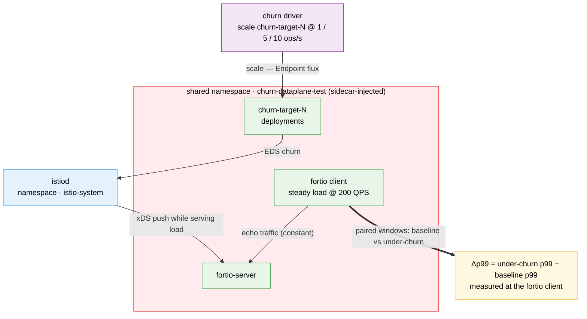

# Churn × Data-plane Test Suite

Measures how much request latency rises while istiod is busy with endpoint churn.
Fortio (client and server) and churn-target deployments share one namespace. Each combo
runs a **baseline** window (steady load, no churn) and a **churn** window (same load
plus deployment scale events) and reports `Δp99_ms = churn p99 − baseline p99`.

## Architecture

> Diagram conventions are shared across suites — see
> [`docs/scale-test-campaign/architecture.md`](../../docs/scale-test-campaign/architecture.md#diagram-conventions).



## What it measures

- Fortio p50/p90/p99/p999/max latency and actual QPS in both windows, and `Δp99_ms`.
- istiod deltas over each window, for attribution: xDS pushes (total and EDS), push
  triggers, and p99 of `pilot_proxy_convergence_time`, `pilot_proxy_queue_time`,
  `pilot_xds_push_time` (summed or merged across all istiod replicas on the source).
- Churn: at `--churn-rate R` for `D` seconds the driver issues `R × D` scale operations,
  each toggling one churn-target deployment between `--base-replicas` and `--scale-to` on
  every active context, in a seeded, repeatable order.

Fortio and the churn targets never exchange traffic (disjoint Service selectors), so
churn affects the latency only through control-plane and node contention. Not covered:
rolling updates, config changes (VirtualService, DestinationRule, Sidecar), sidecar
restarts and Envoy-side stats. Above about 100 ops/s the driver cannot keep up with
the requested rate (per-operation process overhead).

## Quick start

Needs `kubectl` or `oc`, `helm`, `jq`, `curl`, the deployed mesh (see the root README)
and kube contexts for the mesh members (not the ACM hub).

```bash
# 1. Deploy: source gets fortio client + server, remotes get fortio-server, all get churn targets
./tests/churn-dataplane/001-setup-coexec-test.sh \
  --source-context <mesh-a-ctx> --remote-contexts <mesh-b-ctx>

# 2. Baseline window (60 s at 200 QPS)
TSV=tests/churn-dataplane/results/churn-dataplane-smoke.tsv
./tests/churn-dataplane/002-run-baseline-probe.sh \
  --source-context <mesh-a-ctx> --remote-contexts <mesh-b-ctx> --combo-id smoke --output-file "$TSV"

# 3. Churn window (same load + 5 scale ops/s); computes Δp99 against the baseline row
./tests/churn-dataplane/003-run-churn-probe.sh \
  --source-context <mesh-a-ctx> --remote-contexts <mesh-b-ctx> --combo-id smoke \
  --churn-rate 5 --baseline-file "$TSV" --output-file "$TSV"

# 4. Summarize every TSV under tests/churn-dataplane/results/
./tests/churn-dataplane/005-report-results.sh --format md

# 5. Tear down and wait for the namespace to go away
./tests/churn-dataplane/006-cleanup.sh --contexts <mesh-a-ctx>,<mesh-b-ctx> --wait-deletion
```

Baseline and churn rows pair up by `--combo-id`. Add `--dry-run` to any script to see
what it would do without changing the clusters.

## Sweep

```bash
./tests/churn-dataplane/004-run-sweep.sh \
  --contexts <mesh-a-ctx>,<mesh-b-ctx> --churn-rates 1,5,10 --repetitions 2
```

For each mesh size (default `1..N`; the first context is the source) the sweep deploys
once, then for each rate and repetition resets the churn targets to base (after the
first), runs the baseline and churn windows, and finally cleans up. It writes one TSV,
`sweep-summary-<run-id>.md` and `sweep-charts-<run-id>.md` to
`tests/churn-dataplane/results/sweep-<run-id>/`. More than 64 combinations needs
`--force-large-matrix`.

## Results

One TSV row per phase (`baseline`, `churn`, or `cleanup`). `status` is `OK`, `FAILED`
(fortio failed), `POISONED_RESTART` (istiod restarted; latency and istiod columns are
`N/A`), `POISONED_SCRAPE` (an istiod scrape failed or the scrapes were more than
`FANOUT_MAX_SKEW_MS` apart), `CHURN_RATE_NOT_MET` (under 90% of scale operations
succeeded), or a sweep placeholder: `SETUP_FAILED`, `PROBE_FAILED`, `RESET_FAILED`,
`CLEANUP_TIMEOUT`.

The report keeps rows with `status=OK` and `istiod_restarted=0`, pairs them by
`combo_id` within each TSV file, and prints mean and stdev of `Δp99_ms` with
`total_runs`/`valid_runs` for each `(mesh_size, churn_rate)`.

## Settings

Defaults are the `COEXEC_*` variables in `config/options.env` (durations, QPS, churn
rates, settle times, repetitions, seed, cleanup timeouts); each script's `--help` shows
them. Churn size comes from `CHURN_DEPLOYMENT_COUNT`, `CHURN_BASE_REPLICAS` and
`CHURN_SCALE_TO_REPLICAS`, shared with the churn suite. Churn-target pods use a 5 s
termination grace period (chart value `churnTerminationGracePeriodSeconds`), so
scaled-down pods are gone before the next baseline window.

## Scripts

| Script | Purpose |
|--------|---------|
| `001-setup-coexec-test.sh` | Deploy fortio and churn targets; re-applies in place, and waits first if the namespace is still deleting. |
| `002-run-baseline-probe.sh` | One fortio window with no churn; writes a `baseline` row. |
| `003-run-churn-probe.sh` | One fortio window while the churn driver runs; writes a `churn` row with `delta_p99_ms`, then scales the churn targets back to base. |
| `004-run-sweep.sh` | Run the mesh-size × churn-rate × repetition sweep and the report. |
| `005-report-results.sh` | Summarize TSVs as text, csv, json, md or charts. |
| `006-cleanup.sh` | Scale to 0 and delete pods with a short grace period, then delete the namespace. |
