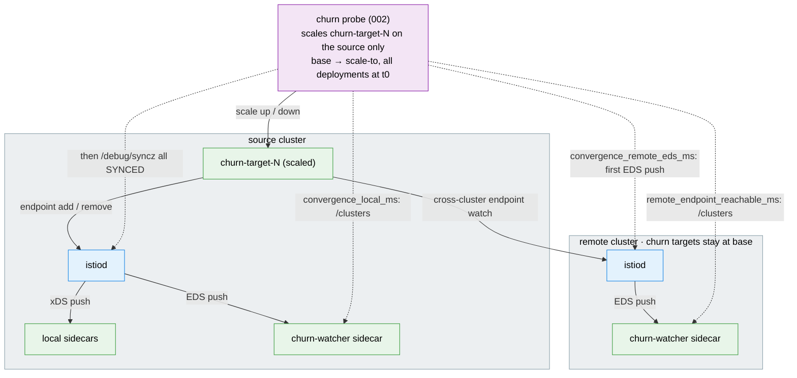

# Churn / Convergence Test Suite

Measures how fast the mesh converges under endpoint churn. The probe scales the
churn-target deployments on one **source** cluster and times when the source sees
the new pods and when each **remote** cluster sees them. Remote clusters stay at
base replicas, so the remote numbers are cross-cluster propagation only.

## Architecture

> Diagram conventions are shared across suites — see
> [`docs/scale-test-campaign/architecture.md`](../../docs/scale-test-campaign/architecture.md#diagram-conventions).



## What gets measured

One TSV row per iteration. istiod metrics are summed or merged across all istiod
replicas. Remote times and p99s are the max across remote clusters; remote counters the sum.
With no remote (mesh size 1) the remote columns are `N/A`.

| Column | Meaning |
|--------|---------|
| `convergence_local_ms` | The source watcher sees at least one new Ready pod per deployment and the source istiod reports every proxy SYNCED (`/debug/syncz`). Includes pod scheduling and sidecar start. |
| `convergence_remote_eds_ms` | First EDS push on the remote istiod after t0 (`pilot_xds_pushes{type="eds"}`). Control plane only. Polled from `/metrics`, so it can trail `remote_endpoint_reachable_ms` by a poll tick. |
| `remote_endpoint_reachable_ms` | Every churn target on the remote watcher has more healthy endpoint weight than before t0: at least one new Ready source pod per deployment. Includes pod scheduling and sidecar start. |
| `*_push_triggers_delta` | `pilot_push_triggers` increase during the iteration. |
| `*_xds_pushes_delta` | `pilot_xds_pushes` increase (one per proxy connection per xDS type). |
| `*_queue_time_p99_ms` / `*_push_time_p99_ms` | p99 of `pilot_proxy_queue_time` / `pilot_xds_push_time` for the iteration, interpolated within its histogram bucket and rounded to ms; `overflow` when it falls in the `+Inf` bucket. |
| `*_connected_proxies` | `pilot_xds` gauge before scaling. |
| `status` | See below. |

On a multi-network mesh a remote sidecar reaches source pods through the east-west
gateway: the gateway endpoint's weight, not the endpoint count, grows with the number of
Ready source pods. The probe therefore sums healthy endpoint weight.

`status` values: `OK`; `TIMEOUT_LOCAL` / `TIMEOUT_REMOTE` (no convergence within
`--timeout`); `POISONED_RESTART` (an istiod restarted mid-iteration, istiod columns are
`N/A`); `SCRAPE_INCOMPLETE` (an istiod `/metrics` scrape failed, counters undercounted);
`SETUP_FAILED` / `PROBE_FAILED` (placeholder for a failed iteration or sweep combo).
The report averages `OK` rows only and shows `n_total` and `n_valid`. The p99 columns are
not averaged: the report shows the worst bucket range a valid row hit (e.g. `500-1000`),
or `overflow (N rows)` when N valid rows had their p99 in the `+Inf` bucket (csv: the
`worst_bucket` and `n_overflow` columns).

The TSV preamble records `HARNESS_SHA` (`git describe --always --dirty`) and
`ISTIO_VERSION`; the report prints those, never the commit it runs on. A TSV written
before they were recorded reads `unknown (not recorded)`, and inputs that differ read
`mixed:a,b` with a warning. Timestamps are UTC.

It also records `KUBE_VERSIONS` and the platform record
([`tests/lib/platform.sh`](../lib/platform.sh)): `PLATFORM`, `TEST_PLATFORM` and, per member, the
platform it serves, the mesh operator, istiod and gateway proxy (ingress and east-west) builds,
istiod's settings and the nodes' provider (`PLATFORM_BY_CONTEXT`, `MESH_OPERATOR_BY_CONTEXT`,
`ISTIOD_IMAGE_BY_CONTEXT`, `PROXY_IMAGE_BY_CONTEXT`, `NODE_PROVIDER_BY_CONTEXT`,
`ISTIOD_ENV_BY_CONTEXT`: a digest of istiod's discovery container env without `CLUSTER_ID`),
read before the first churn event (a sweep reads it once for all its combos, and again after the
last one: a build, istiod setting, tuning lever or Kubernetes version that changed in between is
written to `platform-drift.txt` in the sweep dir). An image carries the digest its pods run
(`@unknown` when none has started: not read, never another build); `none` means no such pod.
`004` prints them in every format (text, csv, md, charts; it has no json), per member as
`<ctx>=mixed:a;b` with a warning in the report itself when the inputs differ (`KUBE_VERSIONS`:
different Kubernetes versions), a value could not be read in some of them, or the sweep's record
changed; an operator that differs only in its state (`Available`, `Unavailable`) is not mixed. A
file without them predates the record (the suite
supported only OpenShift with OSSM then); its values read `unknown`.

Every source or remote istiod status other than `0` also saves the restart evidence to
`istiod-diag-<RUN_ID>/` next to the TSV, tag `iter<N>`, after the row is written; a failed
capture never adds a `SETUP_FAILED` row. A pod replaced between iterations (scale-down,
settle) is in no row; the next iteration's port-forward check sees the new pod set and
captures it (trigger `podset_changed`, tag `before-iter<N>`). Contents, settings and
redaction are in the [dataplane README](../dataplane/README.md#restart-evidence-istiod-diag-run_id);
the report ends text and md with an "istiod restart diagnostics" section.

The report's push amplification is `(source + remote xDS pushes) / source push triggers`.
It grows with connected proxies, so compare it across mesh sizes, not against 1.

## Quick start

Needs `kubectl` or `oc`, `helm`, `jq`, `curl`, the deployed mesh (see the root README)
and kube contexts for the mesh members (not the hub).

```bash
# 1. Deploy churn targets and a watcher on each mesh member
./tests/churn/001-setup-churn-test.sh --contexts <mesh-a-ctx>,<mesh-b-ctx>

# 2. Scale 5 deployments 1 -> 5 replicas on the source, 5 iterations
./tests/churn/002-run-churn-probe.sh \
  --source-context <mesh-a-ctx> --remote-contexts <mesh-b-ctx> --iterations 5

# 3. Summarize everything under tests/churn/results/
./tests/churn/004-report-results.sh --format md

# 4. Remove the test namespace
./tests/churn/005-cleanup.sh --contexts <mesh-a-ctx>,<mesh-b-ctx>
```

Add `--dry-run` to any script to see what it would do without changing the clusters.

## Sweep

```bash
./tests/churn/003-run-sweep.sh --contexts <mesh-a-ctx>,<mesh-b-ctx> --churn-intensities 5,10,20
```

For each mesh size (default `1..N`; the first context is the source) and each churn
intensity (deployment count) the sweep runs setup, probe and cleanup. It writes the TSVs,
`sweep-<run-id>.md` and `sweep-charts-<run-id>.md` to `tests/churn/results/sweep-<run-id>/`.
Charts need at least three contexts (two mesh sizes with a remote).
A failed setup or probe becomes a placeholder row and the sweep moves on.

## Run config (`--config FILE`)

Every script takes `--config FILE`, one file of `KEY=value` lines for a whole run (shared
rules: [Run config](../../README.md#run-config---config-file)).
[`configs/smoke.env`](configs/smoke.env) is a worked example (mesh sizes 1 and 2,
2 and 4 Deployments scaled 1 to 2, 2 iterations):

```bash
./tests/churn/003-run-sweep.sh --config tests/churn/configs/smoke.env --dry-run
./tests/churn/003-run-sweep.sh --config tests/churn/configs/smoke.env
./tests/churn/004-report-results.sh --config tests/churn/configs/smoke.env \
  --results-dir tests/churn/results/smoke/sweep-<RUN_ID> --format md
./tests/churn/005-cleanup.sh --config tests/churn/configs/smoke.env
```

- **Keys:** `SETUP_CONTEXTS` and the `config/options.env` keys `CHURN_*`, `FANOUT_*`,
  `ISTIOD_DIAG_*` (restart evidence), `TEST_PLATFORM` (the members' platform),
  `PLATFORM_READ_TIMEOUT` (each read of the platform record) and
  `METRICS_SCRAPE_TIMEOUT`. `CHURN_TEST_NAMESPACE` stays environment only.
- **One value or a list:** `001` and `002` read `CHURN_DEPLOYMENT_COUNT`; the sweep reads the
  CSV `CHURN_INTENSITIES` (`--churn-intensities`; empty: `CHURN_DEPLOYMENT_COUNT`) and
  `CHURN_MESH_SIZES` (`--mesh-sizes`; empty: 1 to the number of contexts). A list key exported
  in the environment beats a one-value key in the file.
- **Other run keys:** `CHURN_RESULTS_DIR` (`--output-dir`, `--results-dir`; a relative path
  starts at the repo root, unlike the flags) and `CHURN_WAIT_TIMEOUT_SEC`
  (`001 --wait-timeout`).
- **Flags only:** `--source-context`, `--remote-contexts`, `--mesh-size`,
  `--tuning-baseline` and `--sidecar-egress-hosts` (`002`; the sweep sets them),
  `--format` and `--dry-run`.

## Settings

Defaults live in `config/options.env` and flags override them: `CHURN_TEST_NAMESPACE`
(`churn-test`), `CHURN_DEPLOYMENT_COUNT` (5), `CHURN_BASE_REPLICAS` (1),
`CHURN_SCALE_TO_REPLICAS` (5, must exceed base), `CHURN_ITERATIONS` (5),
`CHURN_TIMEOUT_SEC` (120), `CHURN_POLL_INTERVAL_MS` (250).

## Scripts

| Script | Purpose |
|--------|---------|
| `001-setup-churn-test.sh` | Deploy churn targets and the watcher on each context. |
| `002-run-churn-probe.sh` | Scale the source, measure convergence, write one TSV row per iteration. |
| `003-run-sweep.sh` | Run setup, probe and cleanup across mesh sizes and churn intensities. |
| `004-report-results.sh` | Summarize TSVs as text, csv, md or charts. |
| `005-cleanup.sh` | Delete the test namespace. |
