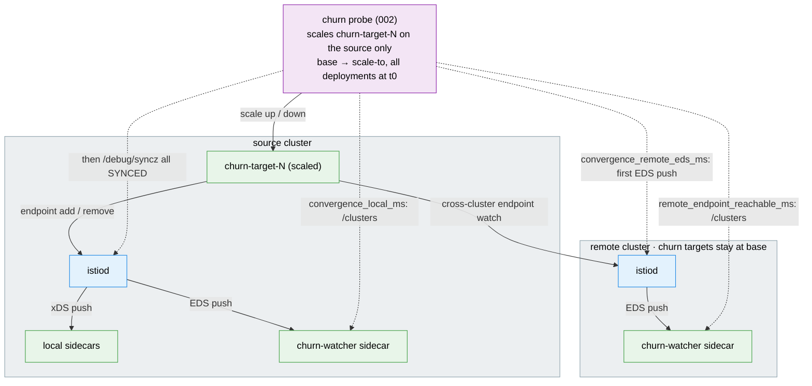

# Churn / Convergence Test Suite

Measures how fast the mesh converges under endpoint churn. The probe scales the
churn-target deployments on one **source** cluster and times when the source sees
the new pods and when each **remote** cluster sees them. Remote clusters stay at
base replicas, so the remote numbers are cross-cluster propagation only.

## Architecture

> Diagram conventions are shared across suites — see
> [`docs/scale-test-campaign/architecture.md`](../../docs/scale-test-campaign/architecture.md#diagram-conventions).



## What gets measured

One TSV row per iteration. istiod metrics are summed or merged across all istiod
replicas. Remote times and p99s are the max across remote clusters; remote counters the sum.
With no remote (mesh size 1) the remote columns are `N/A`.

| Column | Meaning |
|--------|---------|
| `convergence_local_ms` | The source watcher sees at least one new Ready pod per deployment and the source istiod reports every proxy SYNCED (`/debug/syncz`). Includes pod scheduling and sidecar start. |
| `convergence_remote_eds_ms` | First EDS push on the remote istiod after t0 (`pilot_xds_pushes{type="eds"}`). Control plane only. Polled from `/metrics`, so it can trail `remote_endpoint_reachable_ms` by a poll tick. |
| `remote_endpoint_reachable_ms` | Every churn target on the remote watcher has more healthy endpoint weight than before t0: at least one new Ready source pod per deployment. Includes pod scheduling and sidecar start. |
| `*_push_triggers_delta` | `pilot_push_triggers` increase during the iteration. |
| `*_xds_pushes_delta` | `pilot_xds_pushes` increase (one per proxy connection per xDS type). |
| `*_queue_time_p99_ms` / `*_push_time_p99_ms` | p99 of `pilot_proxy_queue_time` / `pilot_xds_push_time` for the iteration, interpolated within its histogram bucket and rounded to ms; `overflow` when it falls in the `+Inf` bucket. |
| `*_connected_proxies` | `pilot_xds` gauge before scaling. |
| `status` | See below. |

On a multi-network mesh a remote sidecar reaches source pods through the east-west
gateway: the gateway endpoint's weight, not the endpoint count, grows with the number of
Ready source pods. The probe therefore sums healthy endpoint weight.

`status` values: `OK`; `TIMEOUT_LOCAL` / `TIMEOUT_REMOTE` (no convergence within
`--timeout`); `POISONED_RESTART` (an istiod restarted mid-iteration, istiod columns are
`N/A`); `SCRAPE_INCOMPLETE` (an istiod `/metrics` scrape failed, counters undercounted);
`SCRAPE_INCOMPLETE_REMOTE_EDS` (a remote's EDS poll never completed a scrape of its istiod,
so `convergence_remote_eds_ms` was not measured and reads `N/A`; no remote timed out);
`TIMEOUT_REMOTE_EDS` (no remote EDS push within `--timeout`); `MISSING_VALUE` (another
measured column has no number: a watcher that did not list every churn target, or a push
counter in neither istiod scrape, e.g. renamed; the probe's stderr names the column);
`SETUP_FAILED` / `PROBE_FAILED` (placeholder for a failed iteration or sweep combo).
An `OK` row has a number in every convergence column and push-counter delta.
The report averages `OK` rows only and shows `n_total` and `n_valid` (`--help` lists the
statuses). A row an older `002` wrote as `OK` with no number in a measured column counts as
`TIMEOUT_REMOTE_EDS` or `MISSING_VALUE`, with a warning on stderr. The p99 columns are
not averaged: the report shows the worst bucket range a valid row hit (e.g. `500-1000`),
or `overflow (N rows)` when N valid rows had their p99 in the `+Inf` bucket (csv: the
`worst_bucket` and `n_overflow` columns).

The TSV preamble records `HARNESS_SHA` (`git describe --always --abbrev=7`; uncommitted changes
under `tests/`, `config/`, `charts/` or `terraform/`, tracked or untracked and not ignored, read
`<describe>-dirty.<8hex>`, a hash of that content; submodules and ignored editor files never count;
see the root README), its content key `HARNESS_CONTENT_KEY` and `ISTIO_VERSION` (what the members
run, next to `ISTIO_VERSION_PIN` and `ISTIO_VERSION_SOURCE`; see the root README); the report prints
those. `HARNESS_SHA` is never the commit the report runs on: that is `REPORT_HARNESS_SHA` (md and
charts frontmatter `report_harness_sha`), which every format also prints, since a report made again
later, or from another checkout, may count rows by other rules; the results dir it reads never
counts as a change to it. A TSV written before they were recorded reads `unknown (not recorded)`,
and inputs that differ read `mixed:a,b` with a warning. Next to `HARNESS_SHA` every format prints
`HARNESS_CONTENT_KEY` (frontmatter `harness_content_key`), the content key of the harness files the
rows ran on: inputs whose `HARNESS_SHA` differs but that share one key differ only in git describe
(a commit or tag that left the harness files as they were), so stderr gives a note instead of the
warning. Timestamps are UTC.

Every source or remote istiod status other than `0` also saves the restart evidence to
`istiod-diag-<RUN_ID>/` next to the TSV, tag `iter<N>`, after the row is written; a failed
capture never adds a `SETUP_FAILED` row. A pod replaced between iterations (scale-down,
settle) is in no row; the next iteration's port-forward check sees the new pod set and
captures it (trigger `podset_changed`, tag `before-iter<N>`). Contents, settings and
redaction are in the [dataplane README](../dataplane/README.md#restart-evidence-istiod-diag-run_id);
the report ends text and md with an "istiod restart diagnostics" section.

The report's push amplification is `(source + remote xDS pushes) / source push triggers`.
It grows with connected proxies, so compare it across mesh sizes, not against 1.

## Quick start

Needs `kubectl` or `oc`, `helm`, `jq`, `curl`, the deployed mesh (see the root README)
and kube contexts for the mesh members (not the ACM hub).

```bash
# 1. Deploy churn targets and a watcher on each mesh member
./tests/churn/001-setup-churn-test.sh --contexts <mesh-a-ctx>,<mesh-b-ctx>

# 2. Scale 5 deployments 1 -> 5 replicas on the source, 5 iterations
./tests/churn/002-run-churn-probe.sh \
  --source-context <mesh-a-ctx> --remote-contexts <mesh-b-ctx> --iterations 5

# 3. Summarize tests/churn/results/
# (it reads every run under the results dir; with more than one there it stops and
#  lists the --results-dir that reports each, or pools them with --allow-multi-run)
./tests/churn/004-report-results.sh --format md

# 4. Remove the test namespace
./tests/churn/005-cleanup.sh --contexts <mesh-a-ctx>,<mesh-b-ctx>
```

Add `--dry-run` to any script to see what it would do without changing the clusters.

## Sweep

```bash
./tests/churn/003-run-sweep.sh --contexts <mesh-a-ctx>,<mesh-b-ctx> --churn-intensities 5,10,20
```

For each mesh size (default `1..N`; the first context is the source) and each churn
intensity (deployment count) the sweep runs setup, probe and cleanup. It writes the TSVs,
`sweep-<run-id>.md` and `sweep-charts-<run-id>.md` to `tests/churn/results/sweep-<run-id>/`.
Charts need at least three contexts (two mesh sizes with a remote).
A failed setup or probe becomes a placeholder row and the sweep moves on.

Exit codes: `0` every cell (mesh size x intensity) ran; `1` the sweep stopped (a bad flag or
precondition, such as another live run that holds the sweep dir, named with its PID in
`.sweep.lock`, or an unexpected error); `130`, `143` or `129` it was interrupted (Ctrl-C, SIGTERM,
SIGHUP; `sweep-outcome.txt` says when and by which signal; a signal sent to the sweep's process
alone stops the running step and every process under it first, `SWEEP_STOP_GRACE_SEC` (30 s) before
SIGKILL; a `kill -INT` or `kill -HUP` skips the processes of a sweep in a terminal's foreground, so
stop such a sweep from elsewhere with SIGTERM; without a `ps` that lists start times or Linux's
`/proc`, only the step's own process is stopped; see the top-level README); `4` it finished and
wrote its reports, but some cells failed (a `SETUP_FAILED` / `PROBE_FAILED` placeholder), or the
Istio version, active revision or generation of the Istio CR or its active IstioRevision changed
during the sweep (read again before the reports), or that check failed, or its harness (a file under
`tests/`, `config/`, `charts/` or `terraform/`, `HARNESS_SHA`) changed during the sweep (read again
before its steps, by each step and at its end). The last line on stderr says how many, by reason;
`sweep-outcome.txt` in the sweep dir and the end of the markdown summary keep the outcome. From the
sweep's start until it writes its outcome, `sweep-outcome.txt` holds a not-finished record
(`EXIT=unfinished`, `STARTED_AT`, `RUN_ID`, `HARNESS_SHA`, `HARNESS_CONTENT_KEY`, and what to do),
so a report of a sweep that died, or still runs, or (with when and by which signal) was interrupted
says "this sweep has not finished" in every format (json `sweep_outcome`: `"exit": null`,
`"unfinished": true`; a finished one reads `"unfinished": false`; one that stopped on an error after
its start records the stop and its reason instead, `STOPPED=1` and `CUT_SHORT=1`, see the top-level
README): when no sweep runs any more, run the sweep again into a new dir (a churn sweep has no
`--resume`); the rows already in the dir cover only the cells it finished. Proxies connected on
another Istio version than their istiod at the start (`ISTIO_PROXY_VERSIONS`) are a note of the
outcome, never a failure. Rows a probe wrote with a non-OK status (`TIMEOUT_*`, `MISSING_VALUE`,
...) are measurements, not failed cells: the report counts them in `n_total`.

## Run config (`--config FILE`)

Every script takes `--config FILE`, one file of `KEY=value` lines for a whole run (shared
rules: [Run config](../../README.md#run-config---config-file)).
[`configs/smoke.env`](configs/smoke.env) is a worked example (mesh sizes 1 and 2,
2 and 4 Deployments scaled 1 to 2, 2 iterations):

```bash
./tests/churn/003-run-sweep.sh --config tests/churn/configs/smoke.env --dry-run
./tests/churn/003-run-sweep.sh --config tests/churn/configs/smoke.env
./tests/churn/004-report-results.sh --config tests/churn/configs/smoke.env \
  --results-dir tests/churn/results/smoke/sweep-<RUN_ID> --format md
./tests/churn/005-cleanup.sh --config tests/churn/configs/smoke.env
```

- **Keys:** `SETUP_CONTEXTS` and the `config/options.env` keys `CHURN_*`, `FANOUT_*`,
  `ISTIOD_DIAG_*` (restart evidence) and `METRICS_SCRAPE_TIMEOUT`. `CHURN_TEST_NAMESPACE`
  stays environment only.
- **One value or a list:** `001` and `002` read `CHURN_DEPLOYMENT_COUNT`; the sweep reads the
  CSV `CHURN_INTENSITIES` (`--churn-intensities`; empty: `CHURN_DEPLOYMENT_COUNT`) and
  `CHURN_MESH_SIZES` (`--mesh-sizes`; empty: 1 to the number of contexts). A list key exported
  in the environment beats a one-value key in the file.
- **Other run keys:** `CHURN_RESULTS_DIR` (`--output-dir`, `--results-dir`; a relative path
  starts at the repo root, unlike the flags) and `CHURN_WAIT_TIMEOUT_SEC`
  (`001 --wait-timeout`).
- **Flags only:** `--source-context`, `--remote-contexts`, `--mesh-size`,
  `--tuning-baseline` and `--sidecar-egress-hosts` (`002`; the sweep sets them),
  `--allow-multi-run` (`004`), `--format` and `--dry-run`.

## Settings

Defaults live in `config/options.env` and flags override them: `CHURN_TEST_NAMESPACE`
(`churn-test`), `CHURN_DEPLOYMENT_COUNT` (5), `CHURN_BASE_REPLICAS` (1),
`CHURN_SCALE_TO_REPLICAS` (5, must exceed base), `CHURN_ITERATIONS` (5),
`CHURN_TIMEOUT_SEC` (120), `CHURN_POLL_INTERVAL_MS` (250).

## Scripts

| Script | Purpose |
|--------|---------|
| `001-setup-churn-test.sh` | Deploy churn targets and the watcher on each context. |
| `002-run-churn-probe.sh` | Scale the source, measure convergence, write one TSV row per iteration. |
| `003-run-sweep.sh` | Run setup, probe and cleanup across mesh sizes and churn intensities. |
| `004-report-results.sh` | Summarize TSVs as text, csv, md or charts. |
| `005-cleanup.sh` | Delete the test namespace. |
