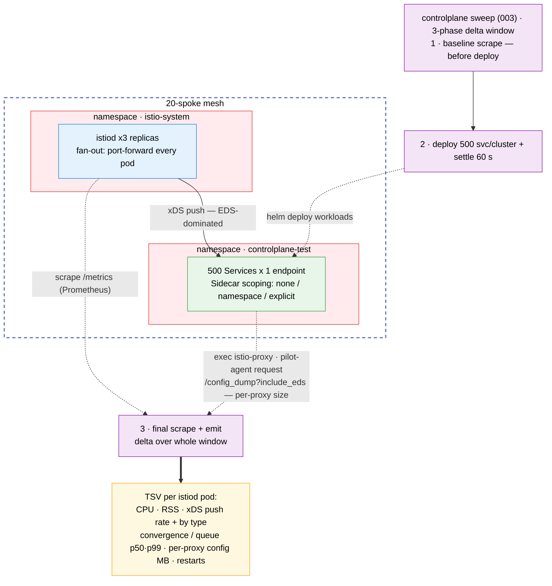

# Control-Plane Resource Scaling Test Suite

Measures istiod CPU, memory and xDS activity as a function of mesh size, service count,
replicas, namespace count, `Sidecar` CR scoping and traffic management (bare services, or
a VirtualService and DestinationRule per service).

## Architecture

> Diagram conventions (arrow styles, box colors) are shared across all suites — see
> [`docs/scale-test-campaign/architecture.md`](../../docs/scale-test-campaign/architecture.md#diagram-conventions).



## What it measures

One TSV row per istiod pod, computed as deltas over a wall-clock window:

| Column(s) | Source |
|-----------|--------|
| `istiod_cpu_m_delta`, `istiod_mem_mi` | `process_cpu_seconds_total`, `process_resident_memory_bytes`; peak of window average and 5 s samples |
| `convergence_*`, `queue_*` (p50/p99) | `pilot_proxy_convergence_time`, `pilot_proxy_queue_time` histogram deltas |
| `xds_pushes_*` (total, rate, per type) | `pilot_xds_pushes` |
| `k8s_events_*` | `pilot_k8s_cfg_events` |
| `connected_proxies` | `pilot_xds` on this istiod pod, summed over its series. Per replica: a replica with no connections reads `0`; an empty or short scrape reads `N/A` |
| `sidecar_config_bytes_*` | `/config_dump?include_eds` size from sampled sidecars |
| `istiod_restarted` | `process_start_time_seconds` (`0`, `1` or `unknown`) |
| `cluster_connected_proxies` | `pilot_xds` summed over every istiod pod of the context, from the same final scrape. Same value on each row of that context. `N/A` if any pod's scrape is empty or short, or the Running istiod pod set changed during the window |
| `sidecar_pods` | Running, non-terminating pods with the `sidecar.istio.io/status` annotation on the context (injected gateways included), read right after the final scrape |
| `proxy_check` | `OK`, `LOW` or `HIGH` when `cluster_connected_proxies` and `sidecar_pods` differ by more than max(`CONTROLPLANE_PROXY_CHECK_TOLERANCE_PCT`, default 10 %, `CONTROLPLANE_PROXY_CHECK_MIN_DIFF`, default 2); `N/A` if either side is `N/A`. A warning only: the row stays in every statistic |
| `traffic_config`, `vsdr_services` | What `001` deployed: `none` or `vsdr`, and how many services got a VirtualService + DestinationRule (`0` for `none`) |
| `istiod_virt_services` | `pilot_virt_services` at the final scrape: every VirtualService istiod knows, so a vsdr row should show at least `vsdr_services` |
| `push_time_avg_ms`, `pushcontext_init_avg_ms` | Average per observation over the window: Δsum ÷ Δcount of `pilot_xds_push_time` and `pilot_pushcontext_init_seconds`. `N/A` with no observation or after a restart |
| `sidecar_clusters_avg`, `sidecar_cds_bytes_avg`, `sidecar_rds_bytes_avg` | From the same sampled `/config_dump`s: dynamic CDS clusters, and the compact JSON size of the CDS and RDS sections |

In a sweep, `003` runs `002 --phase baseline` before deploying, `001` deploys and settles,
then `002 --phase final` scrapes again, so the window covers the deploy push storm. Run
standalone, `002` (`--phase combined`) measures only the `--settle` window.

## Prerequisites

- `oc` or `kubectl`, `helm`, `jq`, `curl`
- A multi-primary mesh (see the root README) and one kube context per mesh member

## Quick start

```bash
# 1. Deploy 10 services x 3 replicas on both clusters
./tests/controlplane/001-setup-controlplane-test.sh --contexts <mesh-a-ctx>,<mesh-b-ctx>

# 2. One 60 s collection window, then the report
./tests/controlplane/002-collect-resource-metrics.sh --contexts <mesh-a-ctx>,<mesh-b-ctx> --settle 60
./tests/controlplane/004-report-results.sh

# 3. Clean up
./tests/controlplane/005-cleanup.sh --contexts <mesh-a-ctx>,<mesh-b-ctx>
```

## Sweep

```bash
./tests/controlplane/003-run-sweep.sh --contexts <mesh-a-ctx>,<mesh-b-ctx> \
  --mesh-sizes 1,2 --service-counts 50 --sidecar-scopings none,namespace,explicit
```

Add `--dry-run` to print the matrix without touching a cluster. The sweep runs the
cross-product of these axes (one CSV flag each):

| Flag | Axis |
|------|------|
| `--mesh-sizes` | Clusters in the measurement (first N of `--contexts`) |
| `--service-counts` | Dummy services per cluster |
| `--replica-counts` | Pods per service |
| `--namespace-counts` | Namespaces the services are spread over (service `i` in namespace `i mod N`) |
| `--sidecar-scopings` | `none` (no Sidecar CRs), `namespace` (one per namespace), `explicit` (one per Deployment) |
| `--traffic-configs` | `none` (bare services) or `vsdr` (a VirtualService + DestinationRule per configured service); innermost, so each pair runs back to back |

More than `CONTROLPLANE_MAX_MATRIX` (64) combinations needs `--force-large-matrix`.
`--settle` (default 60 s) applies after the deploy and again after each cleanup.
`--resume tests/controlplane/results/sweep-<RUN_ID>` continues an interrupted sweep and skips combos that
already have a valid row. Each row records its own axis values, but some scalars are recorded only
once, in the TSV preamble, so they must match on resume: `--vsdr-every` and `--vsdr-subsets` (when
the resumed run has `vsdr` cells) and `CONTROLPLANE_PROXY_CHECK_*`. The sweep reads them from the
preamble and prints a note when that changes a value. It refuses an explicit `--vsdr-every` or
`--vsdr-subsets` that differs. Pass the other options as in the original run.
`--config-dump-samples 0` skips the per-sidecar exec.

**More than one namespace:** namespaces are named `controlplane-test-0..N-1`. With
scoping `none`, the root `Sidecar` egress hosts must list each one (they match namespaces
exactly), so `001` stops unless they are in `charts/spoke-ossm/values.yaml`
`tuningBaseline.sidecar.egressHosts` (or egress is `*/*`). `namespace` and `explicit`
scoping bring their own `Sidecar`s, so they need no change.

## Run config (`--config FILE`)

Every script (`001`-`005`) takes `--config FILE`, a file of `KEY=value` lines, so one file
describes a whole run: setup, collection, sweep, report and cleanup. The rules shared by every
suite (syntax, precedence, environment-only keys, provenance) are in
[Run config](../../README.md#run-config---config-file).
[`configs/smoke.env`](configs/smoke.env) is a worked example (5 services × 2 replicas, mesh
sizes 1 and 2, scoping `none` and `namespace`, a 20 s window):

```bash
./tests/controlplane/003-run-sweep.sh --config tests/controlplane/configs/smoke.env --dry-run
./tests/controlplane/003-run-sweep.sh --config tests/controlplane/configs/smoke.env
./tests/controlplane/004-report-results.sh --config tests/controlplane/configs/smoke.env \
  --results-dir tests/controlplane/results/smoke/sweep-<RUN_ID> --format markdown
./tests/controlplane/005-cleanup.sh --config tests/controlplane/configs/smoke.env
```

- **Keys:** `SETUP_CONTEXTS` and the `config/options.env` keys that start with
  `CONTROLPLANE_`, `SCALE_`, `METRICS_`, `FANOUT_` or `CAP_`. A step ignores the keys it
  does not use. Environment only: `CONTROLPLANE_TEST_NAMESPACE` (`005` deletes it),
  `CONTROLPLANE_MAX_MATRIX` (the `--force-large-matrix` acknowledgment stays per run) and
  the version pins. Any other key, or any bad line, rejects the whole file before anything
  runs, with `file:line` and the reason.
- **Precedence:** flag > `--config` > environment > default. The file loads before
  `options.env`, so the defaults derived there follow it: a config
  `CONTROLPLANE_NS_DELETE_TIMEOUT_SEC` also sets `001`'s namespace wait unless
  `CONTROLPLANE_SETUP_NS_WAIT_SEC` is set. Each key is logged on stderr, with the
  environment value it overrides. `KEY=` (empty) means the built-in default.
- **One value or a list:** `001` and `002` read one value per axis
  (`CONTROLPLANE_SERVICE_COUNT`, `..._REPLICAS_PER_SERVICE`, `..._NAMESPACE_COUNT`,
  `..._SIDECAR_SCOPING`, `..._TRAFFIC_CONFIG`). The sweep reads the CSV keys
  `CONTROLPLANE_MESH_SIZES` (empty: 1 to the number of contexts), `..._SERVICE_COUNTS`,
  `..._REPLICA_COUNTS`, `..._NAMESPACE_COUNTS`, `..._SIDECAR_SCOPINGS` and
  `..._TRAFFIC_CONFIGS`; each falls back to its one-value key. A list key exported in the
  environment beats a one-value key in the file.
- **Other run keys:** `CONTROLPLANE_SETTLE_SEC` (`--settle`), `CONTROLPLANE_RESULTS_DIR`
  (`--output-dir`, `--results-dir`; a relative path starts at the repo root, unlike the
  flags) and `CONTROLPLANE_WAIT_TIMEOUT_SEC` (`001 --wait-timeout`, which a sweep now
  honors too).
- **No key (flags only):** `--dry-run`, `--resume`, `--force-large-matrix`, `--format`,
  `--phase`, `--state-dir`, `--run-id`, `--watch`, `--interval` and `--mesh-size`.
- **Provenance:** the TSV preamble records `RUN_CONFIG` (the file's path from the repo root,
  or only its name outside the repo; `none` without `--config`) and `RUN_CONFIG_SHA256`, and
  every report format repeats them. A sweep also copies the file to
  `sweep-<RUN_ID>/run-config-<RUN_ID>.env`. `--resume` keeps the provenance the sweep
  started with, so a sweep that started with `--config` resumes only with the same file
  (same sha256): it refuses no `--config` and a different one, and names the snapshot
  (`--config <sweep-dir>/run-config-<RUN_ID>.env`); for another config, start a new sweep.
  A sweep that started without `--config` (`RUN_CONFIG=none`) resumes with one after a
  warning. The report prints `unknown` for files
  written before these keys existed, and `mixed:<a>,<b>` with a warning when the inputs
  disagree. With `--config` but no `--results-dir`, `004` warns when the results dir
  holds more than one run.

## Traffic management (VS/DR)

`--traffic-configs none,vsdr` measures what VirtualServices and DestinationRules add on
top of the same services. It is off by default (`none`), and a `none` render is the same
as before. For each configured service (`--vsdr-every N`: service `i` when `i mod N == 0`,
default every service) the chart adds, in the service's namespace:

- a VirtualService with one route that splits traffic by weight across the subsets, a 5 s
  timeout and 3 retries;
- a DestinationRule with `--vsdr-subsets` subsets (default 2), a connection pool and
  outlier detection.

Each subset has to select real pods, so that service's replicas are split over one
Deployment per subset (`dummy-svc-<i>-v1..vN`, label `version=v<k>`). The pod and endpoint
counts do not change (only the pods' `version` label does), so `--vsdr-subsets` must be at
most every `--replica-counts` value. `001` checks that the VirtualServices and
DestinationRules exist (`SETUP_FAILED` otherwise).

The markdown report pairs each vsdr cell with the none cell of the same mesh, services,
replicas, namespaces and scoping (section "Traffic management (VS/DR) effect"): istiod
cost, and per-proxy CDS clusters next to the expected extra clusters (VS+DR services ×
subsets, one CDS cluster per subset). It warns when istiod knows fewer VirtualServices
than were configured. The vsdr cell runs right after its none cell and istiod RSS does not
shrink after GC, so compare heap in use, or run again with `--traffic-configs vsdr,none`.
Run `005` before switching `--traffic-config` by hand with `001`: an in-place re-apply
leaves the other mode's Deployments running.

## Outputs

Results go to `tests/controlplane/results/` (a sweep uses `results/sweep-<RUN_ID>/`):

- `controlplane-<RUN_ID>.tsv`: `# KEY=value` provenance preamble (`CONTROLPLANE_SCHEMA=51`,
  `PROXY_CHECK_TOLERANCE_PCT`, `PROXY_CHECK_MIN_DIFF`, `TRAFFIC_CONFIG`, `VSDR_EVERY`,
  `VSDR_SUBSETS`, `RUN_CONFIG`, `RUN_CONFIG_SHA256`, ...), then the 51-column rows.
- `run-config-<RUN_ID>.env` (sweep with `--config` only): a copy of the run config.
- `sweep-<RUN_ID>.md`, `sweep-charts-<RUN_ID>.md`: report markdown and charts.
- `scale-envelope-<RUN_ID>.md`: campaign scale envelope, led by the customer SLA verdict
  (`PASS`, `CAUTION` at 75 % of a limit, `FAIL` at 90 % or on any istiod restart).

`004-report-results.sh --format text|csv|json|markdown|md|charts` groups rows by the six
axes; the markdown ends with a glossary of every column. Rows with `istiod_restarted` other
than `0` are counted in `n_total` but excluded from the statistics (`n_valid`). A failed
combo is recorded as a row whose `context` is `SETUP_FAILED` or `PROBE_FAILED`; a context
with no running istiod pod gets an all-`N/A` row with `istiod_restarted=unknown`.

Connected proxies appear twice. `connected_proxies per istiod replica (max)` is the busiest
single replica, so with R replicas it is about 1/R of the cluster. R is read on every
context: `istiod replicas` reads `3 per cluster`, or `1-3 per cluster (varies by cluster)`
when the members differ, with the per-context counts in `ISTIOD_REPLICAS_BY_CONTEXT`
(`CONTROLPLANE_INFRA_SCHEMA=2`; an older TSV says `(first context only)`). `connected_proxies per
cluster (max)` is the peak `cluster_connected_proxies`, counted once per cluster scrape and
only when no row of that scrape restarted. The proxy check tallies cluster scrapes as
ok/low/high/n/a/excluded; any low or high prints a `WARNING` line naming
`<context>@<timestamp>` (text and CSV, a `**Warning:**` note in markdown, `proxy_check` in
JSON). It never changes the exit code. The report also reads 40-column TSVs from before this
check; they add nothing to the per-cluster or VS/DR figures and their rows count as traffic
`none`. `--resume` refuses a sweep whose TSV has a different column count.

After each window, `002` reads its rows back. For every context with `istiod_restarted` `1`
or `unknown`, it saves the restart evidence to `istiod-diag-<RUN_ID>/` next to the TSV
(`tests/lib/istiod-diag.sh`; contents, settings and redaction in the
[dataplane README](../dataplane/README.md#restart-evidence-istiod-diag-run_id)). Here a
replaced or deleted istiod pod shows as `unknown`, not `1`: the pod list is pinned at the
baseline, so the old pod's final scrape fails and the new pod is never scraped. The index
says which it was (`replaced_gone` plus `new_pod`, or `restarted_in_place`). Index rows
join the TSV on context and window: the tag is `w<timestamp>` (the row's `timestamp`
without `-`, `:` and the offset, for example `w20261013T122310Z`). A context with no
istiod pod gets trigger `no_running_pods`. With every row `0` there is no extra API call.
The report section is not in `004` yet. The capture's settings, the `ISTIOD_DIAG_*` keys,
are also run-config keys here (`--config`), next to the prefixes listed under "Run config".

## Watch mode

```bash
./tests/controlplane/002-collect-resource-metrics.sh --contexts <mesh-a-ctx>,<mesh-b-ctx> --watch --interval 15
```

Each row is a per-window delta over `--interval` seconds.

## Limitations

- Histogram quantiles resolve only to istiod's buckets (100, 500, 1000 ms, ...); the
  report shows bucket ranges such as `100-500`.
- Each sweep point is one window; rerun the sweep for more samples.
- Services are spread evenly across namespaces; real meshes are skewed.
- Utilization-% columns need the metrics API (`kubectl top`); without it they are `N/A`.
  Node columns count worker nodes, including control-plane nodes that also carry the
  worker role (single-node and compact clusters).
- Raise `METRICS_SCRAPE_TIMEOUT` (default 30 s) if `/metrics` scrapes time out at scale.
- `sidecar_pods` is read a few seconds after the `pilot_xds` scrape, from the same 5 s pod
  list as `pods_scheduled`. Pods starting or stopping in between, or proxies not yet
  connected, can flag `LOW`/`HIGH`; a timed-out list makes `sidecar_pods` and `proxy_check`
  `N/A`.
- VS/DR load grows only with pod-backed services, so a small cluster limits it (a lab of a
  few dozen pods is a functional check, not a measurement of istiod cost).
- With `--vsdr-every` a multiple of `--namespace-counts`, every configured service lands in
  namespace 0 (service `i` lives in namespace `i mod N`).
- Gateways also get the DestinationRule subset clusters, but only workload sidecars are
  sampled.
