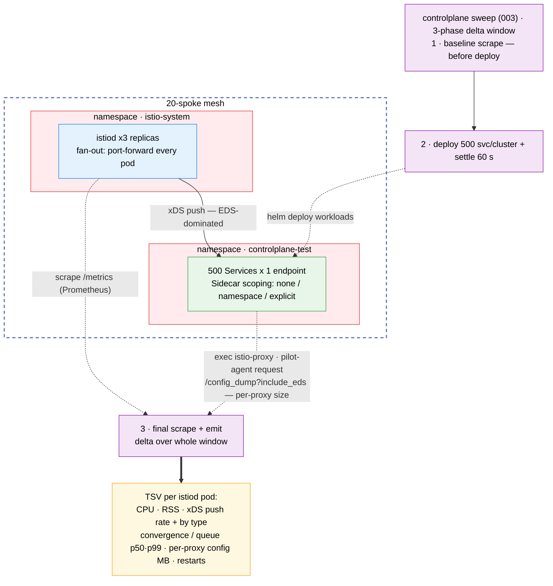

# Control-Plane Resource Scaling Test Suite

Measures istiod CPU, memory and xDS activity as a function of mesh size, service count,
replicas, namespace count, `Sidecar` CR scoping and traffic management (bare services, or
a VirtualService and DestinationRule per service). Growth mode measures how thousands of
namespaces with a few services each drive istiod, proxy and gateway cost
([Namespace scaling](#namespace-scaling-growth-mode)).

## Architecture

> Diagram conventions (arrow styles, box colors) are shared across all suites — see
> [`docs/scale-test-campaign/architecture.md`](../../docs/scale-test-campaign/architecture.md#diagram-conventions).



## What it measures

One TSV row per istiod pod, computed as deltas over a wall-clock window:

| Column(s) | Source |
|-----------|--------|
| `istiod_cpu_m_delta`, `istiod_mem_mi` | `process_cpu_seconds_total`, `process_resident_memory_bytes`; peak of window average and 5 s samples (the report labels them `cpu_peak (m)` and `rss_peak (Mi)`; `cpu_avg (m)` there is `istiod_cpu_s_delta` / the window) |
| `convergence_*`, `queue_*` (p50/p99) | `pilot_proxy_convergence_time`, `pilot_proxy_queue_time` histogram deltas |
| `xds_pushes_*` (total, rate, per type) | `pilot_xds_pushes` |
| `k8s_events_*` | `pilot_k8s_cfg_events` |
| `connected_proxies` | `pilot_xds` on this istiod pod, summed over its series. Per replica: a replica with no connections reads `0`; an empty or short scrape reads `N/A` |
| `sidecar_config_bytes_*` | `/config_dump?include_eds` size from sampled sidecars |
| `istiod_restarted` | `process_start_time_seconds` (`0`, `1` or `unknown`) |
| `cluster_connected_proxies` | `pilot_xds` summed over every istiod pod of the context, from the same final scrape. Same value on each row of that context. `N/A` if any pod's scrape is empty or short, or the Running istiod pod set changed during the window |
| `sidecar_pods` | Running, non-terminating pods with the `sidecar.istio.io/status` annotation on the context (injected gateways included), read right after the final scrape |
| `proxy_check` | `OK`, `LOW` or `HIGH` when `cluster_connected_proxies` and `sidecar_pods` differ by more than max(`CONTROLPLANE_PROXY_CHECK_TOLERANCE_PCT`, default 10 %, `CONTROLPLANE_PROXY_CHECK_MIN_DIFF`, default 2); `N/A` if either side is `N/A`. A warning only: the row stays in every statistic |
| `traffic_config`, `vsdr_services` | What `001` deployed: `none` or `vsdr`, and how many services got a VirtualService + DestinationRule (`0` for `none`) |
| `istiod_virt_services` | `pilot_virt_services` at the final scrape: every VirtualService istiod knows, so a vsdr row should show at least `vsdr_services` |
| `push_time_avg_ms`, `pushcontext_init_avg_ms` | Average per observation over the window: Δsum ÷ Δcount of `pilot_xds_push_time` and `pilot_pushcontext_init_seconds`. `N/A` with no observation or after a restart |
| `sidecar_clusters_avg`, `sidecar_cds_bytes_avg`, `sidecar_rds_bytes_avg` | From the same sampled `/config_dump`s: dynamic CDS clusters, and the compact JSON size of the CDS and RDS sections |
| `services_per_namespace`, `workload_mode`, `measurement_pods`, `outside_namespaces`, `outside_discovery`, `window_kind` | What the window measured (growth mode; a legacy row reads `0`, `pods`, services x replicas, `0`, `none`, `deploy`): `window_kind` is `deploy`, `grow`, `probe`, `outside`, `traffic` (a legacy sweep with `--vsdr-apply split`) or `retire` (a `RETIRE_FAILED` status row) |
| `istiod_services` | `pilot_services` at the final scrape (every Service istiod knows; identical on every replica, never summed) |
| `istiod_cpu_s_delta` | Δ`process_cpu_seconds_total` over the window: the window's istiod CPU-seconds (`N/A` after a restart) |
| `sidecar_mem_mi_avg`, `gateway_clusters_max`, `gateway_mem_mi_max`, `root_cert_configmaps` | Growth mode only (`N/A` otherwise): Envoy `server.memory_allocated` of the sampled pods; the largest ingress/east-west gateway's `cluster_manager.active_clusters` and `server.memory_allocated`; `istio-ca-root-cert` ConfigMaps on the context |
| `gateway_physical_mi_max`, `gateway_ws_mi_max` | Growth mode only (schema 66): the largest gateway's Envoy `server.memory_physical_size` (the tcmalloc heap including freed pages it kept) and istio-proxy container working set (`kubectl top`; `N/A` without the metrics API). The working set is what the OOM killer acts on; on ROSA it ran 1.2-2.9x `gateway_mem_mi_max` after config bursts |
| `leftover_test_namespaces` | Growth mode only (schema 66): `controlplane-test` namespaces on the context that are not this series' (earlier series or runs, discovered or not). They stay in istiod's informers, so its absolute heap and RSS are inflated; the report warns above `CONTROLPLANE_LEFTOVER_NS_WARN` (100) |

In a sweep, `003` runs `002 --phase baseline` before deploying, `001` deploys and settles,
then `002 --phase final` scrapes again, so the window covers the deploy push storm. Run
standalone, `002` (`--phase combined`) measures only the `--settle` window.

## Prerequisites

- `oc` or `kubectl`, `helm`, `jq`, `curl`
- GNU `timeout` (on macOS: `brew install coreutils`, which installs it as `gtimeout`): it bounds
  the config-dump and Envoy-stats reads, and a live `002`/`003` stops at startup without it
- A multi-primary mesh (see the root README) and one kube context per mesh member

## Quick start

```bash
# 1. Deploy 10 services x 3 replicas on both clusters
./tests/controlplane/001-setup-controlplane-test.sh --contexts <mesh-a-ctx>,<mesh-b-ctx>

# 2. One 60 s collection window, then the report (it reads every run under the results
#    dir; with more than one there it stops and says how to report one)
./tests/controlplane/002-collect-resource-metrics.sh --contexts <mesh-a-ctx>,<mesh-b-ctx> --settle 60
./tests/controlplane/004-report-results.sh

# 3. Clean up
./tests/controlplane/005-cleanup.sh --contexts <mesh-a-ctx>,<mesh-b-ctx>
```

## Sweep

```bash
./tests/controlplane/003-run-sweep.sh --contexts <mesh-a-ctx>,<mesh-b-ctx> \
  --mesh-sizes 1,2 --service-counts 50 --sidecar-scopings none,namespace,explicit
```

Add `--dry-run` to print the matrix without touching a cluster. The sweep runs the
cross-product of these axes (one CSV flag each):

| Flag | Axis |
|------|------|
| `--mesh-sizes` | Clusters in the measurement (first N of `--contexts`) |
| `--service-counts` | Dummy services per cluster |
| `--replica-counts` | Pods per service |
| `--namespace-counts` | Namespaces the services are spread over (service `i` in namespace `i mod N`) |
| `--sidecar-scopings` | `none` (no Sidecar CRs), `namespace` (one per namespace), `wide` (one per namespace with egress `*/*`), `explicit` (one per Deployment) |
| `--traffic-configs` | `none` (bare services) or `vsdr` (a VirtualService + DestinationRule per configured service); innermost, so each pair runs back to back |

More than `CONTROLPLANE_MAX_MATRIX` (64) combinations needs `--force-large-matrix`.
`--settle` (default 60 s) applies after the deploy and again after each cleanup.
`SCALE_SIZING_MODE=auto` stops the sweep before any change (also under `--dry-run`): `001`
would deploy a capacity-derived service count while every row records `--service-counts`.
Keep it `fixed` and pick `--service-counts`; auto is for a standalone `001`.
`--resume tests/controlplane/results/sweep-<RUN_ID>` (or a symlink to it, such as `latest`; any
other directory is refused) continues an interrupted sweep and skips combos that already have a
valid row. It never re-runs such a cell, also when it failed partway (a valid row, then a status
row: the outcome counts it failed, and its skip line says so), because the report would pool the
rows of two attempts; to measure it again, start a new sweep with only that cell. Each row
records its own axis values, but some scalars are recorded only once, in the TSV preamble, so
they must match on resume: `--vsdr-every` and `--vsdr-subsets` (when the resumed run has `vsdr`
cells) and `CONTROLPLANE_PROXY_CHECK_*`. The sweep reads them from the preamble and prints a
note when that changes a value. It refuses an explicit `--vsdr-every` or `--vsdr-subsets` that
differs. It refuses `--contexts` that do not name the members the sweep started on, in the same
order, each once (the preamble lists them, in that order, in `ISTIO_ACTIVE_REVISIONS`, else
`ISTIO_VERSION_BY_CONTEXT`; the refusal prints the `--contexts` to use): mesh size N measures
the first N contexts, so other members or another order would measure other clusters. A resume
cannot add members to reach a larger mesh size either (the preamble does not cover them): start
a new sweep for that. It also refuses a mesh that now runs another Istio version than the
`ISTIO_VERSION` the sweep recorded, under either `ISTIO_VERSION_CHECK` policy: the new rows
would be credited to the old version, so start a new sweep. So does a member whose active
revision (`activeRevisionName`, recorded as `ISTIO_ACTIVE_REVISIONS`) is not the one the sweep
started on, at the same version; a TSV from before that key is resumed with a note that it could
not be checked. A sweep that recorded `unknown` (a member could not be read or confirmed when it
started: unreadable, its Istio CR not settled, or an istiod rollout in progress) can never be
resumed, and `--resume` says so before it reads the mesh; when a member cannot be read now, fix
access to it and run the same `--resume` again. Nor can a sweep whose `sweep-outcome.txt` (or
`sweep-outcome.prev.txt`) records a `PROBLEM`: each one says the Istio version or active
revision changed under the sweep, or the end-of-sweep version check failed, so its rows are not
all from one version (or that is not known), and a resume would write an outcome without it.
(The `PROBLEM` that the cells could not be counted is no such problem: every run counts them
again.) A `NOTE` of an earlier run about the end of the sweep (its version unconfirmed, istiod
or IstioCNI not ready) is carried into the resume's outcome, once, as `an earlier run of this
sweep (outcome of <DATE>) noted: ...`, where `<DATE>` is that outcome's `# DATE=` line (UTC).
Once its preflights pass, a resume moves the earlier `sweep-outcome.txt` to
`sweep-outcome.prev.txt`, which stays until the next resume replaces it; until the resume writes
its own, reports show the earlier one from there, after a warning that the last `--resume` has
not finished (json: `"resume_unfinished": true`). The TSV preamble keeps the first run's
`ISTIO_NOTREADY_AT_START` and `HARNESS_SHA`; every resume's outcome repeats a first run that
started not ready as a note, dated with the preamble's first line. The resume's own start
condition, `none` included, goes into a note of its sweep outcome
(`ISTIO_NOTREADY_AT_RESUME=...`) with its start time, in the format of the rows' `timestamp`
column, so its first rows can be found by it. Each resume that passes its preflights also
appends a line to `resumes.txt` in the sweep directory (`RESUMED_AT`, `HARNESS_SHA`,
`ISTIO_NOTREADY_AT_RESUME`, `KUBE_VERSIONS`), which no later run rewrites, so every resume's
start, harness, readiness and Kubernetes versions survive the resumes after it, also when it
died. The outcome notes, from that file, every earlier resume that started with a member not
ready, every resume whose `HARNESS_SHA` is `unknown`, every harness change (with the times
between which the rows are that harness's), and every resume that read other Kubernetes server
versions than the last known ones (the preamble's `KUBE_VERSIONS`, then each resume's, members
`unreachable` or `unknown` left out; grouped by old and new version); a resume that runs another
`HARNESS_SHA` than the last known one before it, or `unknown`, or reads other Kubernetes server
versions, also warns. `HARNESS_SHA` is `git describe --dirty`: two different uncommitted trees
on the same commit both record `<sha>-dirty`, so this check cannot tell them apart; commit
before a resume when that matters. Pass the other options as in the original run. Each axis
lists a value once (`--service-counts 5,5` is refused): a repeated value would run the same
cells twice.
`--config-dump-samples 0` skips the per-sidecar exec.

Exit codes: `0` every cell ran; `1` the sweep stopped (a bad flag or precondition, an unexpected
error, or `RETIRE_FAILED`, after its reports); `4` it finished and wrote its reports, but some
cells failed (a status row instead of a measurement: `SETUP_FAILED`, `PROBE_FAILED`,
`GROW_FAILED`, `SWITCH_FAILED`), or the Istio version or active revision changed during the
sweep (read again before the reports), or that end-of-sweep version check failed, or the cells
could not be counted (the rows are intact: the same `--resume` again counts them). The
last line on stderr says how many, by reason, out of every cell of the TSV and of this run's
matrix, and how many of them failed partway (a `--resume` skips those again). A cell counts
once, by its last row in the TSV: a status row fails it, with that reason (also after some
contexts' rows: a cell that failed partway); a measurement, a `--resume`'s retry included, does
not, as in a fresh run. `1` wins over `4`.
Cells the memory guard skipped (`SKIPPED_MEM_GUARD`, and `SKIPPED_SERIES_STOPPED` after it) are
counted apart, as skipped on purpose, and do not make it `4`. `sweep-outcome.txt` in the sweep
dir, the end of the markdown summary and the end of the scale envelope keep the outcome.

**More than one namespace:** namespaces are named `controlplane-test-0..N-1`. With
scoping `none`, the root `Sidecar` egress hosts must list each one (they match namespaces
exactly), so `001` stops unless they are in `charts/spoke-ossm/values.yaml`
`tuningBaseline.sidecar.egressHosts` (or egress is `*/*`). `namespace` and `explicit`
scoping bring their own `Sidecar`s, so they need no change.

## Run config (`--config FILE`)

Every script (`001`-`005`) takes `--config FILE`, a file of `KEY=value` lines, so one file
describes a whole run: setup, collection, sweep, report and cleanup. The rules shared by every
suite (syntax, precedence, environment-only keys, provenance) are in
[Run config](../../README.md#run-config---config-file).
[`configs/smoke.env`](configs/smoke.env) is a worked example (5 services × 2 replicas, mesh
sizes 1 and 2, scoping `none` and `namespace`, a 20 s window):

```bash
./tests/controlplane/003-run-sweep.sh --config tests/controlplane/configs/smoke.env --dry-run
./tests/controlplane/003-run-sweep.sh --config tests/controlplane/configs/smoke.env
./tests/controlplane/004-report-results.sh --config tests/controlplane/configs/smoke.env \
  --results-dir tests/controlplane/results/smoke/sweep-<RUN_ID> --format markdown
./tests/controlplane/005-cleanup.sh --config tests/controlplane/configs/smoke.env
```

- **Keys:** `SETUP_CONTEXTS` and the `config/options.env` keys that start with
  `CONTROLPLANE_`, `SCALE_`, `METRICS_`, `FANOUT_` or `CAP_`. A step ignores the keys it
  does not use. Environment only: `CONTROLPLANE_TEST_NAMESPACE` (`005` deletes it),
  `CONTROLPLANE_MAX_MATRIX` (the `--force-large-matrix` acknowledgment stays per run),
  `ISTIO_VERSION_CHECK`, `ISTIO_VERSION_READY_WAIT_SEC` / `_POLL_SEC` and the version
  pins. Any other key, or any bad line, rejects the whole file before anything runs, with
  `file:line` and the reason.
- **Precedence:** flag > `--config` > environment > default. The file loads before
  `options.env`, so the defaults derived there follow it: a config
  `CONTROLPLANE_NS_DELETE_TIMEOUT_SEC` also sets `001`'s namespace wait unless
  `CONTROLPLANE_SETUP_NS_WAIT_SEC` is set. Each key is logged on stderr, with the
  environment value it overrides. `KEY=` (empty) means the built-in default.
- **One value or a list:** `001` and `002` read one value per axis
  (`CONTROLPLANE_SERVICE_COUNT`, `..._REPLICAS_PER_SERVICE`, `..._NAMESPACE_COUNT`,
  `..._SIDECAR_SCOPING`, `..._TRAFFIC_CONFIG`). The sweep reads the CSV keys
  `CONTROLPLANE_MESH_SIZES` (empty: 1 to the number of contexts), `..._SERVICE_COUNTS`,
  `..._REPLICA_COUNTS`, `..._NAMESPACE_COUNTS`, `..._SIDECAR_SCOPINGS` and
  `..._TRAFFIC_CONFIGS`; each falls back to its one-value key. A list key exported in the
  environment beats a one-value key in the file.
- **Other run keys:** `CONTROLPLANE_SETTLE_SEC` (`--settle`), `CONTROLPLANE_RESULTS_DIR`
  (`--output-dir`, `--results-dir`; a relative path starts at the repo root, unlike the
  flags) and `CONTROLPLANE_WAIT_TIMEOUT_SEC` (`001 --wait-timeout`, which a sweep now
  honors too).
- **No key (flags only):** `--dry-run`, `--resume`, `--force-large-matrix`, `--format`,
  `--allow-multi-run` (`004`), `--phase`, `--state-dir`, `--run-id`, `--watch`, `--interval`
  and `--mesh-size`.
- **Provenance:** the TSV preamble records `RUN_CONFIG` (the file's path from the repo root,
  or only its name outside the repo; `none` without `--config`) and `RUN_CONFIG_SHA256`, and
  every report format repeats them. A sweep also copies the file to
  `sweep-<RUN_ID>/run-config-<RUN_ID>.env`. `--resume` keeps the provenance the sweep
  started with, so a sweep that started with `--config` resumes only with the same file
  (same sha256): it refuses no `--config` and a different one, and names the snapshot
  (`--config <sweep-dir>/run-config-<RUN_ID>.env`); for another config, start a new sweep.
  A sweep that started without `--config` (`RUN_CONFIG=none`) resumes with one after a
  warning. The report prints `unknown` for files
  written before these keys existed, and `mixed:<a>,<b>` with a warning when the inputs
  disagree. A results dir with more than one run (each `sweep-*` directory is one; outside
  one, each `RUN_ID`) stops `004`, which lists the runs and the `--results-dir` that reports
  each alone; `--allow-multi-run` pools them on purpose (the calibration below), and every
  format then says it pools N runs. Every report also lists the distinct `RUN_ID`,
  `ISTIO_VERSION` and `HARNESS_SHA` of all its input files (`run_ids`, `istio_versions`,
  `harness_shas` in all four formats); with more than one run `run_id` reads `multiple`. Inputs from different Istio versions or harness commits print a
  `WARNING` (stderr and every format) and read `mixed:<a>,<b>`.

## Traffic management (VS/DR)

`--traffic-configs none,vsdr` measures what VirtualServices and DestinationRules add on
top of the same services. It is off by default (`none`), and a `none` render is the same
as before. For each configured service (`--vsdr-every N`: service `i` when `i mod N == 0`,
default every service) the chart adds, in the service's namespace:

- a VirtualService with one route that splits traffic by weight across the subsets, a 5 s
  timeout and 3 retries;
- a DestinationRule with `--vsdr-subsets` subsets (default 2), a connection pool and
  outlier detection.

Each subset has to select real pods, so that service's replicas are split over one
Deployment per subset (`dummy-svc-<i>-v1..vN`, label `version=v<k>`). The pod and endpoint
counts do not change (only the pods' `version` label does), so `--vsdr-subsets` must be at
most every `--replica-counts` value. `001` checks that the VirtualServices and
DestinationRules exist (`SETUP_FAILED` otherwise).

The markdown report pairs each vsdr cell with the none cell of the same mesh, services,
replicas, namespaces and scoping (section "Traffic management (VS/DR) effect"): istiod
cost, and per-proxy CDS clusters next to the expected extra clusters (VS+DR services ×
subsets, one CDS cluster per subset). It warns when istiod knows fewer VirtualServices
than were configured. The vsdr cell runs right after its none cell and istiod RSS does not
shrink after GC, so compare heap in use, or run again with `--traffic-configs vsdr,none`.

`--vsdr-apply split` (`CONTROLPLANE_VSDR_APPLY`) separates the VS/DR cost from pod
startup: `001 --parts workloads` applies everything but the VirtualServices and
DestinationRules and waits for Ready before the baseline, then the window covers only
`001 --parts traffic` (rows `window_kind traffic`; a `none` cell's window is then idle over
the same workloads). With the default `together`, the subset pods start while the VS/DR
already exist, which can push the convergence p99 into a higher bucket; on ROSA the vsdr
cells at 150-250 Services read 10-20 s (BACKLOG 9.11). Compare the two modes at the same
size to tell a harness artifact from a real cost.
Run `005` before switching `--traffic-config` by hand with `001`: an in-place re-apply
leaves the other mode's Deployments running.

## Namespace scaling (growth mode)

How does namespace count drive istiod and proxy cost in a mesh of thousands of namespaces
with one or a few services each? `--services-per-namespaces K` (any K > 0) turns `003`
into growth series and `--namespace-counts` into the ladder of N. Namespace n holds
`dummy-svc-0..K-1` (the chart's block layout), so adding namespaces never moves a Service.

```bash
./tests/controlplane/003-run-sweep.sh --config tests/controlplane/configs/ns-scaling-lab.env --contexts <mesh-a-ctx> --dry-run
```

- **In place** (`--growth in-place`, default). One series grows the namespaces
  `controlplane-test-<series>-<n>` step by step. At each N:
  - a `grow` window: baseline, `001` adds namespaces N_prev..N-1, settle, final. Grow rows
    are always measured under `namespace` scoping (the series is switched back first);
    the report divides their istiod CPU-seconds by the namespaces added (onboarding cost).
  - per scoping (the one the series already has first): the series' Sidecars are switched
    in place (`001 --parts sidecars`), the sweep settles, then a `probe` window: baseline,
    one more namespace with K Services and the scoping's Sidecar but no pod (PL30),
    `--probe-settle`, final. `005 --probe` then
    deletes the probe's Services and Sidecar, drops its discovery labels and queues the
    empty namespace's delete, and the probe settle runs again before the next baseline.
    A probe window measures the cost of one more namespace at N, not a deploy storm
    (PL24).
  - after the last step come the outside phase and the M-sweep, then `--series-retire`.
- **Fresh** (`--growth fresh`). Every N x scoping cell is deployed and deleted like the
  legacy sweep (`window_kind=deploy`), each under its own series id. Use it at a small N
  to check that in-place growth matches a fresh deploy (report table "Fresh vs in-place",
  PL34) and for the pods-mode calibration.
- **Scoping.** `namespace` (own namespace and `istio-system`); `wide` (a per-namespace
  Sidecar with egress `*/*`: the unscoped worst case, without touching the GitOps root
  Sidecar); `none` (no test Sidecar, so the live root Sidecar governs; `001` requires it to
  keep `./*`, which makes `none` close to `namespace`, so skip it at scale). `explicit`
  and `vsdr` are not supported in growth mode.
- **Workload.** `config-only` runs Services without pods plus M measurement pods (one in
  each of namespaces 0..M-1, istio-proxy limit `CONTROLPLANE_MEASUREMENT_PROXY_MEM_LIMIT`),
  so thousands of namespaces fit a node's pod budget. It leaves out endpoint churn and
  pushes to a proxy in every namespace: the report's "Pods vs config-only" table is
  required and reads "not measured" until a `pods` cell exists at the same N, K and
  scoping. Calibrate with two `--growth fresh` sweeps at one small N into the same results
  base, one config-only and one `--workload-mode pods --replica-counts 1` (both with
  `--namespace-counts 30 --sidecar-scopings namespace --outside-modes none`), then report
  the base dir with `--allow-multi-run` rather than one `sweep-<RUN_ID>`;
  `configs/ns-scaling-lab.env` has the
  commands. That report names the runs behind each side of a pair (`run=` in the row
  label, `config_only_run_ids`/`pods_run_ids` in JSON) and warns if the sweeps differ in
  Istio version or harness commit. Window deltas (`istiod_cpu_s`, `xds_pushes`, `pushes_per_proxy`) are compared
  only between cells of the same window kind; across kinds they read N/A and only the
  gauges compare.
- **M-sweep.** `--measurement-pod-counts 4,16` re-probes every scoping at the largest N
  with 16 measurement pods. Heap that grows with M is a cost per namespace with proxies,
  which config-only undercounts. The report takes it from `heap_inuse` summed over a
  cluster's istiod replicas (a namespace's SidecarScope lives on the replica its proxy
  connects to, so a per-replica average would read the cost / replicas) and prints the
  istiod replica count next to the table.
- **Outside the mesh** (`discoverySelectors`). `--outside-namespaces X --outside-modes
  unlabeled,labeled` adds, at the largest N, X namespaces with K Services each and no
  `istio.io/rev`: first without the `istio-discovery=enabled` label (istiod must not see
  them), then labeled (istiod must gain X x K Services). Each phase has an `outside`
  window and a probe per scoping, and the report checks the istiod Service count against
  both expectations (PL31).
- **Memory stop guard.** Before each step, scoping switch and outside phase, `003` samples
  every guard context: `--contexts` plus `SETUP_CONTEXTS` (or `CONTROLPLANE_MEM_GUARD_CONTEXTS`),
  since every member ingests the Services through remote discovery and gateways keep `*/*`
  (PL38). A live sweep also adds every member the measured contexts' Istio remote secrets
  name (context names equal cluster names in the repo's kubeconfigs) and stops when a
  member has no kube context of that name; with `--mem-guard-contexts` it only warns.
  - What it compares with the limit is what the OOM killer acts on: istiod RSS
    (`process_resident_memory_bytes`, max over replicas, per-replica limit) and each
    gateway's istio-proxy container working set (`kubectl top`; else Envoy
    `server.memory_physical_size`, else `server.memory_allocated`). On ROSA the east-west
    gateway's working set ran 1.2-2.9x its allocated memory after config bursts.
  - Two projections, the larger counts. Relative: `base + (current - base) x ratio` from
    the series' starting baseline (`ratio²` for `wide`, from the last wide measurement);
    ratio 1 for the first step and changes that add no Services. Absolute, for gateways:
    `(CONTROLPLANE_GW_MI_INTERCEPT + Mi per 1000 Services x Services after the step / 1000)
    x burst factor`, with the Services from istiod's `pilot_services` plus what the step adds
    (east-west 145 Mi and x2.5, ingress 91 Mi and x1.2; `CONTROLPLANE_{EWGW,INGW}_*`), plus,
    for a working-set reading, the container's memory outside Envoy's heap (working set
    minus `server.memory_physical_size`: pilot-agent, the binary, page cache). The
    absolute projection guards a series' first step (a 0 -> 4000-Service step left a 1.1 GiB
    working set under a 1Gi limit on ROSA) and a base inflated by memory Envoy kept from an
    earlier series. Calibrated on ROSA at 10k Services: a one-step burst peaked at 2.4x the
    model's allocated memory in working set, a 5-step ladder at 2.1x, so x2.5 projects a burst
    about 6% high and a ladder about 30% high; at the 70% stop the chart's 5Gi east-west
    gateway guards a fresh step up to about 9700 Services (10k Services, and a ladder's last
    step with its non-heap memory added, need `--mem-stop-pct 80`). When a gateway's Envoy allocated memory at the series start is far above
    the model for the Services the mesh has (x1.5 + 100 Mi), a WARNING says to restart the
    gateways first.
  - A cell projected above `CONTROLPLANE_MEM_STOP_PCT` (70 %) of a limit becomes a
    `SKIPPED_MEM_GUARD` row, and a skipped grow ends the series. `mem-guard-<RUN_ID>.tsv`
    (`GUARD_SCHEMA=2`) records every decision with both projections; prove the guard fires
    with `--mem-stop-pct 5` (PL33).
- **Leftover test namespaces.** A live growth sweep counts the `controlplane-test`
  namespaces on the measured contexts first: one that is still discovered stops it (its
  Services would be in every cell); undiscovered ones above `CONTROLPLANE_LEFTOVER_NS_WARN`
  (100) warn, because istiod's informers keep them and its absolute heap and RSS read high
  (deltas within a series stay valid). Each series start is logged
  (`ns-lifecycle-<RUN_ID>.tsv` action `leftover-check`), every row carries
  `leftover_test_namespaces`, and the report warns per run. Delete leftovers between sweeps
  for absolute numbers.
- **End of a series** (`--series-retire`). `undiscover` (default) deletes the measurement
  pods and the series' Sidecars and drops `istio-discovery` and `istio.io/rev`, keeping
  the namespaces (`005 --series ID --undiscover --no-delete`); `delete` also queues the
  namespace deletes without waiting (lab only); `keep` leaves the series discovered (one
  series per sweep only). `undiscover` and `delete` are retried
  (`CONTROLPLANE_RETIRE_ATTEMPTS`, 3) and verified: if a namespace of the series is still
  discovered afterwards, the sweep records `RETIRE_FAILED`, runs no later series and exits 1
  after its report, which warns in every format. `--growth fresh` verifies each cell's
  delete the same way. OpenShift deletes namespaces at roughly 0.3-1 per second, so delete
  them later with `005 [--series ID] --timeout <about 1 s per namespace>` (it prints the
  rate), never inside a measurement window.
- **Rows and failures.** Every step is wrapped (PL32): `GROW_FAILED` (ends the series; its
  remaining cells read `SKIPPED_SERIES_STOPPED`), `SWITCH_FAILED`, `SETUP_FAILED`,
  `PROBE_FAILED`, `SKIPPED_MEM_GUARD`, `RETIRE_FAILED` (window `retire`; stops the sweep).
  `--resume` is not supported for growth series.
- **Plan.** `--dry-run` prints each series' steps and cells, the objects per step, the peak
  and the later deletion time (`CONTROLPLANE_NS_DELETE_SEC_PER_NS`); the matrix cap
  (`CONTROLPLANE_MAX_MATRIX`) counts growth cells.
- **Lifecycle.** `ns-lifecycle-<RUN_ID>.tsv` records each apply, readiness wait, switch,
  probe teardown and delete with its duration, objects/s and namespaces/s. 001 runs its
  applies and Sidecar deletes at `kubectl -v=4`, because client-go retries an API 429
  (with Retry-After, as API Priority and Fairness sends it) without printing anything at
  the default verbosity: `api_429_retried` counts those retries, `api_429_exhausted` the
  429s left after them, `client_throttle_waits` client-side rate-limiter waits. Readiness
  waits and 005's deletes record `N/A` (not measured).
- **Report.** A series is one sweep's RUN_ID x mesh size x K x workload (003 refuses a
  repeated mesh size or K). Its cells, grow ladder (N_prev) and fits never pool with another
  run's, even at the same N, so a base-dir report over several sweeps (`--allow-multi-run`; a smoke run next to
  the main series) fits each series on its own and labels it `run=<RUN_ID>` (`run_id` in
  the JSON records, `series_run_id` per cell). Only the pods-vs-config-only and
  fresh-vs-in-place tables pair cells of different sweeps, as they must; they name each
  side's run and, when several runs have a candidate cell, take the latest.
  The "Namespace scaling" section (all four formats) fits each series x
  scoping x window against N: slope per 100 namespaces, intercept, R², n and the log-log
  exponent (1 linear, 2 quadratic), with the raw points, for istiod heap and RSS, Services,
  CPU-seconds, per-proxy config (KiB) and Envoy memory, gateway clusters and memory (allocated, physical, working set), pushes,
  pushes per proxy (per istiod replica), push KiB, push time, PushContext init, convergence
  p99 and root-cert ConfigMaps. A grow window adds N - N_prev namespaces, so its window
  deltas are fitted per namespace added (`onboard_cpu_s_per_ns`, `onboard_pushes_per_ns`,
  `onboard_pushes_per_proxy_per_ns`, `onboard_push_kib_per_ns`; N_prev is the previous grow
  step of the same series, valid or not), never raw. The first grow window of a series (from 0 namespaces)
  stays out of every grow fit of a window measurement (the `onboard_*` deltas, push time,
  PushContext init, convergence p99): it also creates and waits for the M measurement pods
  (certificates, initial full pushes, endpoint updates), which no later step repeats
  (PL30); its gauges are fitted. Convergence p99 points need at least 120 xDS pushes per
  istiod replica in the window, counted across xDS types: istiod counts a push once per
  type a proxy watches (CDS, EDS, LDS, RDS, NDS) but records one convergence sample per
  proxy push, so that is about 30 full pushes, at least about 24 samples. Then the tables
  pods vs config-only, the M-sweep, discovery and fresh vs in-place, and "Cells not measured": every
  `SKIPPED_MEM_GUARD`, `SKIPPED_SERIES_STOPPED` or failed cell with its N, window and
  scoping (guard decisions are in `mem-guard-<RUN_ID>.tsv`). Those status rows are named
  apart from istiod restarts in the per-cell table, its footnote and the SLA headline.
  Fits use cells with `n_valid > 0` only and `heap_inuse` rather than RSS, which never
  shrinks in place.
- **Examples.** [`configs/ns-scaling-lab.env`](configs/ns-scaling-lab.env) (lab shape
  check up to N=400 and 200 outside namespaces) and
  [`configs/ns-scaling-rosa.env`](configs/ns-scaling-rosa.env) (customer scale: N up to
  4000 and 2000 outside, istiod sized for it).

## Outputs

Results go to `tests/controlplane/results/` (a sweep uses `results/sweep-<RUN_ID>/`):

- `controlplane-<RUN_ID>.tsv`: `# KEY=value` provenance preamble (`CONTROLPLANE_SCHEMA=66`,
  `PROXY_CHECK_TOLERANCE_PCT`, `PROXY_CHECK_MIN_DIFF`, `TRAFFIC_CONFIG`, `VSDR_EVERY`,
  `VSDR_SUBSETS`, `VSDR_APPLY`, `RUN_CONFIG`, `RUN_CONFIG_SHA256`, the namespace-scaling keys
  `SERVICES_PER_NAMESPACE`, `GROWTH_MODE`, `WORKLOAD_MODE`, `MEASUREMENT_PODS`,
  `OUTSIDE_*`, `PROBE_SETTLE_SEC`, `MEM_STOP_PCT`, `MEM_GUARD_CONTEXTS`, `SERIES_RETIRE`,
  `DISCOVERY_LABEL`, `LEFTOVER_TEST_NAMESPACES`, `LEFTOVER_NS_WARN`, ...), then the
  66-column rows. The report also reads the 63-, 51- and 40-column files of earlier
  versions (their newer columns read N/A).
- `ns-lifecycle-<RUN_ID>.tsv`, `mem-guard-<RUN_ID>.tsv` (growth sweeps): namespace
  lifecycle timings and the memory guard's decisions.
- `run-config-<RUN_ID>.env` (sweep with `--config` only): a copy of the run config.
- `sweep-<RUN_ID>.md`, `sweep-charts-<RUN_ID>.md`: report markdown and charts.
- `scale-envelope-<RUN_ID>.md`: campaign scale envelope, led by the customer SLA verdict
  (`PASS`, `CAUTION` at 75 % of a limit, `FAIL` at 90 % or on any istiod restart). Its
  `partial coverage` `CAUTION` counts rows (attempts), so a cell that failed and then ran on
  a `--resume` still counts there; `sweep-outcome.txt` is the cell-level verdict. Do not
  rerun a sweep only to clear that `CAUTION`.
- `sweep-outcome.txt` (sweep): the outcome, also at the end of the markdown summary and of
  the envelope. After a `# DATE=` line (UTC, when it was written), its keys: `RUN_ID`,
  `HARNESS_SHA`, `EXIT`, `STOPPED`, `STOP_REASON`, `UNIT`, `TOTAL`, `FAILED` and `SKIPPED`
  (each `unknown` when the cells could not be counted), `FAILED_BY`, `SKIPPED_BY`, then a
  `PROBLEM=`, `NOTE=` or `INFO=` line each. `sweep-outcome.prev.txt`: the one before it, moved
  there by a `--resume`; it stays until the next resume replaces it.
- `resumes.txt` (sweep, after a `--resume`): one line per resume (`RESUMED_AT`,
  `HARNESS_SHA`, `ISTIO_NOTREADY_AT_RESUME`, `KUBE_VERSIONS`), appended, never rewritten.

`004-report-results.sh --format text|csv|json|markdown|md|charts` groups rows by the six
axes; the markdown ends with a glossary of every column. Rows with `istiod_restarted` other
than `0` are counted in `n_total` but excluded from the statistics (`n_valid`). A failed
combo is recorded as a row whose `context` is `SETUP_FAILED` or `PROBE_FAILED`; a context
with no running istiod pod gets an all-`N/A` row with `istiod_restarted=unknown`.

Connected proxies appear twice. `connected_proxies per istiod replica (max)` is the busiest
single replica, so with R replicas it is about 1/R of the cluster. R is read on every
context: `istiod replicas` reads `3 per cluster`, or `1-3 per cluster (varies by cluster)`
when the members differ, with the per-context counts in `ISTIOD_REPLICAS_BY_CONTEXT`
(`CONTROLPLANE_INFRA_SCHEMA=2`; an older TSV says `(first context only)`). `connected_proxies per
cluster (max)` is the peak `cluster_connected_proxies`, counted once per cluster scrape and
only when no row of that scrape restarted. The proxy check tallies cluster scrapes as
ok/low/high/n/a/excluded; any low or high prints a `WARNING` line naming
`<context>@<timestamp>` (text and CSV, a `**Warning:**` note in markdown, `proxy_check` in
JSON). It never changes the exit code. The report also reads 40-column TSVs from before this
check; they add nothing to the per-cluster or VS/DR figures and their rows count as traffic
`none`. `--resume` refuses a sweep whose TSV has a different column count.

After each window, `002` reads its rows back. For every context with `istiod_restarted` `1`
or `unknown`, it saves the restart evidence to `istiod-diag-<RUN_ID>/` next to the TSV
(`tests/lib/istiod-diag.sh`; contents, settings and redaction in the
[dataplane README](../dataplane/README.md#restart-evidence-istiod-diag-run_id)). Here a
replaced or deleted istiod pod shows as `unknown`, not `1`: the pod list is pinned at the
baseline, so the old pod's final scrape fails and the new pod is never scraped. The index
says which it was (`replaced_gone` plus `new_pod`, or `restarted_in_place`). Index rows
join the TSV on context and window: the tag is `w<timestamp>` (the row's `timestamp`
without `-`, `:` and the offset, for example `w20261013T122310Z`). A context with no
istiod pod gets trigger `no_running_pods`. With every row `0` there is no extra API call.
The report section is not in `004` yet. The capture's settings, the `ISTIOD_DIAG_*` keys,
are also run-config keys here (`--config`), next to the prefixes listed under "Run config".

## Watch mode

```bash
./tests/controlplane/002-collect-resource-metrics.sh --contexts <mesh-a-ctx>,<mesh-b-ctx> --watch --interval 15
```

Each row is a per-window delta over `--interval` seconds.

## Limitations

- Histogram quantiles resolve only to istiod's buckets (100, 500, 1000 ms, ...); the
  report shows bucket ranges such as `100-500`.
- Each sweep point is one window; rerun the sweep for more samples.
- Services are spread evenly across namespaces; real meshes are skewed.
- Utilization-% columns need the metrics API (`kubectl top`); without it they are `N/A`.
  Node columns count worker nodes, including control-plane nodes that also carry the
  worker role (single-node and compact clusters).
- Raise `METRICS_SCRAPE_TIMEOUT` (default 30 s) if `/metrics` scrapes time out at scale.
- `sidecar_pods` is read a few seconds after the `pilot_xds` scrape, from the same 5 s pod
  list as `pods_scheduled`. Pods starting or stopping in between, or proxies not yet
  connected, can flag `LOW`/`HIGH`; a timed-out list makes `sidecar_pods` and `proxy_check`
  `N/A`.
- VS/DR load grows only with pod-backed services, so a small cluster limits it (a lab of a
  few dozen pods is a functional check, not a measurement of istiod cost).
- With `--vsdr-every` a multiple of `--namespace-counts`, every configured service lands in
  namespace 0 (service `i` lives in namespace `i mod N`).
- Gateways also get the DestinationRule subset clusters, but only workload sidecars are
  sampled.
- Growth mode measures each cell once, and in config-only mode only a few proxies: per-proxy
  values come from the measurement pods, and convergence quantiles from so few proxies are
  thin (O2), so prefer push time and PushContext init. The pods-vs-config-only table bounds
  what config-only leaves out.
