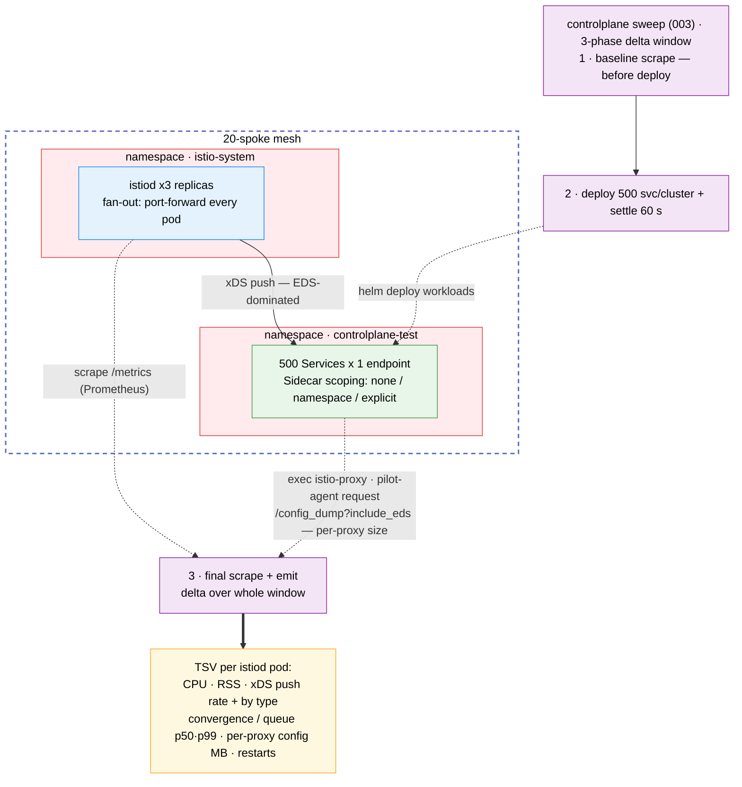

# Control-Plane Resource Scaling Test Suite

Measures istiod CPU, memory and xDS activity as a function of mesh size, service count,
replicas, namespace count and `Sidecar` CR scoping.

## Architecture

> Diagram conventions (arrow styles, box colors) are shared across all suites — see
> [`docs/scale-test-campaign/architecture.md`](../../docs/scale-test-campaign/architecture.md#diagram-conventions).



## What it measures

One TSV row per istiod pod, computed as deltas over a wall-clock window:

| Column(s) | Source |
|-----------|--------|
| `istiod_cpu_m_delta`, `istiod_mem_mi` | `process_cpu_seconds_total`, `process_resident_memory_bytes`; peak of window average and 5 s samples |
| `convergence_*`, `queue_*` (p50/p99) | `pilot_proxy_convergence_time`, `pilot_proxy_queue_time` histogram deltas |
| `xds_pushes_*` (total, rate, per type) | `pilot_xds_pushes` |
| `k8s_events_*` | `pilot_k8s_cfg_events` |
| `connected_proxies` | `pilot_xds` on this istiod pod, summed over its series. Per replica: a replica with no connections reads `0`; an empty or short scrape reads `N/A` |
| `sidecar_config_bytes_*` | `/config_dump?include_eds` size from sampled sidecars |
| `istiod_restarted` | `process_start_time_seconds` (`0`, `1` or `unknown`) |
| `cluster_connected_proxies` | `pilot_xds` summed over every istiod pod of the context, from the same final scrape. Same value on each row of that context. `N/A` if any pod's scrape is empty or short, or the Running istiod pod set changed during the window |
| `sidecar_pods` | Running, non-terminating pods with the `sidecar.istio.io/status` annotation on the context (injected gateways included), read right after the final scrape |
| `proxy_check` | `OK`, `LOW` or `HIGH` when `cluster_connected_proxies` and `sidecar_pods` differ by more than max(`CONTROLPLANE_PROXY_CHECK_TOLERANCE_PCT`, default 10 %, `CONTROLPLANE_PROXY_CHECK_MIN_DIFF`, default 2); `N/A` if either side is `N/A`. A warning only: the row stays in every statistic |

In a sweep, `003` runs `002 --phase baseline` before deploying, `001` deploys and settles,
then `002 --phase final` scrapes again, so the window covers the deploy push storm. Run
standalone, `002` (`--phase combined`) measures only the `--settle` window.

## Prerequisites

- `oc` or `kubectl`, `helm`, `jq`, `curl`
- A multi-primary mesh (see the root README) and one kube context per mesh member

## Quick start

```bash
# 1. Deploy 10 services x 3 replicas on both clusters
./tests/controlplane/001-setup-controlplane-test.sh --contexts <mesh-a-ctx>,<mesh-b-ctx>

# 2. One 60 s collection window, then the report
./tests/controlplane/002-collect-resource-metrics.sh --contexts <mesh-a-ctx>,<mesh-b-ctx> --settle 60
./tests/controlplane/004-report-results.sh

# 3. Clean up
./tests/controlplane/005-cleanup.sh --contexts <mesh-a-ctx>,<mesh-b-ctx>
```

## Sweep

```bash
./tests/controlplane/003-run-sweep.sh --contexts <mesh-a-ctx>,<mesh-b-ctx> \
  --mesh-sizes 1,2 --service-counts 50 --sidecar-scopings none,namespace,explicit
```

Add `--dry-run` to print the matrix without touching a cluster. The sweep runs the
cross-product of these axes (one CSV flag each):

| Flag | Axis |
|------|------|
| `--mesh-sizes` | Clusters in the measurement (first N of `--contexts`) |
| `--service-counts` | Dummy services per cluster |
| `--replica-counts` | Pods per service |
| `--namespace-counts` | Namespaces the services are spread over (service `i` in namespace `i mod N`) |
| `--sidecar-scopings` | `none` (no Sidecar CRs), `namespace` (one per namespace), `explicit` (one per Deployment) |

More than `CONTROLPLANE_MAX_MATRIX` (64) combinations needs `--force-large-matrix`.
`--settle` (default 60 s) applies after the deploy and again after each cleanup.
`--resume tests/controlplane/results/sweep-<RUN_ID>` continues an interrupted sweep and skips combos that
already have a valid row. `--config-dump-samples 0` skips the per-sidecar exec.

**More than one namespace:** namespaces are named `controlplane-test-0..N-1`. With
scoping `none`, the root `Sidecar` egress hosts must list each one (they match namespaces
exactly), so `001` stops unless they are in `charts/spoke-ossm/values.yaml`
`tuningBaseline.sidecar.egressHosts` (or egress is `*/*`). `namespace` and `explicit`
scoping bring their own `Sidecar`s, so they need no change.

## Outputs

Results go to `tests/controlplane/results/` (a sweep uses `results/sweep-<RUN_ID>/`):

- `controlplane-<RUN_ID>.tsv`: `# KEY=value` provenance preamble (`CONTROLPLANE_SCHEMA=43`,
  `PROXY_CHECK_TOLERANCE_PCT`, `PROXY_CHECK_MIN_DIFF`, ...), then the 43-column rows.
- `sweep-<RUN_ID>.md`, `sweep-charts-<RUN_ID>.md`: report markdown and charts.
- `scale-envelope-<RUN_ID>.md`: campaign scale envelope, led by the customer SLA verdict
  (`PASS`, `CAUTION` at 75 % of a limit, `FAIL` at 90 % or on any istiod restart).

`004-report-results.sh --format text|csv|json|markdown|md|charts` groups rows by the five
axes; the markdown ends with a glossary of every column. Rows with `istiod_restarted` other
than `0` are counted in `n_total` but excluded from the statistics (`n_valid`). A failed
combo is recorded as a row whose `context` is `SETUP_FAILED` or `PROBE_FAILED`; a context
with no running istiod pod gets an all-`N/A` row with `istiod_restarted=unknown`.

Connected proxies appear twice. `connected_proxies per istiod replica (max)` is the busiest
single replica, so with R replicas it is about 1/R of the cluster. `connected_proxies per
cluster (max)` is the peak `cluster_connected_proxies`, counted once per cluster scrape and
only when no row of that scrape restarted. The proxy check tallies cluster scrapes as
ok/low/high/n/a/excluded; any low or high prints a `WARNING` line naming
`<context>@<timestamp>` (text and CSV, a `**Warning:**` note in markdown, `proxy_check` in
JSON). It never changes the exit code. The report also reads 40-column TSVs from before this
check; they add nothing to the per-cluster figures. `--resume` refuses a sweep whose TSV has
a different column count.

## Watch mode

```bash
./tests/controlplane/002-collect-resource-metrics.sh --contexts <mesh-a-ctx>,<mesh-b-ctx> --watch --interval 15
```

Each row is a per-window delta over `--interval` seconds.

## Limitations

- Histogram quantiles resolve only to istiod's buckets (100, 500, 1000 ms, ...); the
  report shows bucket ranges such as `100-500`.
- Each sweep point is one window; rerun the sweep for more samples.
- Services are spread evenly across namespaces; real meshes are skewed.
- Utilization-% columns need the metrics API (`kubectl top`); without it they are `N/A`.
  Node columns count worker nodes, including control-plane nodes that also carry the
  worker role (single-node and compact clusters).
- Raise `METRICS_SCRAPE_TIMEOUT` (default 30 s) if `/metrics` scrapes time out at scale.
- `sidecar_pods` is read a few seconds after the `pilot_xds` scrape, from the same 5 s pod
  list as `pods_scheduled`. Pods starting or stopping in between, or proxies not yet
  connected, can flag `LOW`/`HIGH`; a timed-out list makes `sidecar_pods` and `proxy_check`
  `N/A`.
