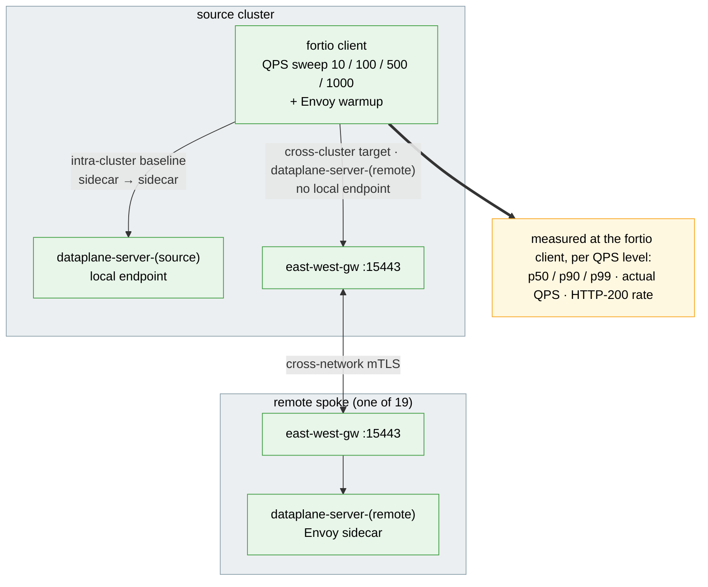

# Cross-Cluster Data-Plane Latency Test Suite

Measures request latency and throughput between sidecars, in-cluster and through the
east-west gateways, using fortio.

## Architecture

> Diagram conventions (arrow styles, box colors) are shared across all suites — see
> [`docs/scale-test-campaign/architecture.md`](../../docs/scale-test-campaign/architecture.md#diagram-conventions).



## What it measures

For each QPS level, `002` runs `fortio load` from the client pod on the source cluster
against each target and records p50/p90/p99/p99.9/max latency, achieved QPS and the share
of HTTP 200 responses.

A load runs inside the client pod, not in the `kubectl exec` that starts it, so it can
outlive that exec. When `002` ends during a load (a stop, Ctrl-C, an error), it deletes
the client pod, so the load cannot run on into the next run's first window: its
Deployment starts a new pod, which a sweep started right after waits for (its setup `001`
waits until the Deployments are Available). Run by hand, `002` loads only a Ready
client pod that is not being deleted, and stops when there is none: run `001`, or wait
until the new pod is Ready. When a load's `kubectl exec` fails part-way (a `FAILED` row,
or a failed warmup), `002` waits until that load's `--duration` (`--warmup-duration` for
the warmup) and 5 s more have passed before it starts the next load, unless the client
pod is gone (deleted, or evicted and Failed: then no load runs).

Every cluster runs `--server-replicas` fortio server pods (default 2,
`DATAPLANE_SERVER_REPLICAS`) labelled `cluster=<ctx>`, and every cluster gets a Service
`dataplane-server-<ctx>` for each context that selects only those pods:

- **local** (`target_class=local`): `dataplane-server-<source>`; the endpoint is in the
  source cluster, so this is the sidecar-to-sidecar baseline (not a no-mesh baseline).
- **remote** (`target_class=remote`): `dataplane-server-<remote>`; there is no local
  endpoint, so traffic crosses the east-west gateways.

The replica count applies to every cluster, so the local target and each remote target
get the same server capacity and "the hop adds X ms" stays a like-for-like comparison.
Only the source's own server takes local traffic, and each remote server takes only
cross-cluster traffic from the source.

A run that does not deliver its target QPS is not a valid latency sample: a saturated
server queues requests and can still answer with HTTP 200. `002` tags such a row
`QPS_SHORTFALL` when actual QPS is below `--min-qps-ratio` × target (default 0.95,
`DATAPLANE_MIN_QPS_RATIO`), and the report drops it from `n_valid`.

## Prerequisites

- `oc` or `kubectl`, `helm`, `jq`, `curl`
- A multi-primary mesh with east-west gateways (see the root README)
- Kube context names must be lowercase DNS labels of at most 46 characters (they become
  Service names); rename others with `kubectl config rename-context`.

## Quick start

```bash
# 1. Servers on both clusters (2 pods each by default), client on the first
./tests/dataplane/001-setup-dataplane-test.sh --source-context <mesh-a-ctx> --remote-contexts <mesh-b-ctx> --server-replicas 2

# 2. Probe (30 s settle, 5 s warmup, then QPS 10/100/500/1000 for 30 s each)
./tests/dataplane/002-run-latency-probe.sh --source-context <mesh-a-ctx> --remote-contexts <mesh-b-ctx>

# 3. Report, then clean up
# (it reads every run under the results dir; with more than one there it stops and
#  lists the --results-dir that reports each, or pools them with --allow-multi-run)
./tests/dataplane/004-report-results.sh
./tests/dataplane/005-cleanup.sh --contexts <mesh-a-ctx>,<mesh-b-ctx>
```

Tune the probe with `--qps-levels 50,200`, `--duration 60`, `--connections 16`,
`--settle 60`, `--warmup-duration 0`, `--min-qps-ratio 0.9`, `--on-unreachable fail`
and `--reach-requests 0` (see [Remote reachability](#remote-reachability)); the sweep
(`003`) takes the same flags plus `--server-replicas` (passed to `001`). `001` re-run with a new
`--server-replicas` scales the servers in place and waits for the rollout. Add
`--dry-run` to `002`, `003` or `005` to print the plan without touching a cluster.

## Sweep across mesh sizes

```bash
./tests/dataplane/003-run-sweep.sh --contexts <mesh-a-ctx>,<mesh-b-ctx> --mesh-sizes 1,2 --repetitions 3
```

For each mesh size the sweep runs `001`, then `002` `--repetitions` times, then `005`,
and writes everything to `tests/dataplane/results/sweep-<RUN_ID>/`, including
`sweep-<RUN_ID>.md` and `sweep-charts-<RUN_ID>.md`. The p50-vs-QPS chart needs one mesh
size with a remote cluster; the p50-vs-mesh-size chart needs two.

Exit codes: `0` every mesh size ran; `1` the sweep stopped (a bad flag or precondition, or an
unexpected error); `130`, `143` or `129` it was interrupted; `3` the reachability gate stopped it
(`--on-unreachable fail`, see below; the reports are written); `4` it finished and wrote its
reports, but some mesh sizes failed (a `SETUP_FAILED` / `PROBE_FAILED` placeholder) or it recorded
a problem ([How a sweep ends](../../README.md#how-a-sweep-ends) has those, and the
`sweep-outcome.txt` record every report repeats). The last line on stderr says how many, by
reason; `3` wins over `4`. When a sweep did not finish and no sweep runs any more, run the sweep
again into a new dir; the rows already in the dir cover only the mesh sizes it finished.

## Run config (`--config FILE`)

Every script takes `--config FILE`, one file of `KEY=value` lines for a whole run (shared
rules: [Run config](../../README.md#run-config---config-file)).
[`configs/smoke.env`](configs/smoke.env) is a worked example (mesh sizes 1 and 2,
QPS 10 and 100, 10 s per level):

```bash
./tests/dataplane/003-run-sweep.sh --config tests/dataplane/configs/smoke.env --dry-run
./tests/dataplane/003-run-sweep.sh --config tests/dataplane/configs/smoke.env
./tests/dataplane/004-report-results.sh --config tests/dataplane/configs/smoke.env \
  --results-dir tests/dataplane/results/smoke/sweep-<RUN_ID> --format markdown
./tests/dataplane/005-cleanup.sh --config tests/dataplane/configs/smoke.env
```

- **Keys:** `SETUP_CONTEXTS` and the `config/options.env` keys `DATAPLANE_*`, `REACH_*`,
  `FANOUT_*`, `ISTIOD_DIAG_*` (restart evidence, below), `TEST_PLATFORM` (the members'
  platform), `PLATFORM_READ_TIMEOUT` (each read of the platform record),
  `PLATFORM_READ_PARALLEL` (members read at once) and `METRICS_SCRAPE_TIMEOUT`.
  `DATAPLANE_TEST_NAMESPACE` and `DATAPLANE_MAX_MATRIX` stay environment only.
- **Run keys:** `DATAPLANE_MESH_SIZES` (`003 --mesh-sizes`; empty: 1 to the number of
  contexts), `DATAPLANE_RESULTS_DIR` (`--output-dir`, `--results-dir`; a relative path starts
  at the repo root, unlike the flags), `DATAPLANE_WAIT_TIMEOUT_SEC` (`001 --wait-timeout`) and
  `DATAPLANE_NS_DELETE_TIMEOUT_SEC` (`005 --deletion-timeout`). `DATAPLANE_QPS_LEVELS` is a
  list for `002` and `003` alike.
- **Flags only:** `--source-context`, `--remote-contexts`, `--mesh-size`,
  `--tuning-baseline` and `--sidecar-egress-hosts` (`001`/`002`; the sweep sets them),
  `--fail-on-unreachable` and `--allow-multi-run` (`004`), `--no-wait-deletion` (`005`),
  `--force-large-matrix`, `--format` and `--dry-run`.

## Remote reachability

A remote that the mesh cannot reach used to show up only as `n_valid < n_total` in the
report, with no name. Before the load, after the settle, `002` now checks every target
from the source's client pod: `--reach-requests` requests (default 10,
`REACH_REQUESTS`) at `REACH_QPS` (10) in total, over `REACH_REQUESTS / 2` parallel
connections, with a `REACH_HTTP_TIMEOUT_SEC` (3 s) timeout to each
`dataplane-server-<ctx>` Service, the local one included. Each target gets one row in
`reach-<RUN_ID>.tsv`:

```
run_id  combo_id  mesh_size  source_ctx  target_ctx  target_class  attempts  requests
ok  pct_200  top_code  reach_status  detail
```

`reach_status` is `REACHABLE` (every response an HTTP 200), `DEGRADED` (some),
`UNREACHABLE` (none) or `UNKNOWN` (the `kubectl exec` failed). A target that is not
`REACHABLE` is checked again `REACH_RETRY_SEC` (10 s) apart, up to `REACH_ATTEMPTS` (3)
checks, because cross-cluster endpoints can lag a fresh setup; `attempts` records how
many ran. `requests` is the responses fortio counted (socket errors are code `-1`), `ok`
the 200s among them, `top_code` the most frequent other code. For a target that is
still not `REACHABLE` after the last check, `detail` holds the first body line of one
`fortio curl` with a `REACH_DETAIL_TIMEOUT_SEC` (35 s) timeout, usually the Envoy reply
(`no healthy upstream`, `upstream connect error ... CERTIFICATE_VERIFY_FAILED`, or
`... connection timeout` for a blackholed east-west gateway); without a reply it holds
fortio's error (`Timeout error ...: i/o timeout`, `Unable to connect ...`). IPv4 and IPv6
addresses become `<ip>` and dotted host names `<host>`. It is a hint: Envoy's wording
varies by version. The blackholed case needs the long timeout: the suite renders no
VirtualService, so the client sidecar uses Istio's default retry policy (two retries,
`connect-failure` among the causes, no per-try timeout) and no route timeout, and Envoy
replies only after three 10 s connect timeouts (`meshConfig.connectTimeout`), about 30 s.
A shorter `REACH_DETAIL_TIMEOUT_SEC` ends on the client side and reads as fortio's
`i/o timeout`; on a mesh that sets `meshConfig.connectTimeout` or
`defaultHttpRetryPolicy`, keep it above (1 + retries) x `connectTimeout`. The file has
its own preamble (`REACH_SCHEMA`,
`RUN_ID`, `HARNESS_SHA`, the `REACH_*` knobs, `ON_UNREACHABLE`, `RUN_CONFIG`,
`RUN_CONFIG_SHA256`), and stderr gets a per-target block ending in
`WARNING: N of M remotes NOT reachable from <source>: ...`.

The check costs about `REACH_REQUESTS / REACH_QPS` (1 s) when every target answers. A
target that never answers (packets dropped) costs at most `REACH_ATTEMPTS x
(REACH_REQUESTS / REACH_QPS + 2 x REACH_HTTP_TIMEOUT_SEC) + (REACH_ATTEMPTS - 1) x
REACH_RETRY_SEC + REACH_DETAIL_TIMEOUT_SEC`, about 76 s at the defaults (three timeouts
per check for an odd `REACH_REQUESTS`), plus `kubectl exec` overhead. Targets are
checked in parallel, so that is the cost per run; `--dry-run` prints it.

What happens next depends on `--on-unreachable` (default `warn`,
`REACH_ON_UNREACHABLE`):

- `warn`: an `UNREACHABLE` remote skips its warmup and load and gets one row per QPS
  level with `status=UNREACHABLE`, `qps_actual` and latency `N/A` (nothing was measured)
  and `pct_200` from the check. `DEGRADED` and `UNKNOWN` remotes run as usual. The run exits 0.
- `fail`: if any remote is `UNREACHABLE` or `UNKNOWN`, `002` writes the `UNREACHABLE`
  rows, one `STOPPED_UNREACHABLE` row (`target_class=na`) and the per-run markdown,
  runs no load and exits 3. `DEGRADED` only warns. The sweep treats exit 3 as a stop:
  it records no `PROBE_FAILED` placeholder (the rows exist), cleans up that mesh size,
  skips the remaining sizes, writes the reports and exits 3.

`--reach-requests 0` turns the check off (no `reach-*.tsv`, nothing skipped). The check
runs before the warmup and the istiod snapshot, so its few requests are outside the
measured window. The data-plane Services must be in the root `Sidecar` egress hosts
(`dataplane-test/*` is in the chart baseline): a `no healthy upstream` detail can also
mean a narrowed egress (PL38), not a dead remote.

The report's **Remote coverage** section, placed before the results table in every
format, aggregates every `reach-*.tsv` per (mesh size, source, remote):
`REMOTE COVERAGE mesh_size=3 source=<mesh-a-ctx>: 1/2 remotes reachable`, a
`WARNING: remotes NOT reachable ...` line naming each remote with its coverage
(`REACHABLE` on every check, `FLAPPING` on some, `DEGRADED`, `UNREACHABLE`, `UNKNOWN`),
checks reachable/total, `top_code` and `detail`. Below it, the remotes whose latency
rows are all or partly invalid are listed with `n_valid/n_total` and their statuses
(`Remotes with no valid latency rows: ...`), so this works for TSVs recorded before the
reach check too. Markdown has a `## Remote coverage` section with tables and a `> ⚠`
callout, CSV `# REMOTE_COVERAGE ...`, `# REMOTE_COVERAGE_TARGET ...` and
`# REMOTE_NO_VALID_ROWS ...` lines, JSON `remote_coverage`, `remote_validity`,
`summary.remotes_not_reachable` and `summary.remotes_without_valid_rows`, and charts a
`> ⚠` line. `004 --fail-on-unreachable` exits 3 after the output when a remote's
coverage is not `REACHABLE` (`rule=reach_coverage`) or a remote has no valid latency row
(`rule=no_valid_rows`); stderr names the rule and the remote, so a reachable remote
whose rows are all `QPS_SHORTFALL` is not mistaken for an unreachable one. Without a reach
file (the check was off, or the TSV predates it) the section reads "no reachability data"
(JSON `remote_coverage.data` false); when every run had a mesh of one member, whose reach
file checks the source itself only, it reads "no remote to check" (`data` true, no groups).

## istiod restart detection

Before and after the load runs, `002` port-forwards every Running istiod pod on every
context. If any pod's `process_start_time_seconds` advanced or the pod set changed, every
row of the run gets `istiod_restarted=1`. A context with no Running istiod pod, or whose
start times could not be read, gives `unknown`. If a context has Running istiod pods but
none serves `/metrics` through port-forward, `002` aborts before any load runs, and the
sweep records a `PROBE_FAILED` row. The report only aggregates rows with `status=OK` and
`istiod_restarted=0`.

### Restart evidence (`istiod-diag-<RUN_ID>/`)

Restart evidence expires fast: events after a few hours, a previous container's log at
the next restart or delete. So when a context's status is `1` or `unknown`, `002` saves
the evidence right after the run, with `tests/lib/istiod-diag.sh`, into
`istiod-diag-<RUN_ID>/` next to the TSV (tag `m<mesh_size>`). Every suite does the same
at its own detection points (controlplane, churn, churn-dataplane and propagation, and
tuning through them). The rows and their status do not change; the capture only adds
evidence, and a failed capture never fails the run.

- `index.tsv`: a `# KEY=value` preamble (`ISTIOD_DIAG_SCHEMA`, `RUN_ID`, `CREATED_BY`,
  `HARNESS_SHA`, `DATE` and the six settings below), a header line, then one
  row per affected pod (columns below).
- `NNN-<tag>-<context>/`: the raw evidence of one capture: `summary.md`, the istiod pod
  status, the Deployment and ReplicaSet revisions, the newest istio-system events of
  istiod objects, the previous container's log (or the old pod's log; a new pod's startup
  log), the pre-window `/metrics`, and the nodes' conditions and events.
- Cost: no API call unless a status is not `0`. Then one pod list; with an affected pod
  that has no folder yet, a few more reads (Deployments/ReplicaSets, events, one log per
  pod up to 10, two reads per node up to 3). Every call carries `--request-timeout`.
- A restart already captured gets a row with `evidence=already_captured`, not a second
  folder. After `ISTIOD_DIAG_MAX_CAPTURES` folders a run writes rows only
  (`budget_exhausted`). When `ISTIOD_DIAG_MAX_SEC` runs out, no more calls start
  (`skipped_deadline`, or a partial folder). A restart that already has a row without a
  folder gets another try at one, and `already_reported` when that fails too.

`index.tsv` columns, in order (`ISTIOD_DIAG_SCHEMA=1`; `N/A` when a value is unknown):

| # | Column | Values |
|---|---|---|
| 1 | `captured_at` | harness UTC time of the capture |
| 2 | `tag` | where the suite captured: `m<mesh_size>` here; `iter<N>` or `before-iter<N>` (churn, propagation), `<combo_id>-baseline` or `-churn` (churn-dataplane), `w<timestamp>` (controlplane) |
| 3 | `context` | the context name |
| 4 | `trigger` | `1` or `unknown` (the suite's status), `podset_changed` (the istiod pod set changed between iterations), `no_running_pods` (no Running istiod at the start, so no pod set to compare) |
| 5 | `pod` | the istiod pod; `-` on a row about the context (`no_change`, `no_pods`, `capture_failed`) |
| 6 | `change` | see below |
| 7 | `cause` | see below |
| 8 | `restart_count` | the container's `restartCount` at the capture |
| 9-11 | `exit_code`, `signal`, `term_reason` | the container's `lastState.terminated` (a pod that is not running: its current `state.terminated`); `signal` is `exit_code - 128` when the API gives none and the exit is above 128 |
| 12-13 | `started_at`, `finished_at` | the current container's start and that termination's end (cluster clock) |
| 14 | `mem_limit_mi` | the container's memory limit (a gone pod: its ReplicaSet's) |
| 15-18 | `rss_pre_mi`, `heap_inuse_pre_mi`, `goroutines_pre`, `proxies_pre` | the suite's last pre-window scrape of the pod; `N/A` when that scrape was empty or short (PL29), never `0` |
| 19 | `pre_scrape_at` | harness time of that scrape |
| 20 | `rs_changed` | replaced and new pods: `1` when the ReplicaSets changed (a rollout), `0` when not, `N/A` when there is nothing to compare (in-place restarts) |
| 21 | `node_ready_at` | the node's last Ready transition (cluster clock); read only for a capture with a folder |
| 22 | `evidence` | the folder `NNN-<tag>-<context>`, or why there is none: `already_captured`, `already_reported`, `budget_exhausted`, `skipped_deadline`, `capture_failed`, `-` (nothing changed) |
| 23 | `note` | sanitized free text: a panic line, a waiting reason, a fetch error, the restarts of a new pod |

`change`:

- `restarted_in_place`: the container started, or its last run ended, after the pre-window
  `process_start_time_seconds` (both cluster clocks): it restarted in the window.
- `restarted_untimed`: the pod has restarts, but there is no pre-window start time (the
  scrape failed or was short, or there was no pod set), so **the restart may predate the
  window**. The report lists it with `(untimed)` and keeps it out of the tally. A running
  container that started more than 300 s before the failed scrape (harness clock, the
  margin covers clock skew) restarted before the window: that pod is `no_change`.
- `replaced_gone`, `replaced_failed`, `replaced_terminating`: a pre-window pod that is
  gone, not Running, or being deleted. `new_pod`: a pod that was not in the pre-window
  set. `not_running`: no pod set, and the pod is not Running.
- `no_change` (cause `no_restart_found`), `no_pods` (`no_istiod_pods`), `capture_failed`
  (`unknown`, with the error in `note`): one row for the context, no pod.

`cause`:

- In place or not running: `oom_killed` (`lastState` OOMKilled), `probe_kill` (a liveness
  or startup probe failure event for the pod), `crash` (an exit other than 0, 137 and
  143), `killed` (137 or 143 without OOMKilled), `exited` (exit 0), `node_restart` (no
  `lastState`, and the node turned Ready at most 300 s before the container started),
  `no_last_state` (no `lastState` and no node evidence).
- Replaced: `evicted`, `preempted`, `node_lost`, `rollout` (`rs_changed=1`), `deleted` (a
  `Killing` event), `scaled` (no new pod), `replaced_unknown`.
- New pod: `rollout`, `replacement` (stands in for a replaced pod), `scaled`.
- `no_restart_found`: the istiod pods neither restarted nor changed since the pre-window
  scrape. Under trigger `unknown` the `unknown` most likely came from a failed scrape, not a
  restart. Under trigger `1` the capture contradicts the detector: check the pod's
  `restartCount` and the suite's restart columns by hand.

| Setting (`config/options.env`, also from `--config`) | Default | Effect |
|---|---|---|
| `ISTIOD_DIAG_ENABLED` | `1` | `0` turns the capture off |
| `ISTIOD_DIAG_REQUEST_TIMEOUT` | `15` | kubectl `--request-timeout`, passed unchanged (`15` = 15 s; `500ms`) |
| `ISTIOD_DIAG_MAX_SEC` | `120` | wall-clock budget per capture |
| `ISTIOD_DIAG_MAX_CAPTURES` | `20` | evidence folders per run |
| `ISTIOD_DIAG_LOG_LINES` | `5000` | lines fetched per previous or old-pod log |
| `ISTIOD_DIAG_LOG_BYTES` | `1048576` | bytes kept per log (the last ones), gzipped |

Redaction: `index.tsv`, `summary.md` and the folder's `README.md` hold no IPs and no
node names; free text has node and context names replaced (`<node>`, `<ctx>`). The
`context` column holds the context name, as the TSVs do, so replace it before quoting a
row. The raw evidence keeps host and node names (stack traces need them) and masks IPs,
bearer tokens and JWTs. It lives under the gitignored `results/` and must never be
committed; the folder's own `.gitignore` ignores everything in it, even under a tracked
`--output-dir`.

For the memory curve before an OOM, `summary.md` lists a PromQL query per pod to run at the
pod's `finished_at` in a Prometheus that scrapes the kubelet's cAdvisor metrics (on OpenShift
the console, Observe > Metrics; on Kubernetes a monitoring stack such as kube-prometheus-stack.
`charts/istiod-monitor` scrapes only istiod, so it cannot answer it):
`max_over_time(container_memory_working_set_bytes{namespace="istio-system",pod="<pod>",container="discovery"}[15m])`.
The report (`004`) ends text and markdown with an "istiod restart diagnostics" section: a
tally by cause, then one line per restart with its `run_id` and its evidence folder
relative to the results dir (`istiod-diag-<RUN_ID>/NNN-...`). Each `002` run (each mesh
size and rep of a sweep) has its own `RUN_ID`, so `run_id` and `tag` join a line to its
`latency-<RUN_ID>.tsv` rows. A restart seen more than once (same context, pod,
restart count and start time; a replaced or new pod by name) is listed once, preferring
the row with a folder; the other rows count as repeats. json has the section as
`istiod_diag` (`by_cause`, `untimed_by_cause`, `rows`, `repeat_rows`, `untimed_rows`, and
`captures` with `run_id`, `evidence`, `repeat` and `untimed`); csv leaves it out.

## Outputs

`latency-<RUN_ID>.tsv` has a `# KEY=value` preamble
([what every result records](../../README.md#what-every-result-records), `FORTIO_IMAGE`, ...),
read before the first window, and these columns. `004` prints the preamble in every format, with a
warning in the report itself (the top-level `warnings` array in json, empty without one) when its
inputs differ or a value could not be read in some of them. On kind nodes
(`NODE_PROVIDER_BY_CONTEXT`), or when a member's node provider could not be read, every format also
warns that the cross-cluster path runs (or may run) through cloud-provider-kind's userspace Envoy
(the east-west gateway's LoadBalancer) on the host the kind clusters share, so remote latency and
the remote-minus-local delta are not a cloud load balancer's; k3d (`k3s://`) and minikube clusters
that share one host are not detected. A file without the record predates it (the suite supported
only OpenShift with OSSM then); its values read `unknown`. `SERVER_REPLICAS` records
the fortio server pods as `<ctx>=<ready>/<spec>` per context, read live before the load
(`<ctx>=unknown` when the read fails); `MIN_QPS_RATIO` and `MIN_PCT_200` record the thresholds
behind `status`, and `REACH_REQUESTS`, `REACH_QPS`, `REACH_HTTP_TIMEOUT_SEC`,
`REACH_DETAIL_TIMEOUT_SEC`, `REACH_ATTEMPTS`, `REACH_RETRY_SEC` and `ON_UNREACHABLE` the reach check
that decides which remotes are `UNREACHABLE`. Next to it, `reach-<RUN_ID>.tsv` holds the reach check
([Remote reachability](#remote-reachability)) and `latency-<RUN_ID>.md` a per-run summary with its
Remote coverage section.

```
run_id  mesh_size  source_ctx  target_ctx  qps_target  qps_actual  connections
duration_s  p50_ms  p90_ms  p99_ms  p999_ms  max_ms  status  pct_200  istiod_restarted  target_class
```

`pct_200` and `DATAPLANE_MIN_PCT_200` are 0–1 ratios despite the name (`1` = every
response was HTTP 200). A row that measured nothing (`FAILED`, `UNREACHABLE`, a missing
fortio `Max` or `ActualQPS`) has `N/A` there, never `0`.

`status` is `UNREACHABLE` for a remote the reach check could not reach (no load ran), else the first
that applies of `FAILED` (fortio exec failed), `PERCENTILE_MISSING`, `ERROR_RATE_HIGH` (`pct_200 <
DATAPLANE_MIN_PCT_200`, default 0.99, or no responses), `QPS_SHORTFALL` (actual QPS <
`--min-qps-ratio` × target, or no `ActualQPS` in the fortio JSON) and `OK`, or one of the
placeholders `SETUP_FAILED` / `PROBE_FAILED` (sweep, one row per failed mesh size) and
`STOPPED_UNREACHABLE` (`002 --on-unreachable fail`), all with `target_class=na`. The console line of
each row also prints `ret_codes` (HTTP `code=count`, `-1` is a socket error) so an `ERROR_RATE_HIGH`
row can be diagnosed. `004-report-results.sh --format text|csv|json|markdown|md|charts` averages
valid rows per (mesh size, QPS, target class) and reports `n_total` / `n_valid`; the markdown ends
with a glossary. Text and markdown print the HTTP 200 share as a percentage (`avg_http_200 (%)`,
e.g. `100.00%`); csv and json keep the 0-1 ratio as `avg_http_200_ratio` and, for existing readers,
under the old name `avg_pct_200`. The per-run `latency-<RUN_ID>.md` rounds latencies to 0.01 ms and
QPS to 0.1, and shows the HTTP 200 share as a percentage. Placeholder rows (`target_class=na`) form
no cell: a `Placeholder rows (no table cell): mesh_size=<n> <STATUS>=<count>` line under the table
names them per mesh size, also when that mesh size has measured rows (a failed repetition, or a
probe that died after some QPS levels); csv has `# PLACEHOLDER=<mesh>:<STATUS>:<count>`, json
`summary.placeholders` and `summary.n_placeholder`, so `n_total` is the cells' `n_total` plus
`n_placeholder`. A mesh size with no local row is also a Local baseline `MISSING`. Under the table,
text and markdown count every row that is not valid as `dropped (poisoned)` (it ran and failed a
check, or is a `SETUP_FAILED`/`PROBE_FAILED` placeholder) or `skipped (remote unreachable)`
(`UNREACHABLE` rows and the `STOPPED_UNREACHABLE` placeholder: no load ran); csv (`# ROWS ...`) and
json (`summary`: `n_dropped`, `n_skipped_unreachable`, `n_placeholder`) carry the same counts. It
reads every `latency-*.tsv` under `--results-dir`, subdirectories included, so pass one
`sweep-<RUN_ID>/` to report a single sweep. Every format carries the inputs' preamble, each key
merged over the files (`HARNESS_SHA`: the harness that measured the rows; `mixed:<a>,<b>`, with a
warning, when the inputs ran on more than one).

## Local baseline verdict

Every report format states whether the same-cluster numbers are usable, so a missing
local cell cannot pass unnoticed (the charts would otherwise draw it as 0):

```
Local baseline: OK at every QPS level (4 cells, top qps_target=1000, min_qps_ratio=0.95)
Local baseline: DROPPED mesh_size=2 qps_target=1000 n_valid=0/1 reason=saturated qps_actual=686.2 (68.6% of target) server_replicas=1/1 remote=1/1 statuses=ERROR_RATE_HIGH=1
Local baseline: UNCHECKED mesh_size=2 qps_target=1000 n_valid=1/1 reason=saturated_unflagged qps_actual=686.2 (68.6% of target) server_replicas=unknown remote=1/1 statuses=OK=1 ok_below_ratio=1
Local baseline: MISSING mesh_size=3 reason=setup_failed (no local rows)
```

`DROPPED` means no valid local row in that cell, `DEGRADED` some. `UNCHECKED` means every
row is valid but `ok_below_ratio` of them are `OK` rows below `MIN_QPS_RATIO` × target,
which only a TSV recorded before the `QPS_SHORTFALL` check can hold (see
[Comparing with earlier runs](#comparing-with-earlier-runs)). `reason` is the first of
`saturated_unflagged` (such rows), `saturated` (a row below `MIN_QPS_RATIO` × target),
`errors`, `percentile_missing`, `failed`, `istiod_restarted` and
`istiod_restart_unknown`; for `MISSING` it is the
placeholder status (`setup_failed`, `probe_failed`, or `stopped_unreachable` when
`--on-unreachable fail` stopped the run before the load). `server_replicas` is the source
cluster's `ready/spec` from the TSV that holds the row. `remote=v/t` is the remote cell at
the same mesh size and QPS, counting only remote rows that carried load: `UNREACHABLE`
rows (the reach check skipped that remote) are left out and shown as
`remote_unreachable=N`, so one dead remote does not read as a dropped one:

- `reason=saturated` with `remote` all valid: the local server ran out of capacity. Raise
  `--server-replicas`.
- local and remote both dropped at that QPS: the ceiling is on the client side (see
  Limitations). Lower `--qps-levels`.

JSON has the verdict under `local_baseline` (`verdict`, `min_qps_ratio`,
`files_without_min_qps_ratio`, `cells[]` with `ok_below_ratio` and `remote_unreachable`),
CSV as `# LOCAL_BASELINE=` and `# LOCAL_BASELINE_CELL=<mesh>:<qps>:<verdict>:<reason>`
lines, markdown in a `## Local baseline` section, and charts as a note per missing or
`UNCHECKED` point.

### Comparing with earlier runs

The June 2026 campaigns ran one server replica per cluster and had no `QPS_SHORTFALL`
status, so a saturated run that still returned only 200s counted as `OK`. Their TSVs have
no `SERVER_REPLICAS` or `MIN_QPS_RATIO` line. The report shows `server_replicas=unknown`
and applies `DATAPLANE_MIN_QPS_RATIO` itself: their `OK` rows still count in `n_valid` and
in the averages, but a local cell with an `OK` row below the ratio is `UNCHECKED`
(`reason=saturated_unflagged`) instead of `OK`, and an all-clear line says
`applied by this report to N files without MIN_QPS_RATIO`. Compare local numbers across
that boundary only in cells without `reason=saturated_unflagged`. The `remote=` count of
those files is by status only.

## Limitations

- Each sidecar, the client's included, runs one Envoy worker: the tuning baseline caps
  sidecars at 1 CPU and pilot-agent sets Envoy concurrency from that limit. The client
  sidecar is therefore a QPS ceiling that `--server-replicas` cannot raise. When local and
  remote rows both fall short at the same QPS, lower `--qps-levels`.
- Each probe run is one sample per cell; use `--repetitions` for more.
- The report averages percentiles across runs rather than pooling fortio histograms.
- Context names are used as Service names and as the `cluster` label (see Prerequisites).
- Every cluster gets one Service per context, so the Service count grows as N².
- The reach check runs one `kubectl exec` per target at once (about 20 at a 20-cluster
  mesh size). An `UNREACHABLE` remote no longer has load rows at any QPS level, so its
  "what would the load do" rows are gone by design.
