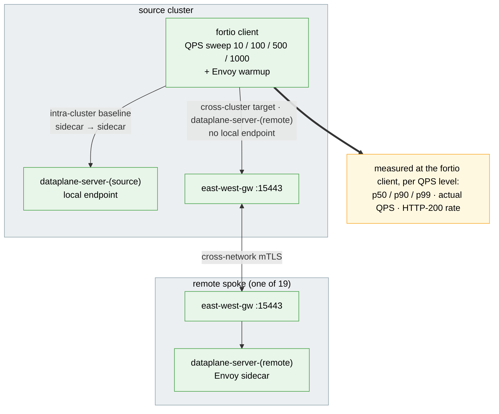

# Cross-Cluster Data-Plane Latency Test Suite

Measures request latency and throughput between sidecars, in-cluster and through the
east-west gateways, using fortio.

## Architecture

> Diagram conventions (arrow styles, box colors) are shared across all suites — see
> [`docs/scale-test-campaign/architecture.md`](../../docs/scale-test-campaign/architecture.md#diagram-conventions).



## What it measures

For each QPS level, `002` runs `fortio load` from the client pod on the source cluster
against each target and records p50/p90/p99/p99.9/max latency, achieved QPS and the share
of HTTP 200 responses.

Every cluster runs one fortio server pod labelled `cluster=<ctx>`, and every cluster gets
a Service `dataplane-server-<ctx>` for each context that selects only that pod:

- **local** (`target_class=local`): `dataplane-server-<source>`; the endpoint is in the
  source cluster, so this is the sidecar-to-sidecar baseline (not a no-mesh baseline).
- **remote** (`target_class=remote`): `dataplane-server-<remote>`; there is no local
  endpoint, so traffic crosses the east-west gateways.

## Prerequisites

- `oc` or `kubectl`, `helm`, `jq`, `curl`
- A multi-primary mesh with east-west gateways (see the root README)
- Kube context names must be lowercase DNS labels of at most 46 characters (they become
  Service names); rename others with `kubectl config rename-context`.

## Quick start

```bash
# 1. Servers on both clusters, client on the first
./tests/dataplane/001-setup-dataplane-test.sh --source-context <mesh-a-ctx> --remote-contexts <mesh-b-ctx>

# 2. Probe (30 s settle, 5 s warmup, then QPS 10/100/500/1000 for 30 s each)
./tests/dataplane/002-run-latency-probe.sh --source-context <mesh-a-ctx> --remote-contexts <mesh-b-ctx>

# 3. Report, then clean up
./tests/dataplane/004-report-results.sh
./tests/dataplane/005-cleanup.sh --contexts <mesh-a-ctx>,<mesh-b-ctx>
```

Tune the probe with `--qps-levels 50,200`, `--duration 60`, `--connections 16`,
`--settle 60` and `--warmup-duration 0`; the sweep (`003`) takes the same flags. Add
`--dry-run` to `002`, `003` or `005` to print the plan without touching a cluster.

## Sweep across mesh sizes

```bash
./tests/dataplane/003-run-sweep.sh --contexts <mesh-a-ctx>,<mesh-b-ctx> --mesh-sizes 1,2 --repetitions 3
```

For each mesh size the sweep runs `001`, then `002` `--repetitions` times, then `005`,
and writes everything to `tests/dataplane/results/sweep-<RUN_ID>/`, including
`sweep-<RUN_ID>.md` and `sweep-charts-<RUN_ID>.md`. The p50-vs-QPS chart needs one mesh
size with a remote cluster; the p50-vs-mesh-size chart needs two.

## istiod restart detection

Before and after the load runs, `002` port-forwards every Running istiod pod on every
context. If any pod's `process_start_time_seconds` advanced or the pod set changed, every
row of the run gets `istiod_restarted=1`; if a context could not be measured it gets
`unknown`. The report only aggregates rows with `status=OK` and `istiod_restarted=0`.

## Outputs

`latency-<RUN_ID>.tsv` has a `# KEY=value` preamble (`HARNESS_SHA`, `ISTIO_VERSION`,
`KUBE_VERSIONS`, `FORTIO_IMAGE`, ...) and these columns:

```
run_id  mesh_size  source_ctx  target_ctx  qps_target  qps_actual  connections
duration_s  p50_ms  p90_ms  p99_ms  p999_ms  max_ms  status  pct_200  istiod_restarted  target_class
```

`status` is `OK`, `FAILED` (fortio exec failed), `PERCENTILE_MISSING`, `ERROR_RATE_HIGH`
(`pct_200 < 0.99`), or the sweep placeholders `SETUP_FAILED` / `PROBE_FAILED` (one row per
failed mesh size, `target_class=na`). `004-report-results.sh --format text|csv|json|markdown|md|charts`
averages valid rows per (mesh size, QPS, target class) and reports `n_total` / `n_valid`;
the markdown ends with a glossary. It reads every `latency-*.tsv` under `--results-dir`,
subdirectories included, so pass one `sweep-<RUN_ID>/` to report a single sweep.

## Limitations

- Each probe run is one sample per cell; use `--repetitions` for more.
- The report averages percentiles across runs rather than pooling fortio histograms.
- Context names are used as Service names and as the `cluster` label (see Prerequisites).
- Every cluster gets one Service per context, so the Service count grows as N².
