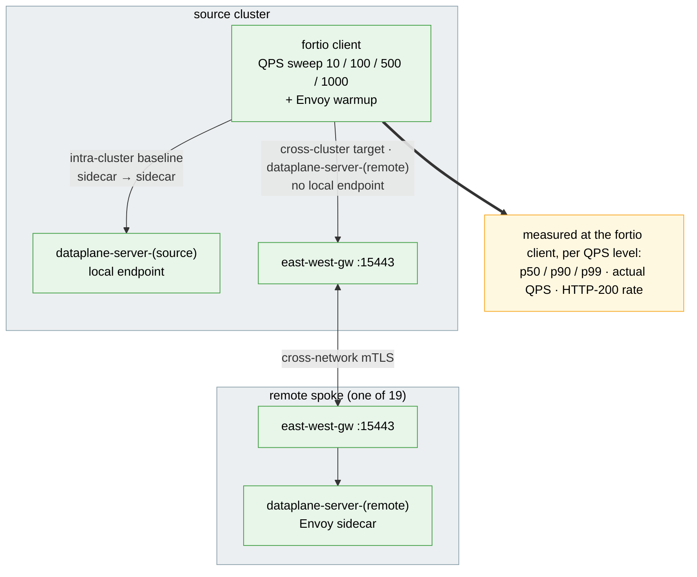

# Cross-Cluster Data-Plane Latency Test Suite

Measures request latency and throughput between sidecars, in-cluster and through the
east-west gateways, using fortio.

## Architecture

> Diagram conventions (arrow styles, box colors) are shared across all suites — see
> [`docs/scale-test-campaign/architecture.md`](../../docs/scale-test-campaign/architecture.md#diagram-conventions).



## What it measures

For each QPS level, `002` runs `fortio load` from the client pod on the source cluster
against each target and records p50/p90/p99/p99.9/max latency, achieved QPS and the share
of HTTP 200 responses.

Every cluster runs `--server-replicas` fortio server pods (default 2,
`DATAPLANE_SERVER_REPLICAS`) labelled `cluster=<ctx>`, and every cluster gets a Service
`dataplane-server-<ctx>` for each context that selects only those pods:

- **local** (`target_class=local`): `dataplane-server-<source>`; the endpoint is in the
  source cluster, so this is the sidecar-to-sidecar baseline (not a no-mesh baseline).
- **remote** (`target_class=remote`): `dataplane-server-<remote>`; there is no local
  endpoint, so traffic crosses the east-west gateways.

The replica count applies to every cluster, so the local target and each remote target
get the same server capacity and "the hop adds X ms" stays a like-for-like comparison.
Only the source's own server takes local traffic, and each remote server takes only
cross-cluster traffic from the source.

A run that does not deliver its target QPS is not a valid latency sample: a saturated
server queues requests and can still answer with HTTP 200. `002` tags such a row
`QPS_SHORTFALL` when actual QPS is below `--min-qps-ratio` × target (default 0.95,
`DATAPLANE_MIN_QPS_RATIO`), and the report drops it from `n_valid`.

## Prerequisites

- `oc` or `kubectl`, `helm`, `jq`, `curl`
- A multi-primary mesh with east-west gateways (see the root README)
- Kube context names must be lowercase DNS labels of at most 46 characters (they become
  Service names); rename others with `kubectl config rename-context`.

## Quick start

```bash
# 1. Servers on both clusters (2 pods each by default), client on the first
./tests/dataplane/001-setup-dataplane-test.sh --source-context <mesh-a-ctx> --remote-contexts <mesh-b-ctx> --server-replicas 2

# 2. Probe (30 s settle, 5 s warmup, then QPS 10/100/500/1000 for 30 s each)
./tests/dataplane/002-run-latency-probe.sh --source-context <mesh-a-ctx> --remote-contexts <mesh-b-ctx>

# 3. Report, then clean up
./tests/dataplane/004-report-results.sh
./tests/dataplane/005-cleanup.sh --contexts <mesh-a-ctx>,<mesh-b-ctx>
```

Tune the probe with `--qps-levels 50,200`, `--duration 60`, `--connections 16`,
`--settle 60`, `--warmup-duration 0` and `--min-qps-ratio 0.9`; the sweep (`003`) takes
the same flags plus `--server-replicas` (passed to `001`). `001` re-run with a new
`--server-replicas` scales the servers in place and waits for the rollout. Add
`--dry-run` to `002`, `003` or `005` to print the plan without touching a cluster.

## Sweep across mesh sizes

```bash
./tests/dataplane/003-run-sweep.sh --contexts <mesh-a-ctx>,<mesh-b-ctx> --mesh-sizes 1,2 --repetitions 3
```

For each mesh size the sweep runs `001`, then `002` `--repetitions` times, then `005`,
and writes everything to `tests/dataplane/results/sweep-<RUN_ID>/`, including
`sweep-<RUN_ID>.md` and `sweep-charts-<RUN_ID>.md`. The p50-vs-QPS chart needs one mesh
size with a remote cluster; the p50-vs-mesh-size chart needs two.

## istiod restart detection

Before and after the load runs, `002` port-forwards every Running istiod pod on every
context. If any pod's `process_start_time_seconds` advanced or the pod set changed, every
row of the run gets `istiod_restarted=1`. A context with no Running istiod pod, or whose
start times could not be read, gives `unknown`. If a context has Running istiod pods but
none serves `/metrics` through port-forward, `002` aborts before any load runs, and the
sweep records a `PROBE_FAILED` row. The report only aggregates rows with `status=OK` and
`istiod_restarted=0`.

## Outputs

`latency-<RUN_ID>.tsv` has a `# KEY=value` preamble (`HARNESS_SHA`, `ISTIO_VERSION`,
`KUBE_VERSIONS`, `FORTIO_IMAGE`, ...) and these columns. `SERVER_REPLICAS` records the
fortio server pods as `<ctx>=<ready>/<spec>` per context, read live before the load
(`<ctx>=unknown` when the read fails); `MIN_QPS_RATIO` and `MIN_PCT_200` record the
thresholds behind `status`.

```
run_id  mesh_size  source_ctx  target_ctx  qps_target  qps_actual  connections
duration_s  p50_ms  p90_ms  p99_ms  p999_ms  max_ms  status  pct_200  istiod_restarted  target_class
```

`status` is the first that applies of `FAILED` (fortio exec failed), `PERCENTILE_MISSING`,
`ERROR_RATE_HIGH` (`pct_200 < DATAPLANE_MIN_PCT_200`, default 0.99, or no responses),
`QPS_SHORTFALL` (actual QPS < `--min-qps-ratio` × target) and `OK`, or one of the sweep
placeholders `SETUP_FAILED` / `PROBE_FAILED` (one row per failed mesh size,
`target_class=na`). The console line of each row also prints `ret_codes` (HTTP
`code=count`, `-1` is a socket error) so an `ERROR_RATE_HIGH` row can be diagnosed.
`004-report-results.sh --format text|csv|json|markdown|md|charts` averages valid rows per
(mesh size, QPS, target class) and reports `n_total` / `n_valid`; the markdown ends with a
glossary. It reads every `latency-*.tsv` under `--results-dir`, subdirectories included,
so pass one `sweep-<RUN_ID>/` to report a single sweep.

## Local baseline verdict

Every report format states whether the same-cluster numbers are usable, so a missing
local cell cannot pass unnoticed (the charts would otherwise draw it as 0):

```
Local baseline: OK at every QPS level (4 cells, top qps_target=1000, min_qps_ratio=0.95)
Local baseline: DROPPED mesh_size=2 qps_target=1000 n_valid=0/1 reason=saturated qps_actual=686.2 (68.6% of target) server_replicas=1/1 remote=1/1 statuses=ERROR_RATE_HIGH=1
Local baseline: UNCHECKED mesh_size=2 qps_target=1000 n_valid=1/1 reason=saturated_unflagged qps_actual=686.2 (68.6% of target) server_replicas=unknown remote=1/1 statuses=OK=1 ok_below_ratio=1
Local baseline: MISSING mesh_size=3 reason=setup_failed (no local rows)
```

`DROPPED` means no valid local row in that cell, `DEGRADED` some. `UNCHECKED` means every
row is valid but `ok_below_ratio` of them are `OK` rows below `MIN_QPS_RATIO` × target,
which only a TSV recorded before the `QPS_SHORTFALL` check can hold (see
[Comparing with earlier runs](#comparing-with-earlier-runs)). `reason` is the first of
`saturated_unflagged` (such rows), `saturated` (a row below `MIN_QPS_RATIO` × target),
`errors`, `percentile_missing`, `failed`, `istiod_restarted` and
`istiod_restart_unknown`; for `MISSING` it is the
placeholder status (`setup_failed`, `probe_failed`, ...). `server_replicas` is the source
cluster's `ready/spec` from the TSV that holds the row. `remote=v/t` is the remote cell at
the same mesh size and QPS:

- `reason=saturated` with `remote` all valid: the local server ran out of capacity. Raise
  `--server-replicas`.
- local and remote both dropped at that QPS: the ceiling is on the client side (see
  Limitations). Lower `--qps-levels`.

JSON has the verdict under `local_baseline` (`verdict`, `min_qps_ratio`,
`files_without_min_qps_ratio`, `cells[]` with `ok_below_ratio`), CSV as
`# LOCAL_BASELINE=` and `# LOCAL_BASELINE_CELL=<mesh>:<qps>:<verdict>:<reason>` lines,
markdown in a `## Local baseline` section, and charts as a note per missing or
`UNCHECKED` point.

### Comparing with earlier runs

The June 2026 campaigns ran one server replica per cluster and had no `QPS_SHORTFALL`
status, so a saturated run that still returned only 200s counted as `OK`. Their TSVs have
no `SERVER_REPLICAS` or `MIN_QPS_RATIO` line. The report shows `server_replicas=unknown`
and applies `DATAPLANE_MIN_QPS_RATIO` itself: their `OK` rows still count in `n_valid` and
in the averages, but a local cell with an `OK` row below the ratio is `UNCHECKED`
(`reason=saturated_unflagged`) instead of `OK`, and an all-clear line says
`applied by this report to N files without MIN_QPS_RATIO`. Compare local numbers across
that boundary only in cells without `reason=saturated_unflagged`. The `remote=` count of
those files is by status only.

## Limitations

- Each sidecar, the client's included, runs one Envoy worker: the tuning baseline caps
  sidecars at 1 CPU and pilot-agent sets Envoy concurrency from that limit. The client
  sidecar is therefore a QPS ceiling that `--server-replicas` cannot raise. When local and
  remote rows both fall short at the same QPS, lower `--qps-levels`.
- Each probe run is one sample per cell; use `--repetitions` for more.
- The report averages percentiles across runs rather than pooling fortio histograms.
- Context names are used as Service names and as the `cluster` label (see Prerequisites).
- Every cluster gets one Service per context, so the Service count grows as N².
