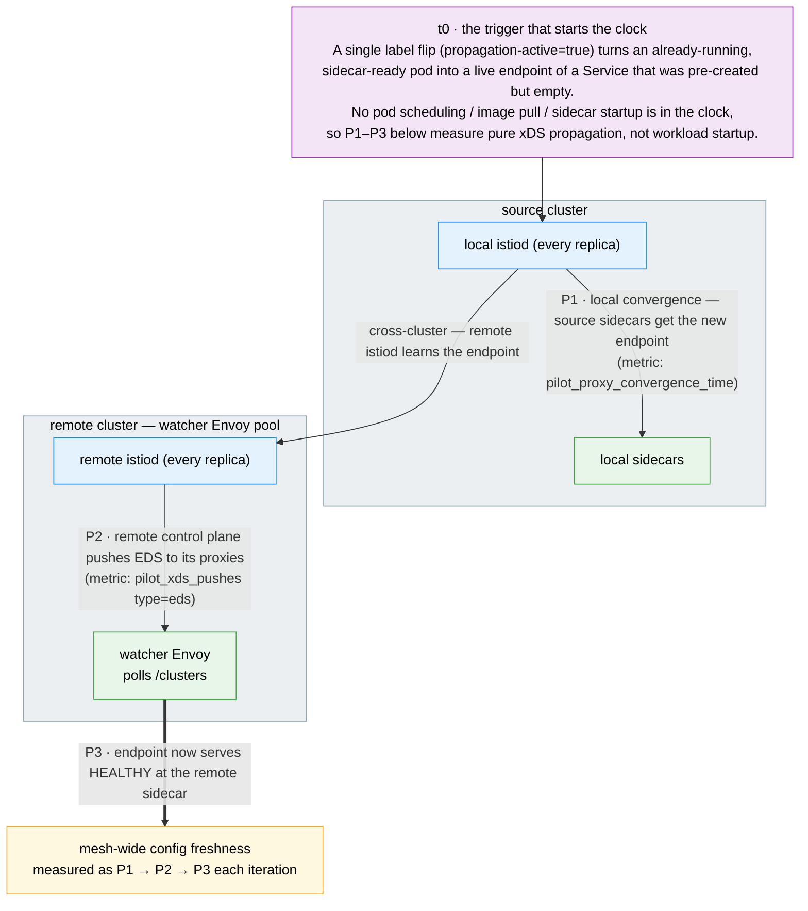

# Propagation Latency Test Suite

Measures how long a new endpoint takes to reach istiod and sidecars on the source cluster
and on every remote cluster in a multi-primary mesh.

## At a glance

**Question:** when a pod becomes a ready endpoint on one cluster, how long until the control
planes and the proxies on every cluster know about it?

**What it deploys**, in namespace `propagation-test` on every member it uses: watcher pods
(sidecar-injected pods whose proxies receive the new endpoint; 1 by default, 30 gives enough
proxies for a p99) and one backer pod, the pod that becomes the endpoint. The sweep removes them
when it ends.

**What a run does:** for each mesh size (1 member, then 2, ...), set up, then repeat 10 times:
add the backer to the `propagation-canary` Service with one label change on the source member,
time the three phases below, remove it again and wait for it to drain. Then clean up and write
the report. Rough time with two members at the defaults: 10 to 20 minutes.

**Reading the results:** the sweep's `sweep-summary.md` has one table per phase, each with min,
average, p50, p95, p99 and max per mesh size:

| Phase | What it times, from the label change |
| --- | --- |
| `P1_local_wall` | until the source's istiod has pushed the change to every connected proxy |
| `P2_discovery` | until each remote member's istiod pushes the new endpoint to its proxies |
| `P3_dataplane` | until a proxy on each remote member reports the endpoint healthy: the end-to-end number |

Smaller is better. Look at how they change with mesh size: P2 and P3 growing with the number of
members means cross-cluster propagation is the bottleneck. For scale, the June 2026 ten-cluster
ROSA run measured P1 and P2 flat at about 2 seconds from 1 to 10 members
([record](../../docs/campaigns/2026-06-04-clean-pass/README.md)). Rows with a status other than
`OK` (a timeout, an istiod restart, a failed scrape) are counted in `n_total` but not averaged;
[Outputs](#outputs) has the full list and [Reading results](../../docs/reading-results.md) the
checks that apply to every suite.

Examples of good and bad results: [Result examples](../../docs/result-examples.md#propagation).

## Architecture

> Diagram conventions (arrow styles, box colors) are shared across all suites — see
> [`docs/scale-test-campaign/architecture.md`](../../docs/scale-test-campaign/architecture.md#diagram-conventions).



## What it measures

`001` deploys a watcher pod and a pre-warmed backer pod on every cluster. At t0 the probe
(`002`) labels the source backer so the `propagation-canary` Service gains an endpoint,
then times three phases from that single t0:

| Phase | Signal |
|-------|--------|
| P1 | Source istiod has pushed to every connected proxy: delta of `pilot_proxy_convergence_time` `_count` reaches the summed `pilot_xds` gauge. Also reports delta-window p50/p99. |
| P2 | Each remote istiod sees the endpoint: first increase of `pilot_xds_pushes{type="eds"}`. |
| P3 | Each remote watcher sidecar reports the endpoint healthy (Envoy admin `/clusters`). |

Every Running istiod pod is port-forwarded and scraped, so multi-replica istiod is measured as a
whole. Removing the label drains the endpoint before the next iteration. Before each iteration's
baseline, and again after the backer's Ready wait (the t0 check, still before the baseline scrape),
every side's watcher must show no healthy canary endpoint; a side that still shows one is
`NOT_DRAINED` for that iteration.

## Prerequisites

- `oc` or `kubectl`, `helm`, `jq`, `curl`, `awk`
- A multi-primary mesh (see the root README) and one kube context per mesh member

## Quick start

```bash
# 1. Watcher + backer on both clusters (30 watchers give enough proxies for p50/p99)
./tests/propagation/001-setup-propagation-test.sh --contexts <mesh-a-ctx>,<mesh-b-ctx> --watcher-replicas 30

# 2. Probe: source on cluster A, remote on cluster B
./tests/propagation/002-run-endpoint-probe.sh \
  --source-context <mesh-a-ctx> --remote-contexts <mesh-b-ctx> --iterations 10 --tsv

# 3. Report, then clean up
# (it reads every run under the results dir; with more than one there it stops and
#  lists the --results-dir that reports each, or pools them with --allow-multi-run)
./tests/propagation/005-report-results.sh
./tests/propagation/007-cleanup.sh --contexts <mesh-a-ctx>,<mesh-b-ctx>
```

Add `--dry-run` to `002`, `004`, `006` or `007` to print the plan without touching a cluster.

## Sweep across mesh sizes

```bash
./tests/propagation/006-run-sweep.sh \
  --contexts <mesh-a-ctx>,<mesh-b-ctx> --mesh-sizes 1,2 --iterations 10 --watcher-replicas 30
```

For each mesh size the sweep removes the suite from unused contexts (`007`), runs `001`
and `002` (with `--tsv`), and settles. It always writes the TSVs, then `sweep-summary.md`
and `sweep-charts.md` from `005` (`--tsv` is still accepted and does nothing).
`--collect-metrics` also saves a `004` snapshot per mesh size.

Exit codes: `0` every mesh size ran; `1` the sweep stopped (a bad flag or precondition, or an
unexpected error); `4` it finished and wrote its reports, but some mesh sizes failed (setup or probe
exited non-zero, a `SETUP_FAILED` / `PROBE_FAILED` placeholder row), or it recorded a problem;
`130`, `143` or `129` it was interrupted. What each records in `sweep-outcome.txt`, and the problems
every sweep checks: [How a sweep ends](../../docs/reference.md#how-a-sweep-ends). When a sweep did not
finish and no sweep runs any more, run `007-cleanup.sh --contexts <the sweep's members>`, then run
the sweep again into a new dir.
Rows a probe wrote with a non-OK status are measurements, not failures: the report counts them in
`n_total`. Its `n_attempted` column is what the probes were configured to run (each TSV's
`ITERATIONS`: iterations for P1, times its remotes for P2 and P3, and what a failed mesh size's
placeholder would have run; `-`, csv empty, json `null`, when a TSV does not record it); a mesh
size that measured fewer iterations or rows than that warns in every format and on stderr.

## Run config (`--config FILE`)

Every script takes `--config FILE`, one file of `KEY=value` lines for a whole run (shared
rules: [Run config](../../docs/reference.md#run-config---config-file)).
[`configs/smoke.env`](configs/smoke.env) is a worked example (mesh sizes 1 and 2,
3 iterations each):

```bash
./tests/propagation/006-run-sweep.sh --config tests/propagation/configs/smoke.env --dry-run
./tests/propagation/006-run-sweep.sh --config tests/propagation/configs/smoke.env
./tests/propagation/005-report-results.sh --config tests/propagation/configs/smoke.env \
  --results-dir tests/propagation/results/smoke/sweep-<RUN_ID> --format markdown
./tests/propagation/007-cleanup.sh --config tests/propagation/configs/smoke.env
```

- **Keys:** `SETUP_CONTEXTS` and the `config/options.env` keys `PROPAGATION_*`, `FANOUT_*`,
  `ISTIOD_DIAG_*` (restart evidence), `TEST_PLATFORM` (the members' platform),
  `PLATFORM_READ_TIMEOUT` (each read of the platform record), `PLATFORM_READ_PARALLEL` (members
  read at once) and `METRICS_SCRAPE_TIMEOUT`.
  `PROPAGATION_TEST_NAMESPACE` and `PROPAGATION_MAX_MATRIX` stay environment only. `004`
  keeps its own port block (`PROPAGATION_SNAPSHOT_PF_BASE`), so a `FANOUT_PF_BASE` in the
  file does not move it.
- **Run keys:** `PROPAGATION_MESH_SIZES` (`006 --mesh-sizes`; empty: 1 to the number of
  contexts), `PROPAGATION_RESULTS_DIR` (`--output-dir`, `--results-dir`; a relative path
  starts at the repo root, unlike the flags) and `PROPAGATION_WAIT_TIMEOUT_SEC`
  (`001 --wait-timeout`).
- **Flags only:** `--tsv` (`002`) and `--collect-metrics` (add them to the command line),
  `--source-context`, `--remote-contexts`, `--mesh-size`, `--sweep-run-id`,
  `--tuning-baseline` and `--sidecar-egress-hosts` (`002`; the sweep sets them), `--watch`
  and `--interval` (`004`), `--allow-multi-run` (`005`), `--force-large-matrix`, `--format`
  and `--dry-run`.

## Passive istiod metrics

```bash
# One .prom file of pilot_* series per istiod pod (add --watch --interval 10 to repeat)
./tests/propagation/004-collect-pilot-metrics.sh --contexts <mesh-a-ctx>,<mesh-b-ctx>

# Or scrape continuously with a Prometheus Operator that watches istio-system: kube-prometheus-stack
# (add --set extraLabels.release=<its release name>), or OpenShift User Workload Monitoring
# (must already be enabled)
helm install istiod-monitor charts/istiod-monitor -n istio-system --kube-context <mesh-a-ctx>
```

## Outputs

Results go to `tests/propagation/results/` (a sweep uses `results/sweep-<RUN_ID>/`; change it with
`--output-dir`):

- `endpoint-<RUN_ID>.tsv` (with `--tsv`): preamble of `# KEY=value` provenance lines, then
  one row per iteration and remote, in 23 columns (new ones are appended, so positions stay):
  `run_id mesh_size iteration source_ctx remote_ctx t0_epoch_ns p1_ms p2_ms p3_ms status
  p1_conv_p50_ms p1_conv_p99_ms p1_sample_count p1_proxy_count p1_overflow restarted p2_dirty
  window_ms scrape_skew_ms p1_status p1_scrape_skew_ms remote_status remote_scrape_skew_ms`.
  Older TSVs have 18, 19 or 21; `006`'s `SETUP_FAILED` / `PROBE_FAILED` rows use all 23.
- The preamble's [platform record](../../docs/reference.md#the-platform-record), read before the first
  iteration (a sweep reads it once for all its steps, and again after the last one). `005` prints
  it in every format, as `mixed` with a warning in the report itself (the top-level `warnings`
  array in json, empty without one) when its inputs differ or a value could not be read in some
  of them. A file without it predates the record (the suite supported only OpenShift with OSSM
  then); its values read `unknown`.
- `endpoint-<RUN_ID>.md`: per-run summary. Its averages count the same rows as `005`
  (one definition, `tests/lib/propagation.sh`), as `n_valid/n_total`, and it lists the
  rows left out by reason (a `remote_status`, a high remote skew), and the iterations whose
  P1 is left out (a `p1_status`, `p1_overflow`, a high source skew).
- `005` formats: `text`, `csv`, `json`, `markdown` (or `md`), `charts`. Every format but
  `charts` gives, per mesh size, `P1_local_wall` (`p1_ms`: from the t0 label flip until the
  convergence histogram's delta `_count` reached the proxy count), `P1_conv_p50` and
  `P1_conv_p99` (bucket bounds, below), `P2_discovery` (the remote's EDS push counter) and
  `P3_dataplane` (the watcher's `/clusters`), with min, max, average and p50, p95 and p99 over the
  valid samples; p95 and p99 read `N/A` (json `null`) below `PROPAGATION_PERCENTILE_MIN_N` (20)
  samples, p50 always shows. The markdown ends with a glossary of every column. `charts` needs
  two or more mesh sizes of at least 2 clusters.
  `HARNESS_SHA` comes from the TSV preambles (the harness that measured the rows): `mixed:<a>,<b>`,
  with a warning, when the inputs ran on more than one. In text and markdown `n_attempted`
follows `n_total` and `n_valid` (csv keeps it last), and a phase with no valid sample reads
`n_valid` 0 in every format.

Row `status`: `OK`, `TIMEOUT_P1|P2|P3|ALL`, `RESTART` (istiod restarted mid-iteration),
`DRAIN_TIMEOUT` (endpoint did not drain within `PROPAGATION_DRAIN_TIMEOUT_SEC` after the iteration:
a flag, not a drop, since the values were measured before that drain), `NOT_DRAINED` (before t0 a
canary endpoint from an earlier iteration or run was still healthy on that side's watcher sidecar
after a `PROPAGATION_DRAIN_TIMEOUT_SEC` wait, was healthy again at the t0 check, or its `/clusters`
could not be read, which is not waited for: its P3 would read about 0 and a late removal push would
shorten P2 or P1; the warning names the iteration and which of these it was), `SCRAPE_INCOMPLETE` (a
pod's `/metrics` was unreachable, or baseline scrape skew exceeded `FANOUT_MAX_SKEW_MS`), and the
sweep placeholders `SETUP_FAILED` / `PROBE_FAILED` (written by `006` in the same 23 columns as
`002`'s rows, `tests/lib/propagation.sh`). `status` is the row's verdict over both sides;
`p1_status` is the source side's alone and `remote_status` the remote's alone (`N/A` on a row with
no remote), and only those decide. The report counts every row in `n_total`; P2 and P3 (`n_valid`)
come only from rows whose `remote_status` is `OK` or `DRAIN_TIMEOUT` (that remote's istiod not
restarted or unknown, no P2 or P3 timeout, its sidecar drained before the iteration, its scrape
complete) and whose `remote_scrape_skew_ms` is within `FANOUT_MAX_SKEW_MS`: the source's restart, P1
timeout or `+Inf` overflow never drops them. P1 and its `conv_p50`/`conv_p99` are measured on the
source once per iteration, so they take one sample per iteration: their `n_total` and `n_valid`
count iterations, not rows. Only the source side leaves an iteration's P1 out: its `p1_status`
column (`TIMEOUT_P1`, `RESTART` or `RESTART_UNKNOWN` for the source istiod, `NOT_DRAINED` for the
source sidecar, `SCRAPE_INCOMPLETE` for a source scrape that failed or skewed past
`FANOUT_MAX_SKEW_MS`), a P1 `+Inf` overflow, or `p1_scrape_skew_ms` over `FANOUT_MAX_SKEW_MS`. A
`DRAIN_TIMEOUT` side counts: its drain timed out only after its window, so dropping it would cut the
slow tail (a slow removal and a slow add share istiod's push path); the next iteration settles
before its baseline and is `NOT_DRAINED` if the endpoint is still there. `002`'s summary and every
`005` format (a warning per mesh size) say how many iterations drained late, and the tuning
comparison adds a `Drain timeouts` row. A remote that timed out or restarted drops its own P2/P3
row, never the iteration's P1. Older TSVs still report: one without `remote_status` (21 columns, or
19 before `p1_status`) drops P2/P3 for the row's `status` (other than `DRAIN_TIMEOUT`), `restarted`
`1`/`unknown` or a high `scrape_skew_ms` (they cannot be split by side), never for `p1_overflow`;
one without `p1_status` takes P1 from the iteration's first row with `status` `OK`, `restarted=0`,
no overflow and a skew within the ceiling. The report lists the column counts it read
(`tsv_columns`) and warns when the inputs mix them. P2 also drops rows with `p2_dirty=1` (EDS pushed
but P3 never went healthy on that remote). After an iteration whose drain timed out, the next one
settles `SETTLE_SEC` before its baseline even when its drain check reads clean (the late removal may
still be pushing). The backer resolve, its Ready wait and the t0 check (one `/clusters` read per
side) run before the baseline scrape, so nothing the probe runs sits between that scrape and t0. A
probe that ends between t0 and its drain (an error, a kill, SIGTERM) removes the t0 label on exit,
so the canary endpoint does not stay up for the next run (stderr says so, or gives the
`kubectl label` command when the removal fails). Averages are rounded to the nearest ms. The
`P1 conv_p50`/`conv_p99` rows are histogram bucket bounds: text and markdown show bucket ranges with
no average (`-`), so read `max` (the worst bucket; the cross-mesh comparison shows
`P1 conv_p99 worst`), while csv and json keep the numbers and add `worst_bucket`. json `mesh_size`
is a number.

When the source or a remote istiod reads as restarted (`RESTART`, `restarted` `1` or
`unknown`), `002` saves the restart evidence after the iteration's rows to
`istiod-diag-<RUN_ID>/` in the output dir, tag `iter<N>`. A replaced istiod pod kills its
port-forward, so that iteration's row usually reads as a timeout or `SCRAPE_INCOMPLETE`,
not `RESTART`. The next iteration's port-forward re-open sees the new pod set and
captures it against the previous baseline (trigger `podset_changed`, tag `iter<N-1>`).
The row keeps its status. Contents, settings and redaction are in the
[dataplane README](../dataplane/README.md#restart-evidence-istiod-diag-run_id); `005`
text, markdown and json carry an "istiod restart diagnostics" section.

## Limitations

- `p1_conv_p50_ms` needs at least 10 samples and `p1_conv_p99_ms` at least 30, else `N/A`.
  With one watcher there are only a few connected proxies; use `--watcher-replicas 30`.
- `pilot_proxy_convergence_time` buckets start at 100 ms, so sub-100 ms convergence shows
  as `0-100`. Use the wall-clock `p1_ms` for finer detail.
- P3 polls `/clusters` at most once per second, so P3 has about 1 s resolution.
- t0 is taken just before `kubectl label`, so every phase includes that call (about 0.3 s).
- Large meshes: raise `METRICS_SCRAPE_TIMEOUT` (default 30 s) if `/metrics` scrapes time
  out, and `FANOUT_MAX_SKEW_MS` (default 1000) if many rows become `SCRAPE_INCOMPLETE`.
