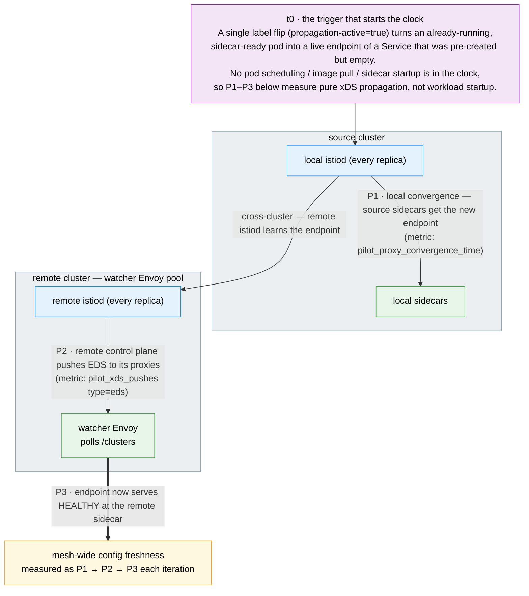

# Propagation Latency Test Suite

Measures how long a new endpoint takes to reach istiod and sidecars on the source cluster
and on every remote cluster in a multi-primary mesh.

## Architecture

> Diagram conventions (arrow styles, box colors) are shared across all suites — see
> [`docs/scale-test-campaign/architecture.md`](../../docs/scale-test-campaign/architecture.md#diagram-conventions).



## What it measures

`001` deploys a watcher pod and a pre-warmed backer pod on every cluster. At t0 the probe
(`002`) labels the source backer so the `propagation-canary` Service gains an endpoint,
then times three phases from that single t0:

| Phase | Signal |
|-------|--------|
| P1 | Source istiod has pushed to every connected proxy: delta of `pilot_proxy_convergence_time` `_count` reaches the summed `pilot_xds` gauge. Also reports delta-window p50/p99. |
| P2 | Each remote istiod sees the endpoint: first increase of `pilot_xds_pushes{type="eds"}`. |
| P3 | Each remote watcher sidecar reports the endpoint healthy (Envoy admin `/clusters`). |

Every Running istiod pod is port-forwarded and scraped, so multi-replica istiod is
measured as a whole. Removing the label drains the endpoint before the next iteration.

## Prerequisites

- `oc` or `kubectl`, `helm`, `jq`, `curl`, `awk`
- A multi-primary mesh (see the root README) and one kube context per mesh member

## Quick start

```bash
# 1. Watcher + backer on both clusters (30 watchers give enough proxies for p50/p99)
./tests/propagation/001-setup-propagation-test.sh --contexts <mesh-a-ctx>,<mesh-b-ctx> --watcher-replicas 30

# 2. Probe: source on cluster A, remote on cluster B
./tests/propagation/002-run-endpoint-probe.sh \
  --source-context <mesh-a-ctx> --remote-contexts <mesh-b-ctx> --iterations 10 --tsv

# 3. Report, then clean up
./tests/propagation/005-report-results.sh
./tests/propagation/007-cleanup.sh --contexts <mesh-a-ctx>,<mesh-b-ctx>
```

Add `--dry-run` to `002`, `004`, `006` or `007` to print the plan without touching a cluster.

## Sweep across mesh sizes

```bash
./tests/propagation/006-run-sweep.sh \
  --contexts <mesh-a-ctx>,<mesh-b-ctx> --mesh-sizes 1,2 --iterations 10 --watcher-replicas 30 --tsv
```

For each mesh size the sweep removes the suite from unused contexts (`007`), runs `001`
and `002`, and settles. With `--tsv` it writes `sweep-summary.md` and `sweep-charts.md`
from `005`. `--collect-metrics` also saves a `004` snapshot per mesh size.

## Run config (`--config FILE`)

Every script takes `--config FILE`, one file of `KEY=value` lines for a whole run (shared
rules: [Run config](../../README.md#run-config---config-file)).
[`configs/smoke.env`](configs/smoke.env) is a worked example (mesh sizes 1 and 2,
3 iterations each):

```bash
./tests/propagation/006-run-sweep.sh --config tests/propagation/configs/smoke.env --tsv --dry-run
./tests/propagation/006-run-sweep.sh --config tests/propagation/configs/smoke.env --tsv
./tests/propagation/005-report-results.sh --config tests/propagation/configs/smoke.env \
  --results-dir tests/propagation/results/smoke/sweep-<RUN_ID> --format markdown
./tests/propagation/007-cleanup.sh --config tests/propagation/configs/smoke.env
```

- **Keys:** `SETUP_CONTEXTS` and the `config/options.env` keys `PROPAGATION_*`, `FANOUT_*`,
  `ISTIOD_DIAG_*` (restart evidence), `TEST_PLATFORM` (the members' platform),
  `PLATFORM_READ_TIMEOUT` (each read of the platform record), `PLATFORM_READ_PARALLEL` (members
  read at once) and `METRICS_SCRAPE_TIMEOUT`.
  `PROPAGATION_TEST_NAMESPACE` and `PROPAGATION_MAX_MATRIX` stay environment only. `004`
  keeps its own port block (`PROPAGATION_SNAPSHOT_PF_BASE`), so a `FANOUT_PF_BASE` in the
  file does not move it.
- **Run keys:** `PROPAGATION_MESH_SIZES` (`006 --mesh-sizes`; empty: 1 to the number of
  contexts), `PROPAGATION_RESULTS_DIR` (`--output-dir`, `--results-dir`; a relative path
  starts at the repo root, unlike the flags) and `PROPAGATION_WAIT_TIMEOUT_SEC`
  (`001 --wait-timeout`).
- **Flags only:** `--tsv` and `--collect-metrics` (add them to the command line),
  `--source-context`, `--remote-contexts`, `--mesh-size`, `--sweep-run-id`,
  `--tuning-baseline` and `--sidecar-egress-hosts` (`002`; the sweep sets them), `--watch`
  and `--interval` (`004`), `--force-large-matrix`, `--format` and `--dry-run`.

## Passive istiod metrics

```bash
# One .prom file of pilot_* series per istiod pod (add --watch --interval 10 to repeat)
./tests/propagation/004-collect-pilot-metrics.sh --contexts <mesh-a-ctx>,<mesh-b-ctx>

# Or scrape continuously with a Prometheus Operator that watches istio-system: kube-prometheus-stack
# (add --set extraLabels.release=<its release name>), or OpenShift User Workload Monitoring
# (must already be enabled)
helm install istiod-monitor charts/istiod-monitor -n istio-system --kube-context <mesh-a-ctx>
```

## Outputs

Results go to `tests/propagation/results/` (a sweep uses `results/sweep-<RUN_ID>/`; change it with
`--output-dir`):

- `endpoint-<RUN_ID>.tsv` (with `--tsv`): preamble of `# KEY=value` provenance lines, then
  one row per iteration and remote. Columns are listed in `005-report-results.sh --help`.
- The preamble's platform record ([`tests/lib/platform.sh`](../lib/platform.sh)): `PLATFORM`,
  `TEST_PLATFORM` and, per member, the platform it serves, the mesh operator, istiod and gateway
  proxy (ingress and east-west) builds, istiod's settings, the nodes' provider and any tuning
  profile objects (`PLATFORM_BY_CONTEXT`, `MESH_OPERATOR_BY_CONTEXT`, `ISTIOD_IMAGE_BY_CONTEXT`,
  `PROXY_IMAGE_BY_CONTEXT`, `NODE_PROVIDER_BY_CONTEXT`, `ISTIOD_ENV_BY_CONTEXT`: a digest of
  istiod's discovery container env without `CLUSTER_ID`, and `TUNING_OBJECTS_BY_CONTEXT`: `none`
  outside a tuning run), read before the first iteration (a sweep reads it once for all its steps
  and hands it to them in `platform-record.txt` in the sweep dir, and reads it again after the
  last one: a build, istiod setting, tuning lever, tuning profile object or Kubernetes version
  that changed in between is written to `platform-drift.txt` there, as is what that read could
  not compare). An image carries the digest its pods run (`@unknown` when none has started: not
  read, never another build); `none` means no such pod. `005` prints it in every format, as `mixed`
  with a warning in the report itself (the top-level `warnings` array in json, empty without one)
  when its inputs differ, a value could not be read in some of them, the sweep's record changed or a
  tuning profile's objects were in place; an operator that differs only in its state (`Available`,
  `Unavailable`) is not mixed. A file without it predates the record (the suite supported only
  OpenShift with OSSM then); its values read `unknown`.
- `endpoint-<RUN_ID>.md`: per-run summary.
- `005` formats: `text`, `csv`, `json`, `markdown` (or `md`), `charts`. The markdown ends
  with a glossary of every column. `charts` needs two or more mesh sizes of at least 2 clusters.

Row `status`: `OK`, `TIMEOUT_P1|P2|P3|ALL`, `RESTART` (istiod restarted mid-iteration),
`DRAIN_TIMEOUT` (endpoint did not drain before the next iteration), `SCRAPE_INCOMPLETE`
(a pod's `/metrics` was unreachable, or baseline scrape skew exceeded `FANOUT_MAX_SKEW_MS`),
and the sweep placeholders `SETUP_FAILED` / `PROBE_FAILED`. The report counts every row in
`n_total` but aggregates only `OK` rows with `restarted=0` (`n_valid`). P2 also drops rows
with `p2_dirty=1` (EDS pushed but P3 never went healthy on that remote). Averages are
rounded to the nearest ms. The `P1 conv_p50`/`conv_p99` rows are histogram bucket
bounds: text and markdown show bucket ranges with no average (`-`), so read `max` (the
worst bucket; the cross-mesh comparison shows `P1 conv_p99 worst`), while csv and json
keep the numbers and add `worst_bucket`. json `mesh_size` is a number.

When the source or a remote istiod reads as restarted (`RESTART`, `restarted` `1` or
`unknown`), `002` saves the restart evidence after the iteration's rows to
`istiod-diag-<RUN_ID>/` in the output dir, tag `iter<N>`. A replaced istiod pod kills its
port-forward, so that iteration's row usually reads as a timeout or `SCRAPE_INCOMPLETE`,
not `RESTART`. The next iteration's port-forward re-open sees the new pod set and
captures it against the previous baseline (trigger `podset_changed`, tag `iter<N-1>`).
The row keeps its status. Contents, settings and redaction are in the
[dataplane README](../dataplane/README.md#restart-evidence-istiod-diag-run_id); `005`
text, markdown and json carry an "istiod restart diagnostics" section.

## Limitations

- `p1_conv_p50_ms` needs at least 10 samples and `p1_conv_p99_ms` at least 30, else `N/A`.
  With one watcher there are only a few connected proxies; use `--watcher-replicas 30`.
- `pilot_proxy_convergence_time` buckets start at 100 ms, so sub-100 ms convergence shows
  as `0-100`. Use the wall-clock `p1_ms` for finer detail.
- P3 polls `/clusters` at most once per second, so P3 has about 1 s resolution.
- t0 is taken just before `kubectl label`, so every phase includes that call (about 0.3 s).
- Large meshes: raise `METRICS_SCRAPE_TIMEOUT` (default 30 s) if `/metrics` scrapes time
  out, and `FANOUT_MAX_SKEW_MS` (default 1000) if many rows become `SCRAPE_INCOMPLETE`.
